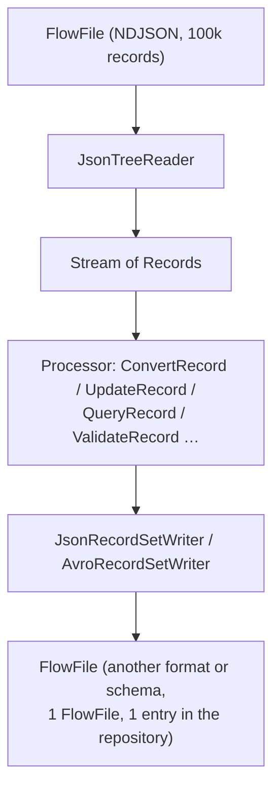

## Contents

- [About this material: versions, sources, notation](#about-this-material-versions-sources-notation)
- [Block 1.1: NiFi fundamentals](#block-11-nifi-fundamentals)
- [Block 1.2: Building data flows](#block-12-building-data-flows)
- [Block 1.3: Record-based processing](#block-13-record-based-processing)
- [Block 1.4: Installation, cluster configuration and setup](#block-14-installation-cluster-configuration-and-setup)
- [Block 1.5: Day 1 recap and Q&A](#block-15-day-1-recap-and-qa)

---

## About this material: versions, sources, notation

### Version baseline

At the time these notes were prepared (November 2026), the 2.x branch evolves through minor releases: the [Release Notes](https://cwiki.apache.org/confluence/display/NIFI/Release+Notes) list 2.12.0 (September 13, 2026) as the main release, while the [Migration Guidance](https://cwiki.apache.org/confluence/display/NIFI/Migration+Guidance) page already describes the move to 2.14.0. The wiki pages may lag behind each other, so check the exact version you are installing before you start.

Notation used in the text:

| Label | Meaning |
|---|---|
| **[2.x]** | Behavior is current for NiFi 2.x |
| **[1.x]** | Behavior of 1.x; changed or removed in 2.x |
| **[dep]** | Deprecated: still works but is marked for removal |
| **[rem]** | Removed: removed in the indicated version |
| **[verify]** | The statement was not confirmed while preparing the notes; check it against the documentation for your version |

### Principles of reliability

1. Facts about releases, removed components, and migration are confirmed against the [Release Notes](https://cwiki.apache.org/confluence/display/NIFI/Release+Notes), the [Migration Guidance](https://cwiki.apache.org/confluence/display/NIFI/Migration+Guidance), and the [NiFi 2.0 Release Goals](https://cwiki.apache.org/confluence/display/NIFI/NiFi+2.0+Release+Goals).
2. The remaining descriptions (processor parameters, `nifi.properties` properties) are based on the official guides: [User Guide](https://nifi.apache.org/docs/nifi-docs/html/user-guide.html), [Administration Guide](https://nifi.apache.org/docs/nifi-docs/html/administration-guide.html), [Expression Language Guide](https://nifi.apache.org/docs/nifi-docs/html/expression-language-guide.html), [RecordPath Guide](https://nifi.apache.org/docs/nifi-docs/html/record-path-guide.html), [NiFi In Depth](https://nifi.apache.org/docs/nifi-docs/html/nifi-in-depth.html), and the [component reference](https://nifi.apache.org/components/). Names and default values of some properties may differ in your minor version. Check the exact values in the built-in documentation (**Help → Documentation** in the UI) of your version.
3. Numeric recommendations (heap, threads) are starting points for measurements, not norms.

---

## Block 1.1: NiFi fundamentals

### 1.1.1 Data in motion vs data at rest

**Data at rest** is data that sits in storage (a database, a data lake, a file system). Typical tools: SQL engines, Spark in batch mode. The unit of work is a query or a job over a bounded set.

**Data in motion** is data that moves between systems: events, logs, messages, CDC rows. The unit of work is an event or a batch; what matters is latency, ordering, delivery guarantees, overload control (backpressure), and provenance (lineage).

NiFi solves the problem of **dynamic routing and delivery** of data between heterogeneous systems: receive, validate, transform if necessary, enrich, deliver, and keep the history of origin. It is a **data movement** tool, not an analytics compute engine. Heavy aggregations and joins over large windows are better left to Spark/Flink/an SQL engine, while NiFi should do lightweight processing (filtering, normalization, routing, format conversion).

| Criterion | Data at rest | Data in motion (NiFi) |
|---|---|---|
| Unit of processing | table / file / set | FlowFile (an event or a batch of events) |
| Key metric | job execution time | throughput, latency, backlog |
| Failures | job restart | retry, back pressure, redelivery |
| Transparency | job logs | Data Provenance for every FlowFile |

### 1.1.2 NiFi architecture

Apache NiFi runs as a Java application in a JVM on every node. The main elements (for more detail see [NiFi In Depth](https://nifi.apache.org/docs/nifi-docs/html/nifi-in-depth.html) and the [Overview](https://nifi.apache.org/docs/nifi-docs/html/overview.html)):

![[images/zero-leader-node.png]]

The **Flow Controller** is the "brain" of the node. It schedules the execution of processors, hands them threads from the pool, and manages queues and repositories. A processor does not own a thread: the Flow Controller invokes its `onTrigger` method on a schedule, and the processor uses a **ProcessSession** to take FlowFiles from its incoming queues and pass them to the outgoing ones.

**Thread pool.** In NiFi 2.x only one pool remains: *time-driven*. Event-driven scheduling was experimental, did not deliver a noticeable gain, and was removed in 2.0 ([source — an article by P. Villard](https://medium.com/cloudera-inc/getting-ready-for-apache-nifi-2-0-5a5e6a67f450), [Cloudera: Behavioral changes](https://docs.cloudera.com/cfm/latest/release-notes/topics/cfm-behavioral-changes.html); the removal of the event-driven pool and the need to switch such components to *Timer Driven* are confirmed by the documentation of a distribution based on NiFi 2.0; the Apache Migration Guidance has no separate line about this). Practical takeaway: before migration, switch components that use the *Event Driven* strategy to *Timer Driven*.

**Bulletins.** These are messages about problems that components publish (a write error, an unavailable database). They are visible as a red icon on the component, on the **Bulletin Board**, and through the API; they are kept in memory (the Bulletin Repository) and are evicted over time. In 2.7.0, clearing bulletins and a stack trace in the bulletin board were added ([Release Notes 2.7.0](https://cwiki.apache.org/confluence/display/NIFI/Release+Notes)).

### 1.1.3 Repositories and the FlowFile lifecycle

Three repositories are the basis of NiFi's guarantees.

| Repository | What it stores | Default implementation | Key `nifi.properties` properties |
|---|---|---|---|
| **FlowFile Repository** | The state of each FlowFile: attributes, a reference to the content claim, and which queue it is in | `WriteAheadFlowFileRepository` (write-ahead log + periodic checkpoints) | `nifi.flowfile.repository.directory`, `nifi.flowfile.repository.checkpoint.interval`, `nifi.flowfile.repository.always.sync` |
| **Content Repository** | The content bytes as *content claims* (immutable, append-only container files) | `FileSystemRepository` | `nifi.content.repository.directory.default` (several directories are possible), `nifi.content.repository.archive.*`, `nifi.content.claim.max.appendable.size` |
| **Provenance Repository** | Provenance events (RECEIVE, SEND, ROUTE, CONTENT_MODIFIED, DROP, etc.) with a search index | `WriteAheadProvenanceRepository` | `nifi.provenance.repository.directory.default`, `nifi.provenance.repository.max.storage.time`, `nifi.provenance.repository.max.storage.size`, `nifi.provenance.repository.index.*` |

Notes on versions:

- `PersistentProvenanceRepository` and the legacy classes were removed in 2.0 ([Release Goals](https://cwiki.apache.org/confluence/display/NIFI/NiFi+2.0+Release+Goals)). `WriteAheadProvenanceRepository` has been available since 1.2.0 ([Release Notes 1.2.0](https://cwiki.apache.org/confluence/display/NIFI/Release+Notes)).
- **[rem 2.0.0]** Support for repository encryption was removed ([Release Notes 2.0.0](https://cwiki.apache.org/confluence/display/NIFI/Release+Notes), the Breaking Changes section). This matters for migration ([Block 2.4](day-2.md#block-24-migration-from-nifi-1x-to-2x)) and for the Encryption section ([Block 3.3](day-3.md#block-33-security-and-governance)).

#### The copy-on-write principle and content immutability

The content of a written claim is **never modified**. When a processor "changes" content (for example, `ConvertRecord`), it reads the old claim and writes a **new** one; the FlowFile receives a reference to the new claim. Consequences:

1. Cloning a FlowFile (for example, when branching into two connections) does not copy the bytes but only adds a reference to the same claim (a reference counter).
2. Operations that change only attributes (`UpdateAttribute`, `RouteOnAttribute`) are cheap: the content is not touched.
3. Every content transformation is read and write I/O. Chains of many processors that rewrite content increase the load on the disk. This motivates using Record-based processing with a minimal number of "rewriting" steps.
4. Disk space is freed when no references to a claim remain; deleted content may stay in the **archive** for some time (if enabled), which must be taken into account when calculating capacity.

#### FlowFile lifecycle (simplified)

```text
// ── 1. Source processor (ListenHTTP / ConsumeKafka / GetFile) ──
onTrigger(context, session):
    data ← read from external source
    ff ← session.create()                         // new FlowFile: UUID + attributes
    provenance.record(RECEIVE or CREATE, ff)       // buffered in the session
    ff ← session.write(ff, out → out.write(data))  // content → new claim in Content Repository
    ff ← session.putAttribute(ff, "key", "value")
    session.transfer(ff, REL_SUCCESS)
    session.commit():
        a) update FlowFile Repository (WAL)        // ← durability point
        b) write provenance events → Provenance Repository
        c) enqueue ff into the outgoing Connection

// ── 2. Connection (queue) ──
on enqueue(ff):
    if queue.count ≥ objectThreshold or queue.size ≥ dataSizeThreshold:
        apply back pressure                        // upstream processor is no longer scheduled
    order queue by prioritizers                    // FIFO, OldestFlowFileFirst, PriorityAttribute…
    if ff.age > flowFileExpiration:
        drop ff                                    // provenance: DROP (expired)
    if loadBalanceStrategy ≠ DO_NOT_LOAD_BALANCE:
        redistribute ff across cluster nodes

// ── 3. Next processor ──
onTrigger(context, session):
    ff ← session.get()
    if ff is null: return
    try:
        ff ← process(ff)                           // read/modify content and attributes
        session.transfer(ff, REL_SUCCESS)
        session.commit()                           // same steps a) b) c)
    catch error:
        session.rollback()                         // ff goes back to the incoming queue
        // or: session.transfer(ff, REL_FAILURE); session.commit()

// ── 4. End of life ──
on terminal processor or auto-terminated relationship:
    session.remove(ff)
    session.commit():
        provenance.record(DROP, ff)
        remove ff from FlowFile Repository
        decrement claimant count of the content claim
        if claimant count == 0:
            claim becomes eligible for cleanup or archive in the Content Repository
```

**Guarantee semantics.** Inside NiFi, processing is organized by session transactions. On `rollback` (an exception in a processor), the FlowFile returns to the incoming queue (with penalization in some cases), so within a node the **at-least-once** model is implemented: data is not lost on a failure between steps, but it may be processed again if the failure occurred after a side effect in an external system but before the commit. This is the key point for integrations (Kafka, databases, REST): idempotent writes at the destination are the flow designer's responsibility.

Durability depends on the sync settings: by default `nifi.flowfile.repository.always.sync=false` and `nifi.content.repository.always.sync=false`. Data is flushed to disk by the operating system asynchronously; on an OS crash or power loss the latest changes may be lost. `true` increases reliability at the cost of throughput (the names and default values are confirmed by the FlowFile Repository documentation, the [Administration Guide](https://nifi.apache.org/docs/nifi-docs/html/administration-guide.html), and by an example of a real configuration: `always.sync=false` for the FlowFile and Content Repositories, `nifi.queue.swap.threshold=20000`, the Content Repository archive — 7 days or 50% of the volume). The checkpoint interval of the FlowFile Repository differs between the documentation and the shipped configurations (`2 mins` in the description, `20 secs` in the example configuration), so check the value in your own `nifi.properties`.

#### Swapping and FlowFiles in memory

FlowFile metadata (attributes) lives in the heap. So that large queues do not cause OutOfMemory, NiFi **swaps** FlowFiles out of queues to disk when the `nifi.queue.swap.threshold` threshold is exceeded (20,000 per queue by default). Practical takeaway: millions of small FlowFiles are dangerous for the heap and for speed; hundreds of large FlowFiles with batches of records are much better (Record-based processing, MergeRecord).

### 1.1.4 Key concepts

| Concept | Description | Practical details |
|---|---|---|
| **FlowFile** | The unit of data: *attributes* (key-value in memory/WAL) + *content* (a byte stream in the Content Repository) | System attributes: `uuid`, `filename`, `path`, `fileSize`, `mime.type` (if set) |
| **Processor** | The unit of work: ingest, transform, route, deliver | Has properties, relationships, scheduling, concurrent tasks, run duration, penalty/yield |
| **Relationship** | A named output of a processor (`success`, `failure`, `retry`, `matched`…) | Every relationship must either be connected or **auto-terminated**, otherwise the processor is invalid |
| **Connection** | A queue between processors/ports | Back pressure, prioritizers, FlowFile expiration, load balancing |
| **Process Group** | A container of components; nesting; Input/Output Ports | The unit of modularity, versioning, parameterization, and (in 2.x) execution in Stateless mode |
| **Controller Service** | A shared configurable service (DBCP pool, SSL Context, Record Reader/Writer, Schema Registry) | Its scope is the group where it was created (and nested groups); requires *Enable* |
| **Parameter Context** | A named set of parameters (including sensitive ones) bound to a Process Group | Referenced as `#{param}` in properties; supports inheritance (since 1.15.0) |
| **Reporting Task** | A periodic controller-level task (metrics, monitoring) | For example, `PrometheusReportingTask`, `MonitorDiskUsage` |
| **Parameter Provider** | Loading parameters from an external store (Vault, AWS/GCP Secrets) | Introduced in 1.18.0 |
| **Flow Registry Client** | Integration with a flow version registry (NiFi Registry, GitHub, GitLab, Bitbucket, Azure DevOps) | More in [Block 1.4](#block-14-installation-cluster-configuration-and-setup) |

About the Variable Registry: **[rem 2.0]** variables (Variables) and the Variable Registry were removed in favor of Parameter Contexts ([Release Goals](https://cwiki.apache.org/confluence/display/NIFI/NiFi+2.0+Release+Goals)); in Expression Language the `ENVIRONMENT` scope (JVM system properties and environment variables) is available instead of `VARIABLE_REGISTRY` ([Migration Guidance, 2.0.0-M1](https://cwiki.apache.org/confluence/display/NIFI/Migration+Guidance)).

### 1.1.5 Typical scenarios

1. **Stream ingestion.** Receiving events over HTTP (`ListenHTTP`/`HandleHttpRequest`), from Kafka (`ConsumeKafka`), or MQTT; normalization and routing into storage systems.
2. **Log shipping.** Receiving syslog (`ListenSyslog`), tailing files (`TailFile`), parsing, filtering (dropping noise), delivery to Splunk/Elastic/Kafka/S3. Splunk is covered in [Block 2.3](day-2.md#block-23-splunk-integration).
3. **Event pipelines.** Validation against a schema, enrichment (`LookupRecord`), separate delivery to several destinations, a DLQ for invalid events.
4. **Batch integrations.** The List/Fetch pattern (`ListFile`+`FetchFile`, `ListSFTP`+`FetchSFTP`, `ListS3`+`FetchS3Object`) with state for incremental loading.

### Lab 1: the NiFi UI and a first flow

> The lab: [[labs/lab-1|Lab 1 — The NiFi UI and a first flow]].

---

## Block 1.2: Building data flows

### 1.2.1 Ingestion of different types of data

| Source | Main components | State / increment | Notes |
|---|---|---|---|
| **Files (local/SFTP/SMB/S3)** | `ListFile` + `FetchFile`, `GetFile`, `ListSFTP` + `FetchSFTP`, `ListS3` + `FetchS3Object` | `List*` keep state (the latest timestamps/keys) | List/Fetch is preferable to `Get*`: List can run on Primary Node Only, while Fetch can be distributed across the cluster through load balancing |
| **HTTP/REST (inbound)** | `ListenHTTP`, `HandleHttpRequest` + `HandleHttpResponse` | — | For receiving events; configure TLS and authentication |
| **HTTP/REST (outbound)** | `InvokeHTTP` | — | Covered in detail in [Block 2.1](day-2.md#block-21-connecting-to-databases-messaging-systems-rest-apis) |
| **Databases** | `ExecuteSQLRecord`, `QueryDatabaseTableRecord`, `GenerateTableFetch` | Maximum-value columns in state | Covered in detail in [Block 2.1](day-2.md#block-21-connecting-to-databases-messaging-systems-rest-apis) |
| **Messaging** | `ConsumeKafka`, `ConsumeJMS`, `ConsumeMQTT`, `ConsumeAMQP` | Offsets/acks on the broker side | Kafka — [Block 2.1](day-2.md#block-21-connecting-to-databases-messaging-systems-rest-apis) |
| **Logs/network** | `TailFile`, `ListenSyslog`, `ListenTCP`, `ListenUDP` | The read position in state | |

**The List/Fetch pattern.** `List*` produces a FlowFile without content (only attributes that describe the object), and then `Fetch*` reads the content. As a result, listing runs on one node (Primary Node Only), while the expensive loading runs on all nodes of the cluster after the queue is balanced. Since NiFi 1.14, processors scheduled as *Primary Node Only* that have incoming connections become invalid ([Migration Guidance, 1.14.0](https://cwiki.apache.org/confluence/display/NIFI/Migration+Guidance)).

### 1.2.2 Routing and filtering

#### Expression Language (EL) — basics

EL is evaluated for the values of properties marked as *Supports Expression Language*; the scope is given in the property documentation: `NONE`, `ENVIRONMENT`, `FLOWFILE_ATTRIBUTES`. The full description is in the [Expression Language Guide](https://nifi.apache.org/docs/nifi-docs/html/expression-language-guide.html).

```text
${filename}                                   // attribute value
${filename:toUpper()}                         // function chain
${fileSize:gt(1048576)}                       // boolean: size > 1 MB
${mime.type:equals('application/json')}
${kafka.topic:startsWith('orders.')}
${now():format('yyyy-MM-dd')}                 // current date
${http.query.param.limit:replaceNull('100')}  // default value
${severity:equals('ERROR'):or(${severity:equals('FATAL')})}
${literal(5):plus(3)}
#{db.url}                                     // parameter reference (Parameter Context), not EL
```

#### RouteOnAttribute

`RouteOnAttribute` directs a FlowFile to named relationships based on EL predicates. The content is not read, so the processor is very cheap.

| Property | Purpose |
|---|---|
| **Routing Strategy** | `Route to Property name` (each dynamic property = a relationship); `Route to 'match' if all match`; `Route to 'match' if any matches` |
| Dynamic property (name = relationship) | An EL expression that returns a boolean |
| Relationship `unmatched` | Everything that did not match any condition |

Example configuration (`Route to Property name`):

```text
big_json      = ${mime.type:equals('application/json'):and(${fileSize:gt(10485760)})}
small_json    = ${mime.type:equals('application/json'):and(${fileSize:le(10485760)})}
csv           = ${filename:endsWith('.csv')}
```

**Limitation.** `RouteOnAttribute` sees only attributes. To route by the content of records, use `RouteOnContent` (regular expressions, scans the content), `QueryRecord`/`PartitionRecord` (splitting by field values without Split), or extract the value into an attribute beforehand (`EvaluateJsonPath`, `ExtractText`) — but extracting into an attribute makes sense only for small values (see the section on performance).

### 1.2.3 Merging flows, back pressure, prioritization

**Merging.** Several incoming connections into one processor are allowed (fan-in); the processor takes a FlowFile from any of them. To merge the *data* itself, use `MergeContent` (byte concatenation, with the formats binary concatenation/TAR/ZIP/Avro) and `MergeRecord` (record-oriented merging that takes the schema into account; a detailed reference on its properties and the rules for when a bin is ready is in [Day 2, section 2.2.6](day-2.md#226-reference-validaterecord-queryrecord-updaterecord-recordpath-evaluatejsonpath-mergerecord)). The key merge parameters are: *Minimum/Maximum Number of Entries (Records)*, *Minimum/Maximum Group Size*, **Max Bin Age** (a forced flush by time — important so that the tail of the data does not get stuck), *Correlation Attribute Name*, and *Merge Strategy* (`Bin-Packing Algorithm` or `Defragment`).

> A historical note: in NiFi 1.8, `MergeRecord` began to honor *Minimum Number of Records* strictly; if the minimum is set lower than the maximum, the output may contain more small FlowFiles. For large output files, set the minimum closer to the maximum ([Migration Guidance, 1.8.0](https://cwiki.apache.org/confluence/display/NIFI/Migration+Guidance)).

#### Back pressure

Back pressure is a protection mechanism against overflow: every Connection has an **Object Threshold** and a **Size Threshold**. New connections get the default values of **10,000 FlowFiles and 1 GB** (introduced in 1.0.0, [Migration Guidance](https://cwiki.apache.org/confluence/display/NIFI/Migration+Guidance)). When either threshold is reached, the source processor of that connection **stops being scheduled** until the queue frees up.

An important consequence: it is enough for **one of the outgoing connections** of a processor to be full, and the processor stops entirely, even if the other connections are free. This is critical for failure queues ([Block 3.1](day-3.md#block-31-fault-tolerance-and-error-handling)).

| Connection parameter | Purpose |
|---|---|
| Back Pressure Object Threshold | The maximum number of FlowFiles in the queue (10,000 by default) |
| Back Pressure Data Size Threshold | The maximum total size (1 GB by default) |
| FlowFile Expiration | After how long to delete unprocessed FlowFiles (`0 sec` by default = do not delete) |
| Prioritizers | The order in which items are taken from the queue |
| Load Balance Strategy | Distribution across the cluster nodes ([Block 1.4](#block-14-installation-cluster-configuration-and-setup)) |

#### Prioritization

Prioritizers are applied at the queue level:

| Prioritizer | Behavior |
|---|---|
| `FirstInFirstOutPrioritizer` | By the time of entering the queue (in order) |
| `NewestFlowFileFirstPrioritizer` | Newest first (reduces the latency of fresh events during a backlog) |
| `OldestFlowFileFirstPrioritizer` | Oldest first by lineage age |
| `PriorityAttributePrioritizer` | By the `priority` attribute (a smaller value means a higher priority) |

Prioritizers do not guarantee a strict global order with several concurrent tasks and in a cluster: the processing order is also determined by parallelism. If order is critical (for example, CDC for a single key), use partitioning by key, one thread per key (partition by attribute + 1 concurrent task), or `EnforceOrder`.

### 1.2.4 Flow design practices

**Naming.** A single standard: `<Action> <Object> [<Source/Destination>]`, for example `Consume orders from Kafka`, `Validate order schema`, `Route invalid orders to DLQ`. Names should be understandable without opening the configuration. Name connections only when it adds meaning (`valid`, `invalid`).

**Documentation.** Use the **Comments** field of components and **Labels** on the canvas; describe the contract of a group (inputs/outputs, formats, SLA). Include a description of the Process Group.

**Modularity.**

- A **Process Group** as a functional module: *ingest*, *validate*, *transform*, *deliver*, *error handling*. Groups communicate through Input/Output Ports.
- A **Parameter Context** for all environment-dependent values (URLs, paths, topics, table names, credentials as sensitive parameters). Context inheritance (`base` → `prod`) lets you keep common values separately.
- One Controller Service — one meaning; create services at the Process Group level rather than at root, unless they are needed globally.
- Isolate error handling in a reusable group (covered in detail in [Block 3.1](day-3.md#block-31-fault-tolerance-and-error-handling)).

**Anti-patterns.** "Spaghetti" of hundreds of processors on one canvas; hard-coded URLs and passwords; extracting large fragments of content into attributes; endless `failure → the same processor` connections without a limit on the number of retries; unnamed processors.

### Lab 2: a flow from several sources with routing

> The lab: [[labs/lab-2|Lab 2 — Several sources and routing]].

---

## Block 1.3: Record-based processing

### 1.3.1 The Record concept

In the classic "one FlowFile = one object" model, a JSON array of 10,000 events required a `SplitJson` (10,000 FlowFiles) and then processing each one. This produces 10,000 entries in the FlowFile Repository, as many provenance events, 10,000 `onTrigger` calls at every step, and a serious load on the heap.

**Record-oriented processing** treats a FlowFile as a **set of records** in one format. The format (JSON, CSV, Avro, Parquet, XML…) is abstracted by two Controller Services:

- A **Record Reader** deserializes bytes into a stream of records (`JsonTreeReader`, `CSVReader`, `AvroReader`, `ParquetReader`, `XMLReader`, `GrokReader`…).
- A **Record Writer** serializes records into bytes (`JsonRecordSetWriter`, `CSVRecordSetWriter`, `AvroRecordSetWriter`, `ParquetRecordSetWriter`…).

A **Schema** describes the fields and types. The processor works with records in a streaming fashion: one record in memory at a time, so large FlowFiles are processed without being loaded entirely (unless a specific processor accumulates data: `QueryRecord` and `MergeRecord` have their own nuances).



### 1.3.2 Reader, Writer, Schema, and Schema Registry

The **Schema Access Strategy (of the Reader)** determines where the schema of the input data comes from:

| Strategy | Schema source | When to use |
|---|---|---|
| `Infer Schema` | Derived from the data itself | Prototyping; loosely structured data; not a production reference (see 1.3.3) |
| `Use 'Schema Name' Property` | The schema name from an attribute (`schema.name`) is resolved through a Schema Registry | Production: many data types with a shared registry |
| `Use 'Schema Text' Property` | The schema (Avro JSON) directly in the property | Individual stable schemas |
| `Schema Reference Reader`, etc. | A reference to the schema in the data/header (for example, the Confluent wire format) | Integration with the Confluent Schema Registry |

The **Schema Write Strategy (of the Writer)** determines how the schema accompanies the output: `Do Not Write Schema`, `Set 'schema.name' Attribute`, `Embed Avro Schema`, `Inherit Record Schema`, and others. A Writer can also use its own schema that differs from the input one (which is why `ConvertRecord` is a conversion of the format **and** the schema).

A **Schema Registry** is a Controller Service that stores schemas:

| Service | Characteristics |
|---|---|
| `AvroSchemaRegistry` | Schemas are stored directly in the service configuration (dynamic properties `name = Avro schema JSON`); simple, versioned together with the flow |
| `ConfluentSchemaRegistry` | An external Confluent registry |
| `AmazonGlueSchemaRegistry`, etc. | Cloud registries (in 1.23+/2.x) |

An example of an Avro schema registered in `AvroSchemaRegistry` as `order.v1`:

```json
{
  "type": "record",
  "name": "Order",
  "namespace": "com.example.orders",
  "fields": [
    {"name": "order_id",  "type": "string"},
    {"name": "customer_id", "type": ["null", "string"], "default": null},
    {"name": "amount",    "type": {"type": "bytes", "logicalType": "decimal", "precision": 12, "scale": 2}},
    {"name": "currency",  "type": "string", "default": "EUR"},
    {"name": "created_at","type": {"type": "long", "logicalType": "timestamp-millis"}}
  ]
}
```

The attribute `schema.name=order.v1` is set by `UpdateAttribute` after ingest.

> A note on 2.x. Parsing and formatting of dates/times in Record components was switched from `SimpleDateFormat` to `DateTimeFormatter` (**2.0.0-M2**, [Release Notes](https://cwiki.apache.org/confluence/display/NIFI/Release+Notes)); format patterns must conform to the `java.time` syntax.

### 1.3.3 Record processors versus Split processors

| Aspect | Split approach (`SplitJson`, `SplitText`, …) | Record approach (`ConvertRecord`, `QueryRecord`, `PartitionRecord`, …) |
|---|---|---|
| Number of FlowFiles | N (one per record) | 1 (or several partitions) |
| Load on the FlowFile Repository / provenance | High | Low |
| Heap usage for metadata | Grows in proportion to N | Constant |
| Content is rewritten | At every step for every record | Once per step for the whole FlowFile |
| Schema and types | None (JSONPath over strings) | Yes; validation and type coercion |
| Filtering/routing | `EvaluateJsonPath` + `RouteOnAttribute` | An SQL query in `QueryRecord`, `PartitionRecord` |
| Aggregating back | `MergeContent` (Defragment) | Not required, or `MergeRecord` |

A typical replacement:

```text
BEFORE: SplitJson ► EvaluateJsonPath ► RouteOnAttribute ► ReplaceText ► MergeContent ► PutX
AFTER:  QueryRecord (filter + projection + routing) ► UpdateRecord (if needed) ► PutXRecord
```

When Split is still justified: a record needs to be processed as an independent unit with a separate result (for example, a REST API is called per record with an independent retry); or the batch size needs to be limited (`SplitRecord` with *Records Per Split* is already the record-based variant of splitting).

### 1.3.4 JSON Tree Reader: Infer Schema, limitations, and an explicit schema

`JsonTreeReader` reads JSON objects as records; it supports a single object, an array of objects, and **NDJSON** (several objects in a row, one per line) — the same Reader accepts all three layouts.

**Infer Schema.** The Reader analyzes the FlowFile data and builds a schema from the values. This is convenient for prototyping but has limitations:

1. **An extra pass over the data.** To infer the schema, the Reader must scan the data before the actual processing begins; on large FlowFiles this is a noticeable overhead (CPU/I/O).
2. **Schema instability between FlowFiles.** A field's type is inferred from the values in *this* FlowFile: a field containing `1`, `2`, `3` is inferred as an integer; if another FlowFile contains `1.5`, the type will be different. A field that is `null` in all records is inferred without a useful type. The result: different schemas for neighboring FlowFiles, errors when writing to a database/Avro, and different output structures.
3. **Irreversibility of decisions.** A Writer with `Inherit Record Schema` will repeat the "accidental" schema: the errors are discovered only at the destination.
4. **No contract.** You cannot guarantee that fields are required, date formats, decimal precision, or default values.
5. **Specifics with dates and times.** A string such as `2026-11-15T10:00:00Z` may remain a string or be recognized as a timestamp, depending on the Reader's format settings.

**What the `JsonTreeReader` reference confirms** ([reference](https://nifi.apache.org/docs/nifi-docs/components/org.apache.nifi/nifi-record-serialization-services-nar/1.5.0/org.apache.nifi.json.JsonTreeReader/index.html), [description in 2.x](https://docs.snowflake.com/en/en/user-guide/data-integration/openflow/controllers/jsontreereader)):

- **The default Schema Access Strategy is `Infer Schema`.** That is, if you have not changed anything, the Reader infers the schema from the data of every FlowFile.
- The Reader accepts "JSON-per-line" (NDJSON), single objects, and arrays; the elements of an array become separate records.
- When a schema is set, **JSON fields that are not in the schema are skipped**, and schema fields that are not in the JSON get `null`. Consequence: with an explicit schema, everything needed downstream (including for Jolt and `QueryRecord`) must be described in the Reader's schema.
- A **schema cache** can be attached for `Infer Schema`: without it, schema inference is repeated for every FlowFile; with it, the schema that was found is reused. For streams with uniform data this is a cheap optimization, but it does not replace an explicit schema as a contract.

**When to set the schema explicitly:** any production flows; writing to a database and columnar formats (Avro/Parquet); validation (`ValidateRecord`); shared access to the data by several teams; the need to evolve the schema in a controlled way.

The main properties of `JsonTreeReader`:

| Property | Purpose |
|---|---|
| Schema Access Strategy | See the table above |
| Schema Registry / Schema Name / Schema Text | Parameters of the chosen strategy |
| Starting Field Strategy (`Root Node` / `Nested Field`) + Starting Field Name | Reading records from a nested array (for example, `$.data.items`) |
| Schema Application Strategy | To which nodes to apply the schema when starting from a nested field |
| Date / Time / Timestamp Format | String parsing patterns |
| Allow Comments | Allow comments in JSON |
| Max String Length | The maximum length of a string value when parsing (`20 MB` by default); protection against excessively large values |
| Infer Schema Cache | An optional schema cache for the `Infer Schema` Schema Access Strategy: if set, a suitable schema is looked up in the cache first; otherwise the schema is inferred again **for every FlowFile** |

In 2.10.0, "the leniency of the JSON readers and the flexibility of the JSON Writer were improved" ([Release Notes 2.10.0](https://cwiki.apache.org/confluence/display/NIFI/Release+Notes)); when upgrading, regression-test the behavior on "dirty" data.

### 1.3.5 Configuring the Reader and Writer for performance

1. **An explicit schema** instead of Infer (avoids the extra pass and unstable types).
2. **A minimum of conversions.** If you read and write JSON with the same schema, do not add an unnecessary `ConvertRecord`.
3. **The Writer.** For `JsonRecordSetWriter`: `Pretty Print JSON = false`; `Output Grouping`: `Array` or `One Line Per Object` (NDJSON). For streaming delivery to Splunk/Kafka/logs, NDJSON is more convenient than an array: it can be cut by lines, concatenated, and processed in a streaming fashion. `Suppress Null Values`: `Never Suppress` / `Always Suppress` / `Suppress Missing Values` — affects the output size and compatibility with the destination.
4. **The Writer schema.** An explicit schema with the required field order determines the output order (see [Block 2.2](day-2.md#block-22-transforming-json-and-ndjson)).
5. **Format.** Binary formats (Avro, Parquet) are cheaper than text JSON in size and parsing CPU; within the chain you can convert to Avro and back to JSON at the boundary.
6. **FlowFile size.** Many records in one FlowFile is good, but giant FlowFiles (gigabytes) hinder parallelism and retry. The usual target is tens to hundreds of MB per FlowFile; tune it to the destinations.
7. **Concurrent Tasks.** Record processors scale safely with `Concurrent Tasks`; the limit is the number of FlowFiles in the queue (with one huge FlowFile, parallelism is useless). Split the input into partitions (`PartitionRecord`/`SplitRecord` with a large *Records Per Split*).
8. **Schema caching.** A Reader/Writer as a Controller Service is created once and reused; do not create a separate service for every processor without need.

### 1.3.6 The main Record processors (overview)

| Processor | Purpose |
|---|---|
| `ConvertRecord` | Format/schema → format/schema |
| `QueryRecord` | SQL (Apache Calcite) over the records of a FlowFile (`FROM FLOWFILE`); each dynamic property = a relationship with the query result |
| `UpdateRecord` | Changing field values by RecordPath |
| `JoltTransformRecord` | Structural transformations through Jolt (located in `nifi-jolt-nar` since 2.0.0-M2) |
| `ValidateRecord` | Checking records against a schema; relationships `valid`, `invalid`, `failure` |
| `PartitionRecord` | Splitting by field values into separate FlowFiles with attributes |
| `LookupRecord` | Enrichment through a Lookup Service |
| `MergeRecord` | Merging small FlowFiles into large ones |
| `SplitRecord` | Splitting into batches of records (when necessary) |
| `RemoveRecordField` | Removing fields (added in 1.23.0) |
| `ForkRecord` | Unfolding nested arrays |

### 1.3.7 Reference: Split processors, an introduction to QueryRecord and RecordPath

This section is needed for [[labs/lab-3|Lab 3]]: in it you compare the Split approach with the Record approach, so it is important to understand **what exactly each Split processor does** and what can replace it. The description of the properties is based on the NiFi component references ([SplitText](https://nifi.apache.org/docs/nifi-docs/components/org.apache.nifi/nifi-standard-nar/1.9.2/org.apache.nifi.processors.standard.SplitText/index.html), [SplitRecord](https://nifi.apache.org/docs/nifi-docs/components/org.apache.nifi/nifi-standard-nar/1.17.0/org.apache.nifi.processors.standard.SplitRecord/), [SplitJson](https://nifi.apache.org/docs/nifi-docs/components/org.apache.nifi/nifi-standard-nar/1.2.0/org.apache.nifi.processors.standard.SplitJson/index.html)); in your version, check the names and default values in the built-in documentation.

#### The three Split processors: a comparison

| | `SplitText` | `SplitRecord` | `SplitJson` |
|---|---|---|---|
| What it splits | Text **by lines** | Data in any format that a Record Reader can read | An **array** inside one JSON document, specified by a JsonPath expression |
| "Understands" the data structure | No, only lines and sizes | Yes (schema, Reader/Writer) | Yes, but only JSON |
| Typical input | Logs, CSV, NDJSON "as text" | JSON, NDJSON, CSV, Avro, Parquet, etc. | One JSON with an array (`{"items":[…]}`) |
| Size of a part | The number of lines and/or bytes | The number of records (`Records Per Split`) | Always one array element per FlowFile |
| Output format | The same text | The Record Writer format (the format can be changed right away) | A JSON fragment or a scalar |
| Relationships | `splits`, `original`, `failure` | `splits`, `original`, `failure` | `split`, `original`, `failure` |

All three processors write **fragment** attributes: `fragment.identifier` (the same for all parts of one parent), `fragment.index` (the sequence number), `fragment.count` (how many parts), and `segment.original.filename` (the name of the parent FlowFile). Using these, `MergeContent`/`MergeRecord` in **Defragment** mode assemble the parts back (Defragment requires `fragment.identifier` and `fragment.count`).

#### SplitText

Splits a text file on line boundaries. Suitable for NDJSON and logs when you need to **cut batches of N lines** without parsing the content.

| Property | Purpose |
|---|---|
| **Line Split Count** | How many lines go into each part (excluding header lines). The value `0` is allowed only together with *Maximum Fragment Size* |
| **Maximum Fragment Size** | The maximum size of a part in bytes, including the header. If both limits are set, the split happens at whichever is reached first. A line that exceeds the limit on its own goes into a separate part that exceeds the limit |
| **Header Line Count** | How many initial lines to treat as the header; they are **duplicated into every part** (convenient for CSV) |
| **Header Line Marker Characters** | An alternative: lines that start with the specified characters are treated as the header (ignored if *Header Line Count* is non-zero) |
| **Remove Trailing Newlines** | Whether to remove the line break at the end of a part (`true` by default). If the parts will be merged later, set `false` |

Result attributes: `text.line.count` (the number of lines in the part) and the `fragment.*` attributes listed above.

**Recommendations.**

- Split into **large batches** (`Line Split Count` = thousands of lines) rather than one line at a time: that is already half the solution to the small-FlowFile problem.
- The reference warns: if the split produces a very large number of parts, memory load may increase (what is kept in memory is FlowFiles with attributes, not the content), so when necessary a **two-stage split** is used: large pieces first, then smaller ones.
- `SplitText` **does not understand JSON**: it will cut a "nicely formatted" multi-line JSON in the middle of an object. For such data you need `SplitRecord` or `SplitJson`.

#### SplitRecord

Splits a FlowFile in a record-oriented format into several FlowFiles by the **number of records**. The Reader reads the input and the Writer writes the result — so in one action you can both split and change the format.

| Property | Purpose |
|---|---|
| **Record Reader** | How to read the input |
| **Record Writer** | How to write each part |
| **Records Per Split** | How many records go into each part; supports Expression Language over FlowFile attributes |

Relationships: `splits` (the parts), `original` (the source FlowFile after a successful split), `failure` (if the FlowFile could not be read/converted, it is returned unchanged). Attributes: `mime.type`, `record.count` (records in the part), `fragment.*`, `segment.original.filename`.

**When it is needed.** Not for "one record per FlowFile" (that is an anti-pattern), but for **controlling batch sizes**: a huge FlowFile has to be split into parts of 10,000–100,000 records so that they are processed in parallel by several threads or nodes ([Block 1.3.5](#135-configuring-the-reader-and-writer-for-performance), item 7).

#### SplitJson

Splits a JSON document by an **array** found by a JsonPath expression. Each element of the array becomes a separate FlowFile.

| Property | Purpose |
|---|---|
| **JsonPath Expression** | The path to the array, for example `$.items` |
| **Null Value Representation** | How to represent `null`: an empty string (the default) or the string `null` |
| **Max String Length** | The maximum length of a string value when parsing (20 MB by default) |

Relationships: `split` (the elements), `original`, `failure` — a FlowFile goes to `failure` if it is not valid JSON or the path is not found (or does not point to an array).

**Specifics.** The processor is designed for **one JSON document** and parses it entirely; it is not intended for NDJSON (many documents in a row). It creates **a FlowFile per element**, which leads to the small-FlowFile problem from [Block 1.1.3](#113-repositories-and-the-flowfile-lifecycle) if the array is large.

#### How to choose

| Task | What to use |
|---|---|
| Cut logs/NDJSON/CSV into batches of N lines without parsing the content | `SplitText` with a large `Line Split Count` |
| Cut data in any format into batches of N **records** or change the format right away | `SplitRecord` |
| From a single JSON `{"items":[…]}`, get separate objects for independent processing | `SplitJson` — or, better, `ForkRecord`/`QueryRecord` if independence is not needed |
| Filter, project, and route records | **Not Split**: `QueryRecord`, `PartitionRecord`, `UpdateRecord` |

**When Split is still justified:** an independent result/retry/external API call is needed for each element; the batch size needs to be limited before the destination; the format is not supported by Readers. In all other cases the Record approach gives the gain.

#### An introduction to QueryRecord

`QueryRecord` is the main "replacement" for the chain `Split → EvaluateJsonPath → RouteOnAttribute`. The idea: you write an **SQL query** over the records of a FlowFile (the table is called `FLOWFILE`), and the query result becomes the content of the output FlowFile.

- Each **dynamic property** of the processor is one **relationship**: the property name = the relationship name, the value = an SQL `SELECT`. There must be at least one property.
- The SQL is ANSI SQL based on Apache Calcite.
- A Record Reader and a Record Writer are required.

Three typical queries (each one a separate property/relationship):

```sql
-- relationship "errors": only errors, only the needed fields
SELECT ts, svc, msg FROM FLOWFILE WHERE level = 'ERROR'

-- relationship "normal": everything except DEBUG
SELECT * FROM FLOWFILE WHERE level <> 'DEBUG'

-- relationship "stats": an aggregate by service
SELECT svc, COUNT(*) AS cnt FROM FLOWFILE GROUP BY svc
```

A single FlowFile with 100,000 records is processed without a single Split; as a result, the three relationships receive data in the required shape. The full reference (properties, behavior on empty results, the result schema, cost) is in [Day 2, section 2.2.6](day-2.md#226-reference-validaterecord-queryrecord-updaterecord-recordpath-evaluatejsonpath-mergerecord).

#### A mini-insert: RecordPath

Many Record processors (`UpdateRecord`, `PartitionRecord`, `LookupRecord`, `RemoveRecordField`) specify fields using **RecordPath** — a path language over the fields of a record ([RecordPath Guide](https://nifi.apache.org/docs/nifi-docs/html/record-path-guide.html)). The basics:

| Construct | Meaning | Example |
|---|---|---|
| `/field` | A top-level field | `/level` |
| `/parent/child` | A nested field | `/user/id` |
| `//field` | A field with that name at any nesting level | `//id` |
| `/array[*]` | All elements of an array | `/items[*]/sku` |
| `..` | The parent of the current node | `../id` |

A detailed treatment of RecordPath and its functions (`concat`, `format`, etc.) is in [Day 2, section 2.2.6](day-2.md#226-reference-validaterecord-queryrecord-updaterecord-recordpath-evaluatejsonpath-mergerecord) (together with `UpdateRecord`).


### Lab 3: replacing a Split-based flow with a Record-based one and comparing throughput

> The lab: [[labs/lab-3|Lab 3 — A Split flow versus a Record flow]].

---

## Block 1.4: Installation, cluster configuration and setup

### NiFi configuration files: an overview

The main configuration lives in the `NIFI_HOME/conf/` directory. Below is a short reference; the location of the repositories and the full directory tree are in section 1.4.5.

| File | Purpose | What is inside | Notes for a cluster |
|---|---|---|---|
| `nifi.properties` | **The main node settings file** | Web server ports and host, TLS (keystore/truststore), paths and parameters of the three repositories, cluster (`nifi.cluster.*`), ZooKeeper (`nifi.zookeeper.*`), Site-to-Site (`nifi.remote.*`), `nifi.sensitive.props.key`, paths to the other configs (`authorizers.xml`, `login-identity-providers.xml`, `state-management.xml`), flow archiving | Each node has its own file: some values are the same (the sensitive key, cluster settings), some are individual (the node address, paths, certificates). Changes take effect after the node restarts |
| `bootstrap.conf` | Parameters for **starting the JVM** and the supervisor process (Bootstrap) | `java.arg.N` (heap `-Xms`/`-Xmx`, GC parameters, `-XX:+HeapDumpOnOutOfMemoryError`), the path to Java, the graceful shutdown timeout | Edited when tuning memory ([Block 3.4](day-3.md#block-34-performance-tuning-hardware-and-storage)); a restart is mandatory |
| `flow.json.gz` | **The saved flow**: processors, connections, Process Groups, Controller Services, Parameter Contexts | Compressed JSON; sensitive values are encrypted with the key from `nifi.sensitive.props.key` | The same on all cluster nodes; not edited by hand. In 2.x it is the only format (`flow.xml.gz` is not used) |
| `authorizers.xml` | **Authorization**: where users and groups come from, where policies are stored | User Group Provider, Access Policy Provider, Authorizer; the initial administrator (*Initial Admin Identity*) and the identities of the cluster nodes | Must be consistent between nodes |
| `login-identity-providers.xml` | **Authentication** by login/password | Provider settings: LDAP/AD, Single User, etc. Used when the corresponding provider is selected in `nifi.properties` | The same on the cluster nodes |
| `users.xml`, `authorizations.xml` | Users/groups and access policies, if **file-based** providers are used | Created and updated by NiFi (the file names are set in `authorizers.xml`) | Must match across the cluster; **included in the backup** ([Block 3.1.5](day-3.md#315-backup-and-restore-configuration-flow-definitions-keys)) |
| `state-management.xml` | **Storage of component state** | The local state provider (on the node's disk, `state/local`) and the cluster state provider (ZooKeeper or Kubernetes) | The connection parameters of the cluster provider are the same on all nodes |
| `logback.xml` | **Logging** | Log files (`nifi-app.log`, `nifi-user.log`, `nifi-bootstrap.log`, `nifi-request.log`, `nifi-deprecation.log`), levels, rotation | Log levels are often changed during debugging; logback usually picks up changes without a restart (**[verify]** on your system) |
| `zookeeper.properties` | Settings of the **embedded ZooKeeper** | Ports, the data directory, the list of servers | Only for labs; production uses an external ZooKeeper ensemble. In 2.x the ZooKeeper integration was moved into a separate NAR (2.6.0) |
| `archive/` (directory) | **An archive of previous flow versions** | Time-stamped copies of `flow.json.gz` (`nifi.flow.configuration.archive.*`) | The first line of configuration rollback ([Block 3.1](day-3.md#block-31-fault-tolerance-and-error-handling)/[3.2](day-3.md#block-32-monitoring-provenance-and-troubleshooting)) |
| Keystore/truststore (for example, `keystore.p12`, `truststore.p12`) or PEM files | The node's **TLS material** | The node's certificate and private key, trusted certificates | Individual for each node (SAN = the node's name); store with restricted permissions |
| `bin/nifi-env.sh` (outside `conf/`) | Environment variables for the startup scripts (for example, `JAVA_HOME`) | Variable exports | Needed if Java is not detected automatically (**[verify]** in your version) |

Obsolete and removed in 2.x: `flow.xml.gz` (replaced by `flow.json.gz`), `bootstrap-notification-services.xml` (Bootstrap Notification Services were removed in 2.0.0-M2), encryption of values in `nifi.properties` through `encrypt-config` (removed in 2.0.0-M4) — details in [Block 2.4](day-2.md#block-24-migration-from-nifi-1x-to-2x) and [Block 3.3](day-3.md#block-33-security-and-governance).

**The main property groups of `nifi.properties`.**

| Group (prefix) | What it is responsible for |
|---|---|
| `nifi.web.*` | The HTTPS address and ports (8443 by default), proxy hosts, Jetty settings |
| `nifi.security.*` | Keystore/truststore, the authentication and authorization mode |
| `nifi.flow.configuration.*` | The path to `flow.json.gz`, flow archiving |
| `nifi.flowfile.repository.*`, `nifi.content.repository.*`, `nifi.provenance.repository.*` | The location and parameters of the repositories |
| `nifi.queue.*` | Queue swap thresholds |
| `nifi.cluster.*` | The node's role in the cluster, addresses, load balancing, flow election |
| `nifi.zookeeper.*` | The connection to ZooKeeper |
| `nifi.remote.*` | Site-to-Site |
| `nifi.sensitive.props.*` | The key and algorithm for encrypting sensitive values |
| `nifi.state.management.*` | The path to `state-management.xml` and the state providers |

**Practical rules.**

1. Make configuration changes through a configuration management system (Ansible, Helm values, images), not by hand on the nodes: this keeps the nodes consistent.
2. Do not change files "on the fly" without a restart where one is needed (`nifi.properties`, `bootstrap.conf`); after editing, check `nifi-app.log` for startup errors.
3. Do not keep secrets (keystore passwords, `nifi.sensitive.props.key`) in the repository with the configuration and do not publish them in logs; restrict file permissions (`chmod 600/640`, the owner is the NiFi user).
4. Make a copy of a file before editing it; before a migration, make a full backup of `conf/` ([Block 2.4](day-2.md#block-24-migration-from-nifi-1x-to-2x) and [3.1.5](day-3.md#315-backup-and-restore-configuration-flow-definitions-keys)).

### 1.4.1 Single node vs cluster

| Aspect | Single node | Cluster |
|---|---|---|
| Scaling | Vertical | Horizontal (adding nodes) |
| Availability | A single point of failure | A node failure does not stop the cluster; the data of a stuck node is processed after it returns |
| Complexity | Low | ZooKeeper (or Kubernetes leader election), TLS between nodes, balancing |
| Unified flow management | — | A flow change is applied to all nodes |
| When to choose | Development, small loads, simple sources | Throughput > one node, HA, rolling maintenance |

Important: a NiFi cluster is a **set of independent nodes with the same flow**, not a single queue. Each node processes *its own* FlowFiles; data moves between nodes only through configured load balancing or Site-to-Site. A node failure means that the data in its repositories is unavailable until the node returns (or until its disks are attached to a replacement) — storage reliability (RAID, volume replication) needs to be planned separately.

### 1.4.2 Cluster roles and coordination

NiFi uses **zero-master clustering** (since 1.0.0): there is no dedicated manager; roles are elected.

| Role | Function |
|---|---|
| **Cluster Coordinator** | Receives heartbeats, manages membership (connect/disconnect), replicates UI request changes to all nodes, merges the responses |
| **Primary Node** | The only node on which processors scheduled as *Primary Node Only* run (for example, `List*`, `QueryDatabaseTableRecord`) |
| The remaining nodes | Execute the flow, take part in load balancing |

The election of the Coordinator and the Primary Node is implemented through **leader election**: by default through Apache ZooKeeper; in 2.x an implementation based on **Kubernetes Leases/ConfigMaps** is also available (Kubernetes-based leader election and state management were introduced in 2.0.0-M1, [Release Notes](https://cwiki.apache.org/confluence/display/NIFI/Release+Notes)). In 2.6.0 the ZooKeeper integration was moved into a separate NAR module ([Release Notes 2.6.0](https://cwiki.apache.org/confluence/display/NIFI/Release+Notes)).

ZooKeeper is also used as the **cluster state provider**: it stores the *cluster-scoped* state of components (for example, `List*` pointers). *Local* state is stored on the node's disk (`state/local`).

**Flow election.** When a cluster starts, the nodes vote for the "correct" flow: they wait for `nifi.cluster.flow.election.max.wait.time` or for `nifi.cluster.flow.election.max.candidates` nodes; the flow with the most votes wins. A node whose flow differs **synchronizes** with the cluster flow when it connects, after first saving a backup copy of its own (since 1.16.0, connecting is permitted even with substantial differences, [Release Notes 1.16.0](https://cwiki.apache.org/confluence/display/NIFI/Release+Notes)).

Key `nifi.properties` properties for a cluster:

```properties
nifi.cluster.is.node=true
nifi.cluster.node.address=nifi-1.example.com
nifi.cluster.node.protocol.port=11443
nifi.cluster.flow.election.max.wait.time=5 mins
nifi.cluster.flow.election.max.candidates=3
nifi.cluster.load.balance.host=nifi-1.example.com
nifi.cluster.load.balance.port=6342
nifi.zookeeper.connect.string=zk1:2181,zk2:2181,zk3:2181
nifi.zookeeper.root.node=/nifi
nifi.state.management.configuration.file=./conf/state-management.xml
```

2.x specifics:

- Starting with **2.12.0**, when TLS is enabled the properties `nifi.cluster.load.balance.host` and `nifi.cluster.node.address` **must** be DNS names (for TLS Endpoint Identification) ([Migration Guidance, 2.12.0](https://cwiki.apache.org/confluence/display/NIFI/Migration+Guidance)).
- All cluster nodes must have correct certificates (with a SAN matching the host name); mutual authentication (mTLS) between nodes is mandatory (since 1.8.0 a secure connection requires two-way SSL).
- The embedded ZooKeeper is suitable only for labs; in production use an external ensemble of 3 or 5 nodes.
- To verify: the UI → **Cluster** (menu) shows the nodes, roles, heartbeat, and statuses (CONNECTED, DISCONNECTED, OFFLOADED).

### 1.4.3 Load balancing between nodes

Load balancing is configured **at the Connection level** (since 1.8.0): the *Settings → Load Balance Strategy* tab.

| Strategy | Behavior | When to use |
|---|---|---|
| `Do not load balance` | The FlowFile stays on the node where it was created | Sources that produce an even load on every node |
| `Round robin` | Evenly across nodes | Evening out after a source on a single node (`List*`, `ConsumeKafka` with a small number of partitions) |
| `Partition by attribute` | The attribute value determines the node (a hash) | Related data needs to be "pinned" to a node (aggregation, `MergeRecord` by key, ordering by key) |
| `Single node` | All FlowFiles go to one node | Serializing access to a resource, global aggregation |

Additionally: compression (`Load Balance Compression`: do not compress / attributes only / content and attributes). Balancing goes through the port `nifi.cluster.load.balance.port` (6342 by default); it must be open between the nodes.

Practical notes: load balancing is additional network I/O and a write to the repositories of the receiving node; do not enable it "just in case" on every connection. A typical solution is to distribute the data once after the source and then process it locally. Since 2.3.0, the distribution of FlowFiles with `partition by attribute` has been fixed ([Release Notes 2.3.0](https://cwiki.apache.org/confluence/display/NIFI/Release+Notes)); rare problems during offload/balancing were fixed after 2.10.0 ([Release Notes 2.10.0](https://cwiki.apache.org/confluence/display/NIFI/Release+Notes)).

**Offload.** Before maintenance a node can be **Offloaded**: it stops accepting new data and passes its FlowFiles to the other nodes; after that the node can be safely stopped (the Cluster dialog → Disconnect → Offload).

### 1.4.4 Deployment options: Docker, Helm, Ansible

| Option | What is available officially | Comment |
|---|---|---|
| **Docker** | The official [`apache/nifi`](https://hub.docker.com/r/apache/nifi) images | The image is configured through environment variables (including `SINGLE_USER_CREDENTIALS_USERNAME`/`PASSWORD`, `NIFI_JVM_HEAP_INIT`/`NIFI_JVM_HEAP_MAX`, `NIFI_WEB_HTTPS_PORT`, `NIFI_SENSITIVE_PROPS_KEY`, `NIFI_ELECTION_MAX_WAIT`, `NIFI_ELECTION_MAX_CANDIDATES`); the installation directory is `/opt/nifi/nifi-current`. Check the Java version in the description of the chosen image tag (2.x needs Java 21) |
| **Kubernetes / Helm** | As far as is known, Apache does not ship an official Helm chart | Community solutions are used: [cetic/helm-nifi](https://github.com/cetic/helm-nifi) — **archived and not maintained**, the latest chart version targets NiFi 1.23.2; the [Stackable](https://stackable.tech/en/apache-nifi2-key-updates-stackable/) and [NiFiKop](https://github.com/konpyutaika/nifikop) operators. The absence of an official chart is confirmed by a discussion on the [NiFi users mailing list (November 2024)](https://www.mail-archive.com/users@nifi.apache.org/msg16771.html); re-check it as of today. For a cluster in Kubernetes, 2.x has Kubernetes leader election (ZooKeeper is not needed) |
| **Ansible** | There is no official role in the project (**[verify]**) | Use your own/community roles: installing Java 21, unpacking the distribution, templating `nifi.properties`, certificates |

Docker, a minimal single-node lab (training mode; for production — your own certificates and secrets):

```bash
docker run --name nifi -p 8443:8443 -d \
  -e SINGLE_USER_CREDENTIALS_USERNAME=admin \
  -e SINGLE_USER_CREDENTIALS_PASSWORD=ChangeMe-Min12Chars! \
  apache/nifi:latest
```

The Single User password must be at least 12 characters long, otherwise NiFi will generate a random user name and password (the behavior is described in the image README; the generated credentials are written to the log: `docker logs nifi | grep Generated`). The UI is available at `https://localhost:8443/nifi`; the certificate is self-signed.

Recommendations for containers:

- Move the repositories and `conf/` onto **volumes**; the container should be replaceable, the data should not.
- `nifi.sensitive.props.key` must be **the same** on all cluster nodes and stored in a secret store.
- Pin the exact image version (not `latest`) for reproducibility.
- For Kubernetes, provide **stable identity** (a StatefulSet) and persistent volumes for the repositories of each node.

### 1.4.5 Configuration files, repositories, and their locations

The installation structure (`NIFI_HOME`):

```text
NIFI_HOME/
├── bin/                         nifi.sh (start|stop|restart|status|dump|diagnostics ...), nifi.cmd (Windows)
├── conf/
│   ├── nifi.properties          main configuration (ports, TLS, repositories, cluster)
│   ├── bootstrap.conf           JVM arguments, Java, bootstrap parameters
│   ├── logback.xml              logging
│   ├── state-management.xml     state providers (local / cluster)
│   ├── authorizers.xml          authorizer, user group provider, access policy provider
│   ├── login-identity-providers.xml   LDAP / single-user, etc.
│   ├── flow.json.gz             the current flow (in 2.x — the only format)
│   ├── users.xml, authorizations.xml  internal users and policies (File providers)
│   └── archive/                 archive of previous flow versions
├── lib/                         framework libraries and NARs
├── extensions/                  custom NARs (hot loading)
├── python/                      Python extensions (2.x)
├── flowfile_repository/
├── content_repository/
├── provenance_repository/
├── database_repository/         flow change history (Flow Configuration History)
├── state/                       local state
├── work/                        unpacked NARs, documentation
└── logs/                        nifi-app.log, nifi-bootstrap.log, nifi-user.log, nifi-request.log, nifi-deprecation.log
```

Facts about the configuration:

- In 2.x `flow.xml.gz` is not used; in `nifi.properties` the property `nifi.flow.configuration.file` must point to `flow.json.gz` ([Migration Guidance, 2.0.0-M1](https://cwiki.apache.org/confluence/display/NIFI/Migration+Guidance)).
- NiFi **archives** previous flow versions in `conf/archive` (`nifi.flow.configuration.archive.enabled`, `.max.time`, `.max.storage`) — this is your first line of configuration rollback ([Block 3.1](day-3.md#block-31-fault-tolerance-and-error-handling)/[3.2](day-3.md#block-32-monitoring-provenance-and-troubleshooting)).
- `nifi.sensitive.props.key` is the key for encrypting sensitive properties in `flow.json.gz`. **Losing the key = being unable to decrypt the sensitive values** (you will have to enter them again). It has been mandatory since 1.14.0 ([Migration Guidance, 1.13→1.14](https://cwiki.apache.org/confluence/display/NIFI/Migration+Guidance)).
- JVM parameters (heap, etc.) are in `bootstrap.conf` (`java.arg.N`). In the distribution the default heap is small (on the order of 512 MB); for real workloads it must be increased ([Block 3.4](day-3.md#block-34-performance-tuning-hardware-and-storage)).
- Ports (defaults): web HTTPS `8443`; load balancing `6342`; the cluster node protocol is set by `nifi.cluster.node.protocol.port`; Site-to-Site — `nifi.remote.input.socket.port`. The full list is in the Administration Guide.
- Place the repositories on **separate volumes** (at a minimum: the FlowFile Repository separate from Content; Provenance separate) — more in [Block 3.4](day-3.md#block-34-performance-tuning-hardware-and-storage).

### 1.4.6 Flow versioning and change management

A **Flow Registry Client** is a pluggable component for storing Process Group versions. The supported implementations (with history):

| Client | Status / version |
|---|---|
| **NiFi Registry** | Historically the standard registry; **[dep]** declared deprecated in **2.8.0** with a recommendation to use git-based clients ([Release Notes 2.8.0](https://cwiki.apache.org/confluence/display/NIFI/Release+Notes), [Migration Guidance 2.8.0](https://cwiki.apache.org/confluence/display/NIFI/Migration+Guidance)) |
| **GitHub** | Available since 2.0.0-M3 (a GitHub repository as the "registry"; branches are supported) |
| **GitLab** | Added in 2.0.0 |
| **Bitbucket** | Added in 2.4.0 (Data Center — since 2.7.0) |
| **Azure DevOps (Git)** | Added in 2.6.0 |

(Sources: [Release Notes](https://cwiki.apache.org/confluence/display/NIFI/Release+Notes).) Starting with 2.10.0: support for creating branches and *Author+Committer* for git clients; in 2.11.0 — initial rebase support.

**Workflow.**

1. Process Group → **Version → Start version control**: you choose the client, the bucket/branch, and the flow name.
2. After changes the group shows a *locally modified* icon; **Show local changes** displays the diff; **Commit local changes** records a new version; **Revert local changes** rolls back.
3. In another environment: **Import from Registry** or **Change version** to the required version. NiFi itself stops the affected components and applies the changes.
4. Parameter values: since 2.5.0 there are options for handling parameter values during versioning in git clients (so as not to commit environment-specific values) and normalization of JSON flow definitions.

**Change management practices.**

- Environments dev → test → prod; the same flow version, the only difference being the Parameter Context.
- Secrets — only sensitive parameters / Parameter Providers; not in Git.
- Review changes in git (pull requests) instead of edits in the UI on prod; restrict change permissions on prod ([Block 3.3](day-3.md#block-33-security-and-governance)).
- **Flow Analysis Rules** (the API was introduced in 2.0.0-M1) make it possible to automatically check compliance with design standards (Apache NiFi 2.6.0 provides `DisallowComponentType`, `RestrictBackpressureSettings`, `RequireServerSSLContextService`, `RestrictFlowFileExpiration` — details in [Day 3, section 3.2.6](day-3.md#326-nifi-settings-the-purpose-of-the-general-management-controller-services-reporting-tasks-flow-analysis-rules-registry-clients-and-parameter-providers-tabs)).
- XML Templates were removed in 2.0; JSON flow definitions and versioning replace them (**[rem 2.0]**).
- Copying a flow between independent deployments: since 2.1.0 the UI supports copy/paste of flow definitions ([Release Notes 2.1.0](https://cwiki.apache.org/confluence/display/NIFI/Release+Notes)).

#### Stateless execution (2.x)

Since 2.0, any Process Group can be configured for **Stateless** execution: the group is executed as a "source to sink" transaction without writing intermediate FlowFiles to the repositories; on a failure the transaction is rolled back as a whole. This gives at-least-once/exactly-once-like semantics for Kafka→…→Kafka and similar chains, but limits parallelism/sizes (data is in memory) ([Release Notes 2.0.0-M1](https://cwiki.apache.org/confluence/display/NIFI/Release+Notes)). Note that in 2.13.0 the API gained support for in-memory content for the Stateless engine (**[exp]**/new functionality — **[verify]** before using it in production).

---

## Block 1.5: Day 1 recap and Q&A

### Key takeaways

1. **Architecture.** The Flow Controller + three repositories; content is immutable (copy-on-write); at-least-once within a node; durability is configurable.
2. **FlowFile.** Attributes in the heap/WAL, content on disk; small FlowFiles are the enemy of performance.
3. **Building flows.** List/Fetch, `RouteOnAttribute`, EL; back pressure protects the system, but one full output stops the processor.
4. **Record-based.** One FlowFile = many records; Reader/Writer/Schema are the foundation; Infer Schema is acceptable for prototypes, in production use explicit schemas.
5. **Installation and the cluster.** Nodes are independent; the coordinator and the primary are elected; load balancing is at the connection level; TLS and correct DNS names are mandatory.
6. **Versioning.** Parameter Contexts + Flow Registry Clients (git); NiFi Registry is deprecated since 2.8.0.

### Self-check questions

1. Why is `UpdateAttribute` cheaper than `ReplaceText`?
2. What happens to a processor if the queue on the `failure` connection has reached the back pressure threshold while `success` is free?
3. In which cases does `Infer Schema` lead to different schemas for neighboring FlowFiles?
4. How does `Partition by attribute` differ from `Round robin`, and when is each needed?
5. What data is lost irretrievably if `nifi.sensitive.props.key` is lost?

### Day 2 preview

Connections to databases, REST, and Kafka (using Record processors), JSON/NDJSON transformations, delivery to Splunk, and migration from NiFi 1.x to 2.x.
