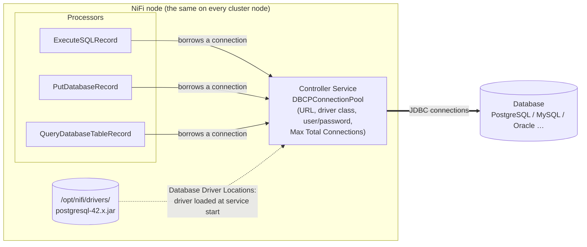
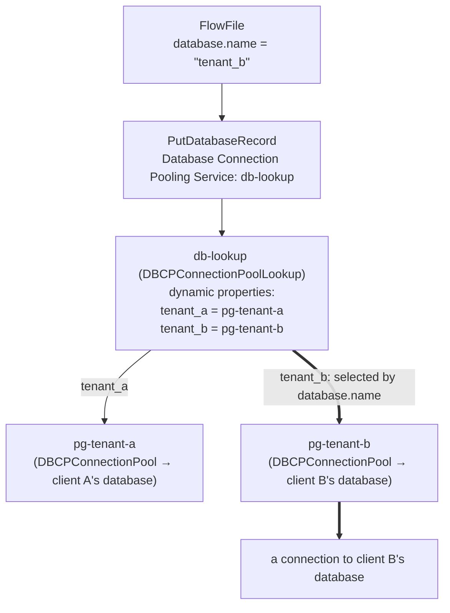
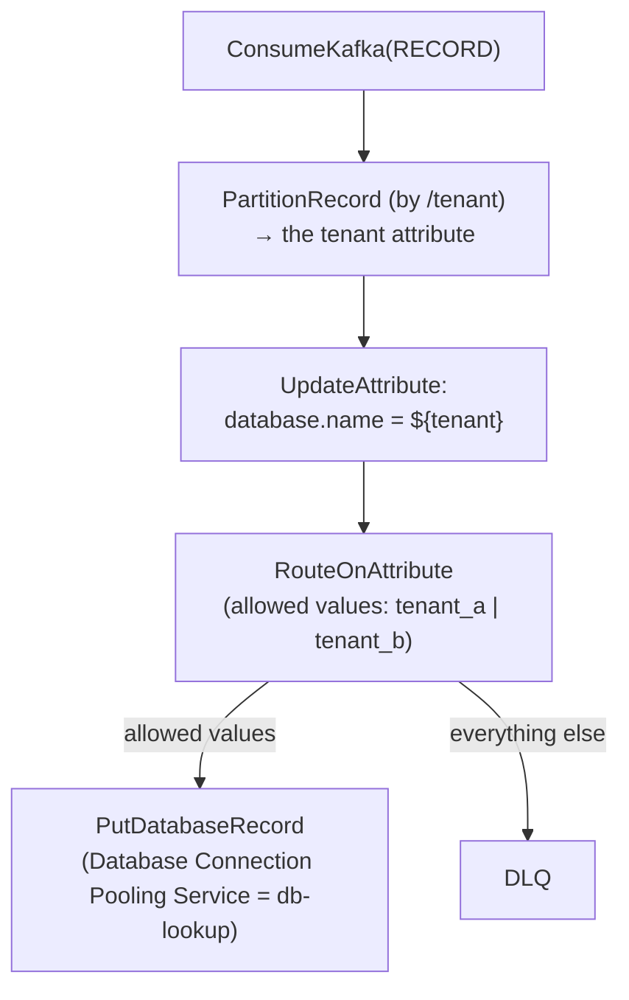
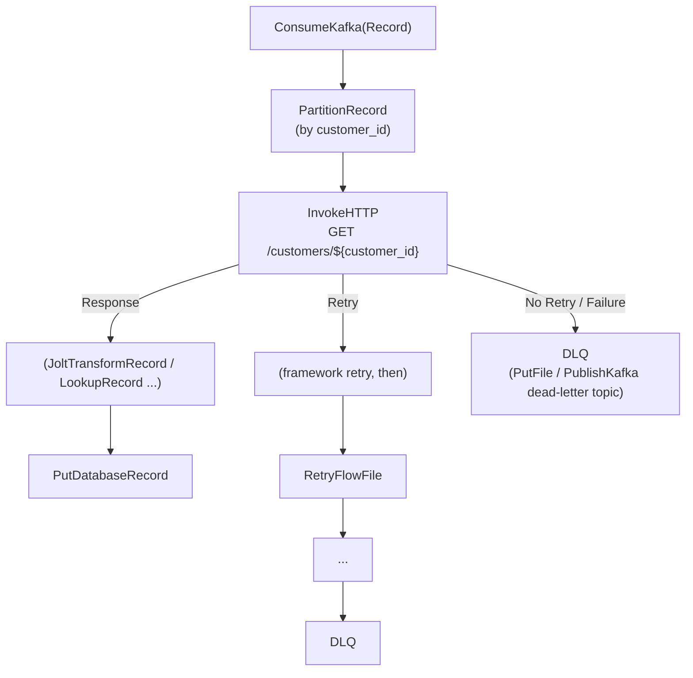
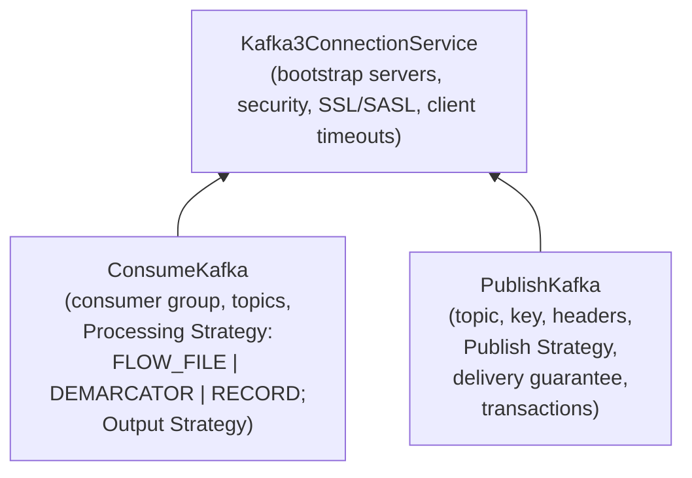

## Contents

- [Block 2.1: Connecting to databases, messaging systems, REST APIs](#block-21-connecting-to-databases-messaging-systems-rest-apis)
- [Block 2.2: Transforming JSON and NDJSON](#block-22-transforming-json-and-ndjson)
- [Block 2.3: Splunk integration](#block-23-splunk-integration)
- [Block 2.4: Migration from NiFi 1.x to 2.x](#block-24-migration-from-nifi-1x-to-2x)
- [Block 2.5: Day 2 recap and Q&A](#block-25-day-2-recap-and-qa)

---

## Block 2.1: Connecting to databases, messaging systems, REST APIs

### 2.1.1 Databases (JDBC)

#### A connection pool as a Controller Service

The database connection is encapsulated in the Controller Service `DBCPConnectionPool` (or `HikariCPConnectionPool`). The pool is shared by all the processors that reference it, so the size of the pool limits the total parallelism of database access.

| Property | Purpose | Recommendations |
|---|---|---|
| Database Connection URL | The JDBC URL, for example `jdbc:postgresql://db:5432/orders` | Via a parameter: `#{db.url}` |
| Database Driver Class Name | For example `org.postgresql.Driver` | |
| Database Driver Locations | The path to the driver JAR (a file/directory/URL) | The driver is placed outside `lib/`, for example `/opt/nifi/drivers/` |
| Database User / Password | Credentials | The password is a sensitive parameter |
| Max Wait Time | How long to wait for a free connection | Shorter than the query timeout so that errors are noticeable |
| Max Total Connections | The pool size | ≥ the total Concurrent Tasks of the processors that use the pool (with a margin), but ≤ the database limits |
| Validation Query | A connection liveness check | `SELECT 1` (or rely on the driver's check if it supports `isValid`) |

Notes on security and compatibility:

- In 1.22.0, H2 connections stopped being supported in `DBCPConnectionPool`/`HikariCPConnectionPool` following CVE-related URL validation; in 1.23.0 the *Reference Remote Resources* restriction was introduced for a number of components (including `DBCPConnectionPool`) ([Migration Guidance](https://cwiki.apache.org/confluence/display/NIFI/Migration+Guidance)). If you use fine-grained policies, the users who configure these components need to be granted the corresponding permission. The *restricted components* restrictions as an authorization mechanism were removed in 2.10.0 (see [Block 3.3](day-3.md#block-33-security-and-governance)).
- In 2.7.0, AWS RDS IAM authentication for DBCP was added ([Release Notes 2.7.0](https://cwiki.apache.org/confluence/display/NIFI/Release+Notes)).
- Since 2.2.0, there is a **Database Dialect Service** for different SQL dialects ([Release Notes 2.2.0](https://cwiki.apache.org/confluence/display/NIFI/Release+Notes)).

#### The JDBC driver: where to get it, where to put it, how to connect it

NiFi connects to a database through the standard JDBC interface, but **you have to add the driver for the specific DBMS separately**: the JDBC drivers of external DBMSs are not included in the standard distribution (in 2.12.0 neither the distribution nor the `apache/nifi` image contains drivers for PostgreSQL, MySQL, SQL Server, Oracle, ClickHouse, or H2). A processor does not work with the driver directly: the driver is attached to the Controller Service `DBCPConnectionPool`, and the processors reference that service.



##### Step 1. Download the driver

Download the driver only from an **official source**: the DBMS vendor's site or Maven Central (the Maven coordinates are below). Verify the checksum (SHA-256) and/or the signature given on the download page. Choose the driver version so that it supports **your DBMS version** and **Java 21** (for NiFi 2.x): old drivers built for Java 8 often work, but the current line is preferable.

| DBMS | Maven coordinates (a guideline) | Driver class | JDBC URL format |
|---|---|---|---|
| PostgreSQL | `org.postgresql:postgresql` | `org.postgresql.Driver` | `jdbc:postgresql://host:5432/dbname` |
| MySQL | `com.mysql:mysql-connector-j` | `com.mysql.cj.jdbc.Driver` | `jdbc:mysql://host:3306/dbname` |
| MariaDB | `org.mariadb.jdbc:mariadb-java-client` | `org.mariadb.jdbc.Driver` | `jdbc:mariadb://host:3306/dbname` |
| Microsoft SQL Server | `com.microsoft.sqlserver:mssql-jdbc` | `com.microsoft.sqlserver.jdbc.SQLServerDriver` | `jdbc:sqlserver://host:1433;databaseName=dbname;encrypt=true` |
| Oracle | `com.oracle.database.jdbc:ojdbc11` (the line for modern JDKs; choose according to the Oracle compatibility matrix) | `oracle.jdbc.OracleDriver` | `jdbc:oracle:thin:@//host:1521/SERVICE_NAME` |
| ClickHouse | `com.clickhouse:clickhouse-jdbc` | `com.clickhouse.jdbc.ClickHouseDriver` | `jdbc:clickhouse://host:8123/dbname` |

**Be sure to check** the driver class and the URL format against the documentation of the chosen driver version: they sometimes change between major versions. Some drivers need additional JARs (for example, Oracle — auxiliary libraries for internationalization/pools; SQL Server with Windows integrated authentication — native components) — read the vendor's instructions.

##### Step 2. Put the driver on the NiFi nodes

**Recommendation:** keep drivers in a **separate directory outside `NIFI_HOME/lib`**, for example `/opt/nifi/drivers/` (in the Docker image NIFI_HOME is usually `/opt/nifi/nifi-current`, and the drivers directory is mounted as a volume — see Appendix A, where `./drivers:/opt/nifi/drivers` is already present).

Why not in `lib/`:

- `lib/` is the NiFi framework directory; adding third-party JARs there can lead to **classpath conflicts** with NiFi libraries.
- Files in `lib/` are lost or require a manual transfer when the NiFi version is upgraded.
- A driver attached through a service is loaded by a **separate class loader** of that service, so different pools can use **different driver versions** at the same time (in 2.12.0 the service is annotated with `@RequiresInstanceClassLoading`, and *Database Driver Locations* modifies its classpath).

Placement requirements:

| Requirement | Explanation |
|---|---|
| **The same path on every node of the cluster** | The path in the service settings is resolved locally on each node; if the JAR exists only on one node, the service on the other nodes will be invalid |
| Read permission for the user NiFi runs as | For example, owner `nifi:nifi`, permissions `640` on files and `750` on the directory |
| The directory can be specified as a whole | The service will load all JARs from the directory (convenient when a driver has several files). Do not mix different versions of the same driver in one directory |
| Do not keep anything extra in the directory | Every JAR ends up in the service's class loader |

```bash
# An example for a Linux node
sudo mkdir -p /opt/nifi/drivers/postgresql
sudo cp postgresql-<version>.jar /opt/nifi/drivers/postgresql/
sudo chown -R nifi:nifi /opt/nifi/drivers
sudo chmod 750 /opt/nifi/drivers /opt/nifi/drivers/postgresql
sudo chmod 640 /opt/nifi/drivers/postgresql/*.jar
# Repeat (or roll out via Ansible/an image) on all nodes of the cluster
```

**The lab stand.** The PostgreSQL driver is already in the `nifi/drivers` directory of the stand repository and is mounted into all NiFi nodes (single and cluster) as `/opt/nifi/drivers` (read-only): in `DBCPConnectionPool`, specify `/opt/nifi/drivers/postgresql-42.7.14.jar`. Simply put new drivers into `nifi/drivers` — no restart is needed; the JAR is loaded when the service is enabled (Appendix A.6).

**Containers and Kubernetes.** In Docker — a volume with the drivers (see Appendix A); in Kubernetes — either your own image with the driver, or an `initContainer` that downloads the JAR into a shared volume, or a PersistentVolume. The main thing is that the path is the same in all pods.

**Loading through NiFi (2.x).** In 2.0.0, REST services for uploading *assets* and custom NARs were added ([Release Notes 2.0.0](https://cwiki.apache.org/confluence/display/NIFI/Release+Notes)); in NiFi 2.x, Parameter Context parameters can reference uploaded files (assets), which makes it possible not to lay out drivers manually across nodes. In 2.12.0 this works: a parameter that references an uploaded JAR asset can be used in *Database Driver Locations* (for example, `#{jdbc.driver}`), and the service loads the driver from the asset when it is enabled.

##### Step 3. Create and configure `DBCPConnectionPool`

1. Open the area where the service will live: right-click the canvas of the needed **Process Group → Controller Services** (or *Configure*), click **"+"**, and select `DBCPConnectionPool`. The service is visible to the processors of this group and of nested groups; a service in the root group is visible to everyone.
2. Fill in the properties:

| Property | Example | Comment |
|---|---|---|
| Database Connection URL | `#{db.url}` → `jdbc:postgresql://pg:5432/orders` | Via an environment parameter. Do not put the password in the URL |
| Database Driver Class Name | `org.postgresql.Driver` | From the driver documentation |
| **Database Driver Locations** | `/opt/nifi/drivers/postgresql` | A path to a JAR, a directory, or a URL; several values are separated by commas |
| Database User | `#{db.user}` | An account with the minimum necessary permissions |
| Password | `#{db.password}` | A **sensitive parameter**, not plain text |
| Max Wait Time | `10 sec` (`500 millis` by default) | How long the processor waits for a free connection; the default value is very small — under load it leads to "timeout waiting for idle object" errors |
| Max Total Connections | `16` (`8` by default) | Do not exceed the database limits, taking all cluster nodes into account (connections are multiplied by the number of nodes!). Related properties: Max Idle Connections (`8`), Minimum Idle Connections (`0`), Max Connection Lifetime (`-1`, unlimited), Minimum Evictable Idle Time (`30 mins`) |
| Validation Query | `SELECT 1` (Oracle: `SELECT 1 FROM DUAL`) | A connection liveness check when it is handed out from the pool |
| Dynamic properties | for example, `sslmode = verify-full` | Dynamic properties are passed to the driver as JDBC connection parameters (they support EL over environment variables); a name with the prefix `SENSITIVE.` (for example, `SENSITIVE.password`) is handled as a sensitive value. This is how TLS and vendor-specific options are set |

3. **Apply** → the service should become *Disabled* with no red icon. If the service is *Invalid*, hover over the icon — the reason is shown (the path, the class, a required property).
4. **Enable** (the lightning-bolt icon). Enabling creates the pool and (depending on the settings) checks the connection.
5. If property verification is available in your version (**Verify** in the configuration dialog), run it: it will show whether the driver is loaded and whether the connection is established, without starting a flow.

##### Step 4. Connect a processor

In the processor, open *Properties* and in the **Database Connection Pooling Service** property select the created service (or create it right from the drop-down list "Create new service…").

| Processor | What to configure | Note |
|---|---|---|
| `ExecuteSQLRecord` | Database Connection Pooling Service; SQL select query; Record Writer; Max Rows Per Flow File; Fetch Size | Reading; the result is records in the chosen format |
| `QueryDatabaseTableRecord` | Pooling Service; Table Name; Maximum-value Columns; Record Writer | Incremental reading; Primary Node Only |
| `PutDatabaseRecord` | Pooling Service; Record Reader; Statement Type; Table Name; Update Keys; Batch Size | Writing; see the details above |

An example of a minimal read test: `GenerateFlowFile` (run once) → `ExecuteSQLRecord` with the query `SELECT 1 AS ok` → `LogAttribute`. If a FlowFile with `record.count = 1` appears in `LogAttribute`, the driver, the URL, and the credentials are configured correctly.

##### Diagnosing driver problems

| Symptom | Probable cause | What to do |
|---|---|---|
| The service is *Invalid*: path not found / `Database Driver Locations` | A wrong path; no permissions; the JAR is only on some of the nodes | Check the path on **every** node, the owner, and the permissions |
| `Cannot load JDBC driver class '...'` | A typo in the class name; the JAR does not contain the class; the driver's required dependencies are missing | Check the class against the driver documentation; add the missing JARs |
| `No suitable driver` | The URL prefix does not match the driver | Check the URL (`jdbc:postgresql://`, `jdbc:mysql://`, etc.) |
| `UnsupportedClassVersionError` | The driver was built for a newer Java than the one running | Choose a driver version that matches the NiFi Java |
| An authentication/SSL error | Wrong credentials, the database TLS policy, certificates | The TLS parameters in the URL/dynamic properties; the driver's truststore |
| `Timeout waiting for idle object` / not enough connections | A small `Max Total Connections` relative to the number of `Concurrent Tasks` | Increase the pool or reduce parallelism; take the database limits into account |
| After replacing the JAR the old version "lives on" | The service's class loader has already been created | Disable and enable the service again; restart NiFi if necessary |
| The service enables, but connections "break" | The pool is idle, a firewall closes idle connections | Validation Query, the pool's idle/lifetime parameters, keepalive on the network |

Notes on security and compatibility: take the component restrictions into account (in 1.22.0 H2 connections through `DBCPConnectionPool`/`HikariCPConnectionPool` are prohibited; in 1.23.0 the *Reference Remote Resources* restriction was introduced — [Migration Guidance](https://cwiki.apache.org/confluence/display/NIFI/Migration+Guidance)); a user with permission to configure such a service gets access to the file system and the network on behalf of NiFi, so restrict the permissions to modify Controller Services ([Block 3.3](day-3.md#block-33-security-and-governance)).

#### DBCPConnectionPool and DBCPConnectionPoolLookup: what is the difference

Both services implement the same `DBCPService` interface, so they are selected in processors (`ExecuteSQLRecord`, `PutDatabaseRecord`, etc.) from the same *Database Connection Pooling Service* property. But their roles are different.

**`DBCPConnectionPool`** is a **real connection pool** to **one** database: it stores the URL, the driver, the login/password, and the pool sizes; it is the one that opens and holds the connections.

**`DBCPConnectionPoolLookup`** is **not a pool but a "router"**: it does not connect to anything itself, and for each connection request it **selects another `DBCPService`** (usually a `DBCPConnectionPool`) by the value of the **FlowFile attribute `database.name`**. The service has been available since NiFi 1.7.0 ([a community post](https://community.cloudera.com/t5/Support-Questions/Nifi-Multiple-databases-same-query-how-do-pass-database-name/m-p/240247)) and is present in the 2.12.0 documentation ([reference](https://nifi.apache.org/components/org.apache.nifi.dbcp.DBCPConnectionPoolLookup)).

##### How Lookup works

- It has **no** required properties. It is configured through **dynamic properties**: the *property name* is the "key" (the value that will arrive in `database.name`), and the *property value* is a reference to an enabled Controller Service `DBCPService`. Expression Language support for these properties is off; sensitive dynamic properties are not supported ([reference](https://nifi.apache.org/docs/nifi-docs/components/org.apache.nifi/nifi-dbcp-service-nar/1.28.0/org.apache.nifi.dbcp.DBCPConnectionPoolLookup)).
- When a processor requests a connection, it passes the FlowFile attributes to the service. If the `database.name` attribute is absent, the service **throws an exception**; if the value did not match any key, it is impossible to select a service (an error).



##### Comparison

| Aspect | `DBCPConnectionPool` | `DBCPConnectionPoolLookup` |
|---|---|---|
| What it is | A connection pool | A proxy/router between several `DBCPService`s |
| What it connects to | One database (one URL, one user) | Nothing directly; it uses other services |
| Where the URL, driver, and password are stored | In itself | In the **target** `DBCPConnectionPool`s; Lookup holds only a "key → service" table |
| Database selection | Fixed by configuration | **Dynamic**, per FlowFile, by the `database.name` attribute |
| Required properties | The URL, the driver class, the user, etc. | None (only dynamic key properties) |
| Pool size | Its own (`Max Total Connections`) | None: the sizes are set in each target pool; the total number of connections = the sum over the pools |
| Requirements for the flow | None | Every FlowFile must have the `database.name` attribute before the processor (set by `UpdateAttribute`, `EvaluateJsonPath`, `PartitionRecord`, etc.) |
| Restrictions on processors | Any processor with a DBCP property | Only processors that **have an incoming FlowFile** (`database.name` is taken from its attributes). Sources without input (for example, `QueryDatabaseTableRecord`) and processors that do not pass attributes (for example, `ListDatabaseTables`) cannot use Lookup (the service requires the `database.name` attribute and throws an exception without it) |
| Failure | The database is unavailable → connection errors | Additionally: no attribute or an unknown key → an exception |
| Simplicity | Maximum | More complex: more services, dependencies, naming rules |

##### When to use Lookup

- **Multi-tenancy:** a separate database per client/department, the same schema and the same flow. Instead of copying the flow N times — one flow + Lookup.
- **Environments/shards:** the same queries against several shards or regional databases.
- **Separating reads and writes** (a read replica/primary): different keys for different branches of the flow.
- **Controlled switching** between database instances (for example, a manual failover to another host) without editing processors — but for an automatic failover it is better to solve this at the level of DNS/the database cluster.

When it is **not** needed: a single database (use a regular `DBCPConnectionPool`); different databases require **different** SQL/logic (separate branches are simpler); strict isolation of permissions and network policies per client with secret rotation is needed (this is also possible with Lookup, but responsibility for the target services remains).

##### A configuration example (multi-tenant order intake)

1. Create two `DBCPConnectionPool` services: `pg-tenant-a` and `pg-tenant-b` (different URLs/credentials; the same driver), and enable them.
2. Create a `DBCPConnectionPoolLookup` named `db-lookup`; add dynamic properties: `tenant_a` → `pg-tenant-a`, `tenant_b` → `pg-tenant-b`. Enable it (the dependent services must be enabled).
3. Build the flow:



`PartitionRecord` is needed here because **one FlowFile goes to one database**: mixed records of different clients must be separated before writing.

##### Pitfalls

- **The attribute name is fixed** — `database.name`; the value must match the name of the dynamic property **exactly** (case-sensitive).
- **Security:** if the value of `database.name` comes from external data (an HTTP header, a message field), it effectively selects the database the data will go to. Validate the value against a **whitelist** (`RouteOnAttribute`) and do not use it "as is" from an untrusted source.
- Error handling: a missing attribute/an unknown key is an error at the connection acquisition stage; provide `failure`/DLQ branches and bulletin monitoring.
- **Enabling/disabling:** Lookup depends on the target services; you cannot enable Lookup until the target services are enabled, and you cannot disable a target service while Lookup is enabled (the UI will show the dependent components).
- **Cluster:** the driver must be on every node (as for a regular pool), and the total number of connections should be counted as "the sum of the pools × the number of nodes".
- **Do not confuse** it with `DatabaseRecordLookupService`/`SimpleDatabaseLookupService`: these are *enrichment* services (looking up values in a table for `LookupRecord`), not connection routers.


#### HikariCPConnectionPool (in brief)

**What it is.** Another Controller Service with the `DBCPService` interface, that is, a real connection pool to one database, just like `DBCPConnectionPool`. It is based on the HikariCP library and is selected in the same processors from the same *Database Connection Pooling Service* property.

**Why.** It is an alternative pool implementation: HikariCP is known for its small size and low overhead when handing out connections. It is chosen when the pool is under high concurrent load (many `Concurrent Tasks`) or when the team is used to HikariCP parameters.

**How it differs.**

| | `DBCPConnectionPool` | `HikariCPConnectionPool` |
|---|---|---|
| Pool library | Apache Commons DBCP | HikariCP |
| Purpose | A universal "default" pool | An alternative pool with a different set of settings |
| Set of properties | Max Total Connections (`8`), Max Wait Time (`500 millis`), Max Idle Connections (`8`), Minimum Idle Connections (`0`), Max Connection Lifetime (`-1`), Validation Query, Kerberos User Service, etc. | Max Total Connections (`10`), Max Wait Time (`500 millis`), **Minimum Idle Connections (`10`)**, Max Connection Lifetime (`-1`), Validation Query, Kerberos User Service ([reference](https://docs.snowflake.com/en/user-guide/data-integration/openflow/controllers/hikaricpconnectionpool)). The HikariCP service documentation recommends setting Minimum Idle equal to Max Total Connections so that the pool does not recreate connections |
| JDBC driver, URL, user | Required | Required, connected the same way (see above) |
| Role in a flow | A connection to one database | The same |

Both services are real pools; this is exactly what distinguishes them from `DBCPConnectionPoolLookup`, which only chooses between pools. If there is no specific reason, start with `DBCPConnectionPool`; moving to `HikariCPConnectionPool` is justified by measurements. The restriction on H2 connections (1.22.0) applies to both services ([Migration Guidance](https://cwiki.apache.org/confluence/display/NIFI/Migration+Guidance)).

#### Reading: ExecuteSQLRecord and QueryDatabaseTableRecord

**`ExecuteSQLRecord`** executes an arbitrary SELECT with output through a Record Writer (JSON/Avro/CSV).

| Property | Purpose |
|---|---|
| Database Connection Pooling Service | The DBCP service |
| SQL select query | SQL; supports EL over the attributes of the incoming FlowFile (`${id}`) — convenient but dangerous: see below |
| Record Writer | The output format (JSON NDJSON, Avro, …) |
| Max Rows Per Flow File | The size of the output FlowFile (0 = all rows in one) |
| Output Batch Size | How many FlowFiles to hand to the session before a commit (reduces memory for very large result sets) |
| Fetch Size | The size of the batch the driver fetches at a time (the driver default may be "everything into memory") |
| Query timeout | An execution limit |

**Important about memory.** Some JDBC drivers (PostgreSQL) without an explicit cursor mode load the entire result into client memory; for `Fetch Size` to work, specific connection settings are needed (for PostgreSQL — a mode without autocommit; the exact conditions are in the pgjdbc documentation section on getting results with a cursor). Always limit result sets by time/key.

**Parameters in SQL.** Substituting values into an SQL string through EL is vulnerable to SQL injection if the value comes from external data. For safe queries, use the parameterized path (the `sql.args.N.type/value` attributes of the `PutSQL` processors) or validate the values (`RouteOnAttribute`/`ValidateRecord`) before substitution.

**`QueryDatabaseTableRecord`** is an incremental table extraction.

| Property | Purpose |
|---|---|
| Table Name, Columns to Return | The source |
| **Maximum-value Columns** | Monotonically growing columns (id, updated_at); the processor keeps the maximum in **state** and adds `WHERE col > <state>` |
| Max Rows Per Flow File, Fetch Size | Control of size and memory |
| Record Writer | The output format |
| Scheduling | **Primary Node Only** in a cluster (otherwise several nodes will start reading the same thing) |

Limitations: updated (UPDATE) rows without a change in the max-value column and deleted rows will not be detected; for CDC, use CDC sources (`CaptureChangeMySQL`, Debezium→Kafka). For very large tables, combine `GenerateTableFetch` (splitting into independent queries) with `ExecuteSQLRecord` and load balancing.

#### Writing: PutDatabaseRecord

`PutDatabaseRecord` is the main processor for writing records to a database (batch insert/update/upsert/delete).

| Property | Purpose |
|---|---|
| Record Reader | The Reader of the input records (with an explicit schema!) |
| Database Type / Dialect | Needed for UPSERT and dialect specifics |
| **Statement Type** | `INSERT`, `UPDATE`, `DELETE`, `UPSERT` (since 1.22.0), `INSERT_IGNORE`, `SQL`, `Use statement.type Attribute`, `Use Record Path` (the set may differ by version) |
| Database Connection Pooling Service | DBCP |
| Schema Name / Table Name | The target table |
| Translate Field Names | Matching field and column names regardless of case/underscores |
| Unmatched Field Behavior / Unmatched Column Behavior | What to do with fields that have no columns and vice versa |
| Update Keys | Keys for UPDATE/UPSERT |
| Batch Size | The number of rows in a JDBC batch (affects speed and transaction size) |
| Rollback On Failure | Roll back the entire transaction (and leave the FlowFile in the incoming queue) instead of routing to `failure` |

**Relationships:** `success`; `failure` — data the database does not accept (constraint violations, wrong types); `retry` — temporary problems (a lost connection, a deadlock). Do not connect `retry` back to the same processor without a limit (see [Block 3.1](day-3.md#block-31-fault-tolerance-and-error-handling)).

**Efficiency.**

1. Large FlowFiles (thousands of records) + **batch** — instead of one record per FlowFile.
2. Parallelism: `Concurrent Tasks` ≤ the pool size; watch for locks on the table.
3. Idempotency: for redelivery (at-least-once), use `UPSERT`/`INSERT ... ON CONFLICT DO NOTHING` (via `INSERT_IGNORE` or the dialect), a unique event key.
4. For very large loads, database-specific paths (`COPY` in PostgreSQL, bulk loaders) are beyond NiFi — consider batch file loads.

An example of the input record schema and the table:

```sql
CREATE TABLE orders_stage (
    order_id   VARCHAR(64) PRIMARY KEY,
    customer   VARCHAR(128),
    amount     NUMERIC(12,2) NOT NULL,
    currency   CHAR(3) NOT NULL,
    created_at TIMESTAMP NOT NULL,
    ingest_ts  TIMESTAMP DEFAULT CURRENT_TIMESTAMP
);
```

### 2.1.2 REST API: InvokeHTTP

`InvokeHTTP` is a universal HTTP client (a replacement for the removed `GetHTTP`/`PostHTTP`, **[rem 2.0]**, see [Migrating Deprecated Components](https://cwiki.apache.org/confluence/spaces/NIFI/pages/240883792/Migrating+Deprecated+Components+and+Features+for+2.0.0)).

| Property | Purpose |
|---|---|
| HTTP Method | `GET`, `POST`, `PUT`, `DELETE`, `PATCH` … (supports EL) |
| HTTP URL | The address; values in the URL must be URL-encoded (a requirement since 1.24.0, [Migration Guidance](https://cwiki.apache.org/confluence/display/NIFI/Migration+Guidance)) |
| SSL Context Service | TLS configuration (trust store, client certificate) |
| Connection Timeout / Read Timeout | Timeouts — always set them deliberately; the default values may be unsuitable for your API |
| Request Content-Type | For POST/PUT (by default from the `mime.type` attribute) |
| Request OAuth2 Access Token Provider | Attaching `StandardOauth2AccessTokenProvider` (client credentials, JWT Bearer — since 2.4.0) |
| Request Username / Password | Basic authentication (sensitive) |
| Dynamic properties | Add HTTP headers, for example `Authorization`, `X-Request-Id: ${UUID()}` |
| Response Body Attribute Name | Put the response body into an attribute (only for small responses) |
| Always Output Response | Emit the response to `Response` even on status errors |
| Proxy Configuration Service | A proxy |

**Relationships and routing of response codes.**

| Relationship | When |
|---|---|
| `Original` | The original request (always, if context is needed) |
| `Response` | A response with a successful status (2xx) — the body is in the content |
| `Retry` | Responses for which a retry makes sense (including 5xx) |
| `No Retry` | Client errors (4xx): a retry is pointless |
| `Failure` | Transport errors (connection, DNS, timeout) |

Response attributes: `invokehttp.status.code`, `invokehttp.status.message`, `invokehttp.request.url`, `invokehttp.tx.id`, `invokehttp.response.url`. These attributes are used for further routing (`RouteOnAttribute`) and logging.

#### The "retry with exponential backoff" pattern

1. Enable **framework-level Retry** on the processor (since 1.16.0): the *Relationships* tab → check the *Retry* box for `Retry`/`Failure`; set the number of attempts, the **Backoff Policy** (Penalize/Yield), and the **Maximum Backoff Period**. This is implemented by the framework itself, without a loop in the flow.
2. For more complex logic — `RetryFlowFile` ([Block 3.1](day-3.md#block-31-fault-tolerance-and-error-handling)).
3. Rate limiting for an external API: `ControlRate` (by the number of FlowFiles/volume/attribute) before `InvokeHTTP`; or limiting `Concurrent Tasks`.

#### An example: enriching events with an external API



If a separate request is needed for every record, these are *per-record* calls; so as not to turn a batch into millions of requests, first group by key (`PartitionRecord`), cache (`LookupRecord` with a caching lookup service, for example `RestLookupService`), or enrich with a batch request. For an HTTP lookup in a Record flow, `LookupRecord` + `RestLookupService` is often better than `InvokeHTTP` per record (in 2.12.0 the service has `URL`, `Record Reader`, `Record Path`, `Response Handling Strategy`, authentication settings, `Connection Timeout` of 5 s and `Read Timeout` of 15 s).

### 2.1.3 Kafka: PublishKafka and ConsumeKafka (NiFi 2.x)

> **A critically important change for the course.** The agenda mentions `PublishKafka` and `ConsumeKafkaRecord`. In NiFi **2.x** the "Kafka 2.6" processors (`ConsumeKafka_2_6`, `ConsumeKafkaRecord_2_6`, `PublishKafka_2_6`, `PublishKafkaRecord_2_6`) have been **removed** (**[rem 2.0.0]**, [Release Notes 2.0.0 — Breaking Changes](https://cwiki.apache.org/confluence/display/NIFI/Release+Notes)). In their place are the **unified** processors `ConsumeKafka` and `PublishKafka` and the Controller Service `Kafka3ConnectionService`. There are no separate Record variants any more: Record mode is enabled by the **Processing Strategy = RECORD** property (in consume) and the corresponding publish strategy. Confirmation: [the description of the Pull Request that introduced the new components](https://www.mail-archive.com/issues@nifi.apache.org/msg169807.html) and the [ConsumeKafka reference](https://nifi.apache.org/components/org.apache.nifi.kafka.processors.ConsumeKafka/).

#### Architecture



Advantages of the service-based approach: connection parameters (brokers, TLS, SASL) are set **once**; processors do not depend on the version of the client library; the same processor works in FlowFile/Record/Demarcator modes.

#### Kafka3ConnectionService: key properties

According to the component reference ([Kafka3ConnectionService](https://docs.snowflake.com/en/user-guide/data-integration/openflow/controllers/kafka3connectionservice)):

| Property | Default | Purpose |
|---|---|---|
| **Bootstrap Servers** | — | A comma-separated list of `host:port` (`bootstrap.servers`) |
| **Security Protocol** | `PLAINTEXT` | `PLAINTEXT`, `SSL`, `SASL_PLAINTEXT`, `SASL_SSL` |
| **SASL Mechanism** | `GSSAPI` | `GSSAPI`, `PLAIN`, `SCRAM-SHA-256`, `SCRAM-SHA-512`; for PLAIN/SCRAM a SASL Username and Password are set |
| SSL Context Service | — | TLS communication with the brokers |
| **Max Poll Records** | `10000` | The maximum number of records returned per poll (`max.poll.records`); determines the batch size of `ConsumeKafka` |
| **Client Timeout** | `60 sec` | The overall timeout of client operations (`default.api.timeout.ms`); `request.timeout.ms` is derived as half of it |
| **Acknowledgment Wait Time** | `5 sec` | How long to wait for an acknowledgment after sending |
| **Max Metadata Wait Time** | `5 sec` | How long to wait for metadata/a buffer flush on `send` (`max.block.ms`) |
| **Transaction Isolation Level** | `Read Committed` | `Read Committed` — do not receive messages of aborted transactions (a delay is possible); `Read Uncommitted` — receive them immediately |

#### ConsumeKafka: key properties

| Property | Purpose |
|---|---|
| Kafka Connection Service | A reference to `Kafka3ConnectionService` |
| Group ID | The consumer group; **all nodes and threads that consume one set of partitions must have the same Group ID** |
| Topics | The topic name(s) or a pattern |
| **Auto Offset Reset** | What to do if there is no saved offset: `earliest` / `latest` / `none`; corresponds to Kafka `auto.offset.reset` (`latest` by default) |
| **Processing Strategy** | `FLOW_FILE` (one message — one FlowFile), `DEMARCATOR` (several messages in one FlowFile with a delimiter), `RECORD` (records through a Reader/Writer) |
| Record Reader / Record Writer | With `RECORD`: what to read the message value with and what to write with |
| **Output Strategy** | With `RECORD`: `Use Content as Value`, `Use Wrapper` (a record contains the key, headers, and metadata together with the value), `Inject Metadata` (Kafka metadata is inserted into the record; since 2.3.0/2.5.0, [Release Notes](https://cwiki.apache.org/confluence/display/NIFI/Release+Notes)) |
| Header Name Pattern, Header Encoding | Which Kafka headers to turn into attributes |
| Commit Offsets | Control of offset commits |
| Max Uncommitted Time | The maximum time before offsets are committed |

Attributes of the output FlowFiles: `kafka.topic`, `kafka.partition`, `kafka.offset` (or the minimum in the batch), `kafka.max.offset`, `kafka.count`, `kafka.key`, `kafka.timestamp` — they are used for routing and diagnostics.

#### PublishKafka: key properties

| Property | Purpose |
|---|---|
| Kafka Connection Service | The connection |
| Topic Name | The target topic (supports EL: `orders.${tenant}`) |
| Publish Strategy | How to form the message: value = content / a wrapper record / parsing records with a Reader |
| Record Reader / Record Writer | For publishing by records (each record is a separate message) |
| Kafka Key / Message Key Field | The message key: either the value of the property (if not set — the `kafka.key` attribute) or a field of the input record; the key determines the partition |
| Record Key Writer, Record Metadata Strategy | How to serialize the record key and where to take the metadata from (the topic and partition — from the record metadata or from the processor properties) |
| Delivery Guarantee (`acks`) | `Best Effort`, `Guarantee Single Node Delivery`, `Guarantee Replicated Delivery`: faster ↔ more reliable |
| Transactions Enabled, Transactional ID Prefix | Transactional publishing (`transactional.id` — a generated UUID with the given prefix). **Enabling requires `Delivery Guarantee = Guarantee Replicated Delivery`** |
| `compression.type`, `partitioner.class`, etc. | Kafka client parameters |

The list of `PublishKafka` properties was checked against the component description ([a documentation mirror](https://docs.snowflake.com/en/en/user-guide/data-integration/openflow/processors/publishkafka)); in your minor version, see *Help → Documentation*. There are additional properties for Kafka header attributes and encodings.

**The evolution of the Kafka components in 2.x (confirmed against the [Release Notes](https://cwiki.apache.org/confluence/display/NIFI/Release+Notes)):**

| Version | Change |
|---|---|
| 2.0.0-M4 | Kafka 3 support for consume and publish |
| 2.4.0 | Refactoring of the Kafka components (improvements and fixes); AWS MSK IAM support |
| 2.5.0 | SASL/OAUTHBEARER; the Inject Metadata output mode; fixes to the Kafka components |
| 2.7.0 | Web Identity support for `AmazonMSKConnectionService` |
| 2.8.0 / 2.9.0 | Fixed the message duplication problem during consumer group rebalancing in `ConsumeKafka` |

Practical takeaway: **do not use versions below 2.8.0 in production with intensive rebalancing** if your destination is not idempotent — otherwise duplicates are possible (confirmed by an entry in the Release Notes of 2.8.0/2.9.0).

### 2.1.4 Efficient integration with Kafka: batching, offsets, guarantees, parallelism

#### Offsets and delivery semantics

Offsets are stored **in Kafka** (the `__consumer_offsets` topic), not in NiFi; NiFi only commits them after a successful session commit. Consequently:

- Changing the `Group ID` = a "new consumer": reading will start according to `Auto Offset Reset`.
- You cannot reset offsets from NiFi; this is done with Kafka tools (`kafka-consumer-groups.sh --reset-offsets`) while the consumers are stopped.
- To continue reading after migrating from the old processors, keep the same **Group ID** — reading will continue from the committed offsets (see Block 2.4).

Semantics (consumer side):

| Mode | Behavior | Risk |
|---|---|---|
| Commit offsets *after* a successful session (the standard) | **At-least-once** | Duplicates on a failure between a side effect and the commit; on rebalance |
| Auto-commit before processing | At-most-once | Losses on a failure |
| A Stateless group with Kafka consume/publish in a transaction | Closer to **exactly-once** on a Kafka→Kafka chain | Stateless limitations (memory, a limited set of processors) |

Producer side: acknowledgment levels (`acks`), the idempotent producer, and Kafka transactions determine whether duplicates and losses are possible on publish. Depending on the requirements: *critical* flows — `acks=all`, idempotence; *metrics/logs* — weaker guarantees for the sake of throughput.

**Idempotency of the destination is the main rule.** For at-least-once you need either a unique event key and `UPSERT`, or `DetectDuplicate`, or deduplication at the destination.

#### Batching

- **Consume.** In one `onTrigger` call, `ConsumeKafka` reads a *batch* of messages (a client poll). With the `RECORD` Processing Strategy, the batch becomes one FlowFile with N records — this is the key to throughput. The batch size is set by the service property **Max Poll Records** (`10000` by default) and by the processor's `Run Duration` (the larger it is, the bigger the batches and the higher the throughput at the expense of latency).
- **Publish.** In `RECORD` mode each record is published as a separate message, but the Kafka client batches them itself according to `linger.ms`/`batch.size`. Tune these parameters (through dynamic properties/the service) for latency and message size.
- **Message size.** Do not publish megabyte-sized FlowFiles to Kafka as a single message; watch the broker's `message.max.bytes` and the client's `Max Request Size`.

#### Parallelism and partitions

Consumption parallelism is limited by the number of **partitions**: for one partition in a group there is one consumer at a time.

```text
A topic with 12 partitions, the group "nifi-orders"
A cluster of 3 nodes × ConsumeKafka with Concurrent Tasks = 4  →  12 consumers → 1 partition per thread (ideal)
Concurrent Tasks = 8 on 3 nodes → 24 threads for 12 partitions → 12 threads sit idle
```

Rules:

1. `Concurrent Tasks × the number of nodes` ≤ the number of partitions (more is useless).
2. If ordering within a partition is critical, do not insert steps after consume that destroy ordering (parallel `Concurrent Tasks` > 1 on the following processors, round-robin balancing).
3. Rebalances (a change in the group membership) pause consumption; reduce their frequency: do not restart `ConsumeKafka` without need; watch the session/heartbeat timeouts.
4. If there are few partitions and the processing is heavy — distribute the data across the cluster with `Round robin` on the connection *after* consume.

### Lab 4: a database + REST + Kafka with record processing

> The lab: [[labs/lab-4|Lab 4 — A database + REST + Kafka with record processing]].

---

## Block 2.2: Transforming JSON and NDJSON

### 2.2.1 Working with NDJSON efficiently

**NDJSON** (newline-delimited JSON, also known as JSON Lines) is a format where each line is a self-contained JSON object:

```json
{"ts":"2026-11-15T10:00:00Z","level":"INFO","svc":"api","msg":"started","user":{"id":7,"pwd":"s3cret"}}
{"ts":"2026-11-15T10:00:01Z","level":"ERROR","svc":"api","msg":"db timeout","user":{"id":9,"pwd":"x"}}
```

Advantages: streaming processing without loading the entire array; simple cutting/merging by lines; well suited for Kafka, logs, and Splunk. Disadvantages: there is no common "root"; line breaks inside an object are prohibited (in the compact form).

**How to work with it in NiFi.**

1. `JsonTreeReader` reads NDJSON directly — no separate parsing is needed.
2. On output, `JsonRecordSetWriter` with **Output Grouping = One Line Per Object** produces NDJSON; *Pretty Print JSON* must be off.
3. Do not use `SplitText` on NDJSON for the sake of per-record processing — this takes you back to the Split anti-pattern (millions of FlowFiles). If you need to limit batch sizes — `SplitRecord` with a large *Records Per Split*, or `MergeRecord` after processing.
4. To merge small FlowFiles before delivery, use `MergeRecord` with an NDJSON Writer: *Merge Strategy* `Bin-Packing Algorithm`; *Minimum/Maximum Number of Records*; *Max Bin Age* (mandatory); *Correlation Attribute* if necessary.
5. Watch the `mime.type`: NDJSON often has `application/x-ndjson` or `application/json`; delivery processors (HTTP) may send the `Content-Type` header from this attribute.

### 2.2.2 Key processors

| Processor | Purpose | When to use |
|---|---|---|
| `ValidateRecord` | Checking records against a schema; `valid`/`invalid` | Quality control at the input |
| `QueryRecord` | SQL filtering/projection/aggregation within a FlowFile | Filters, routing by values, renaming columns, simple aggregates |
| `UpdateRecord` | Changing the values of existing fields (RecordPath + EL) | Normalizing values, computed fields when the field is in the schema |
| `JoltTransformRecord` | Structural transformations (shift/default/remove/modify), details in section 2.2.3 | Renaming/moving, adding missing fields, removal |
| `EvaluateJsonPath` | Extracting values into attributes or content | Only small scalars; not for processing arrays of records |
| `MergeRecord` | Merging FlowFiles | Preparing batches for the destination |
| `RemoveRecordField` | Removing fields by RecordPath | Simple removal |
| `PartitionRecord` | Splitting by a field value | Routing by keys |

Detailed references on `ValidateRecord`, `QueryRecord`, `UpdateRecord` (with the basics of RecordPath), `EvaluateJsonPath`, and `MergeRecord` are in section 2.2.6; on `JoltTransformRecord` — in section 2.2.3; on the Split processors — in [Day 1, section 1.3.7](day-1.md#137-reference-split-processors-an-introduction-to-queryrecord-and-recordpath).

**2.x compatibility.** `JoltTransformJSON` and `JoltTransformRecord` were moved to `nifi-jolt-nar` (**2.0.0-M2**). In **2.8.0** they were switched to the maintained jolt-community library; custom transformation classes from external JARs must be **recompiled** ([Migration Guidance 2.8.0](https://cwiki.apache.org/confluence/display/NIFI/Migration+Guidance)). In **2.10.0** the return value types of the RecordPath functions `format()`, `toString()`, `toDate()`, `toBytes()` changed — they now return correctly typed values ([Migration Guidance 2.10.0](https://cwiki.apache.org/confluence/display/NIFI/Migration+Guidance)); check the `UpdateRecord` expressions that use these functions.

### 2.2.3 Jolt: declarative JSON transformations in NiFi

#### What Jolt is

**Jolt** is a Java library for **declarative JSON→JSON transformations**: you describe a *specification* (spec) — also JSON — which says "from where to where" to move the data, which values to add by default, what to remove, and so on. No code is written. The project is developed as [jolt-community/jolt](https://github.com/jolt-community/jolt) (which also has detailed documentation of the operations and examples).

In NiFi two processors work with Jolt, and they are part of the `nifi-jolt-nar` bundle (they were moved there in version 2.0.0-M2, see the [Release Notes](https://cwiki.apache.org/confluence/display/NIFI/Release+Notes)):

| Processor | How it reads the data | What it is for |
|---|---|---|
| `JoltTransformJSON` | The whole FlowFile as **one JSON document** (an object or an array) | One-off structural transformations of a single document |
| `JoltTransformRecord` | **Record by record** through a Record Reader/Writer; the specification is applied to each record | Event streams, NDJSON, any formats supported by Readers/Writers (JSON, Avro, CSV…) |

For streaming data (NDJSON, large batches of records), use **`JoltTransformRecord`**: it processes records in a streaming fashion and is consistent with the Record approach ([Block 1.3](day-1.md#block-13-record-based-processing)). `JoltTransformJSON` is designed for one JSON document and parses it entirely in memory.

**Version notes (confirmed against the [Migration Guidance](https://cwiki.apache.org/confluence/display/NIFI/Migration+Guidance)).** In **2.8.0** both processors were switched to the maintained jolt-community library; custom transformation classes from external JARs must be **recompiled** against it. In **2.0.0-M2** the processors were moved from `nifi-standard-nar` to `nifi-jolt-nar` (important if you build a custom image/distribution).

#### The properties of `JoltTransformRecord`

Properties according to the component reference ([JoltTransformRecord](https://nifi.apache.org/docs/nifi-docs/components/org.apache.nifi/nifi-jolt-record-nar/1.8.0/org.apache.nifi.processors.jolt.record.JoltTransformRecord/index.html), [2.0.0-M3](https://nifi.apache.org/documentation/nifi-2.0.0-M3/components/org.apache.nifi/nifi-jolt-nar/2.0.0-M3/org.apache.nifi.processors.jolt.JoltTransformRecord/index.html)); the names below match 2.12.0:

| Property | Purpose |
|---|---|
| **Record Reader** | Reads the input records and determines their schema |
| **Record Writer** | Writes the result |
| **Jolt Transform** | Which operation is applied: `Chain` (the default), `Shift`, `Default`, `Remove`, `Cardinality`, `Sort`, `Modify - Default`, `Modify - Define`, `Modify - Overwrite`, `Custom` |
| **Jolt Specification** | The text of the specification **or a path to a file** with the specification. Supports Expression Language over FlowFile attributes. Ignored for `Sort` |
| Custom Transformation Class Name / Custom Module Directory | Only for `Custom`: the class and the directories with the JARs |
| **Transform Cache Size** (`1` by default) | How many compiled transformations to keep in memory. Compilation is expensive; if the specification uses Expression Language, different FlowFiles need different transformations — the cache can be increased |

Relationships: `success` (the result), `original` (the source FlowFile), `failure` (a parsing or transformation error). Output attributes: `record.count`, `mime.type`.

#### How Jolt works

The principle is **walking the tree of the input data and the tree of the specification simultaneously**. A specification is a "template" with the same nesting as the data; at each level the engine matches the keys of the data against the keys of the specification and performs the action written in the value. Two styles:

- **Input-driven** (`shift`, `remove` as far as the traversal goes): the engine walks the *input* data and for each node looks for a suitable rule in the specification. Consequence: **only what is explicitly matched ends up in the result**; everything else is discarded.
- **Spec-driven** (`default`, `modify-*`, `cardinality`): the engine walks the *specification* and applies the rule to the corresponding data nodes (if there is no node, it is created for `default`).

Operations are assembled into a chain (`chain`): the output of one operation is the input of the next. `chain` is the default mode in NiFi.

##### Operations (transformations)

| Operation (in NiFi / in the specification) | What it does | Style | Typical use |
|---|---|---|---|
| **Shift** / `shift` | Copies values from one place of the input to another place of the output (renaming, moving, "flattening", nesting, unfolding arrays). Unmatched fields are **not copied** | Input-driven | Restructuring, renaming, a whitelist of fields |
| **Default** / `default` | Adds default values if the key is absent | Spec-driven | Adding constants/default values, filling in gaps |
| **Remove** / `remove` | Removes the listed keys (the values in the specification are ignored — usually `""`) | Spec-driven | Removing secrets, PII, service fields |
| **Cardinality** / `cardinality` | Changes the "cardinality": `"ONE"` — array → scalar (the first element), `"MANY"` — scalar → array | Spec-driven | Normalizing a field that is sometimes an array and sometimes a single value |
| **Modify - Overwrite** / `modify-overwrite-beta` | Computes and **always overwrites** a value using functions (`=toInteger`, `=concat`, `=toUpper`, …) | Spec-driven | Type coercion, computed fields |
| **Modify - Default** / `modify-default-beta` | The same, but writes only if the key is **absent or the value is `null`** | Spec-driven | Default values that depend on other fields |
| **Modify - Define** / `modify-define-beta` | The same, but writes only if the key is **absent** | Spec-driven | Defining derived fields without overwriting existing ones |
| **Sort** / `sort` | Sorts object keys alphabetically; the specification is ignored | — | A deterministic form for comparison/hashing |
| **Chain** / `chainr` | A list of operations executed sequentially | — | Any non-trivial transformation |
| **Custom** | Your Java transformation class | — | Special cases; requires building and maintaining a JAR |

(The `-beta` suffix in the `modify-*` names is a historical name in the Jolt library; in NiFi these operations are ordinary values of the list.)

##### Operators (wildcards) in a `shift` specification

| Operator | Where | Meaning | Example |
|---|---|---|---|
| a literal | left | the exact key name | `"order_id": "id"` |
| `*` | left | any name (can be used as part of one: `"rating-*"`) | `"rating-*": "ratings.&(0,1)"` |
| `&` | right | substitution of a key from the path: `&` = the current one, `&1` = the parent, `&(0,1)` = the first `*` match at the current level | `"name": "person.&"` |
| `@` | left/right | a reference to a value; `@` is the current value, `@(1,key)` is the value of a neighboring key one level up | `"@": "copy"` |
| `$` | left | use the **key name** as the value | `"customer": { "$": "customer_key" }` |
| `\|` | left | "OR" between names | `"a\|b": "x"` |
| `[]` | right | an array index/a forced array | `"tag": "tags[]"`, `"lines[&1].sku"` |
| `#` | left | write a literal (a constant) into the specified place | `"#EUR": "currency"` |

Selection rule: **a more specific key wins over a more general one** (a literal is more important than `*`).

#### Examples

The input record (one record in an NDJSON stream):

```json
{"order_id":"o-1","customer":{"id":7,"name":"Ann","email":"a@x.com"},"items":[{"sku":"A","qty":"2","price":10.5},{"sku":"B","qty":"1","price":3}],"pwd":"s3cret","coupon":null}
```

**1) `Shift` — renaming, flattening, unfolding an array.**

```json
{
  "order_id": "id",
  "customer": {
    "id":   "customer_id",
    "name": "customer_name"
  },
  "items": {
    "*": {
      "sku":   "lines[&1].sku",
      "qty":   "lines[&1].qty",
      "price": "lines[&1].price"
    }
  }
}
```

The result:

```json
{"id":"o-1","customer_id":7,"customer_name":"Ann","lines":[{"sku":"A","qty":"2","price":10.5},{"sku":"B","qty":"1","price":3}]}
```

Here `&1` is the key of the parent level (the index of an `items` element). Note that `pwd`, `customer.email`, and `coupon` have **disappeared** — `shift` carries over only what is described. This is convenient as a "whitelist" of fields, but dangerous if you forgot a field. To **keep everything else**, add the rule `"*": "&"` at the end of the specification (it copies the unmatched top-level fields under their own names).

**2) `Remove` — removing fields.**

```json
{ "pwd": "", "customer": { "email": "" } }
```

Removes `pwd` and `customer.email`; everything else is kept.

**3) `Default` — adding missing values.**

```json
{ "currency": "EUR", "source": "nifi", "items": { "*": { "discount": 0 } } }
```

Adds `currency` and `source` at the top level and `discount: 0` to every element of `items`. A value that is already present will not change. For `null` values: according to descriptions of the library's implementations (including its ports), `default` fills in both absent and `null` values, but this is worth checking on your own data. It is unambiguously confirmed for the modifiers ([Jolt 0.0.22 release notes](https://github.com/bazaarvoice/jolt/releases/tag/jolt-0.0.22)): `modify-overwrite-beta` always writes, `modify-default-beta` writes if the key is absent **or the value is `null`**, and `modify-define-beta` writes only if the key is absent.

**4) `Modify - Overwrite` — type coercion and computations.**

```json
{
  "lines": { "*": { "qty": "=toInteger", "total": "=toDouble(@(1,price))" } },
  "customer_name": "=toUpper(@(1,customer_name))"
}
```

Functions (check the set in your version against the Jolt documentation): `=toInteger`, `=toLong`, `=toDouble`, `=toString`, `=toBoolean`, `=toUpper`, `=toLower`, `=trim`, `=concat(...)`, `=substring(...)`, `=join(...)`, `=split(...)`, `=size`, `=sum`/`=intSum`/`=doubleSum`, `=min`/`=max`/`=avg`, `=abs`, `=firstElement`/`=lastElement`/`=elementAt`, `=toList`, `=sort`, `=squashNulls`. The argument `@(1,price)` means "the value of `price` one level up relative to the current node".

**5) `Cardinality`.**

```json
{ "tags": "MANY", "primary_tag": "ONE" }
```

`tags` will always become an array (a scalar is wrapped), `primary_tag` — a scalar (the first element is taken). Useful when the source sends a field sometimes as a string and sometimes as an array of one string.

**6) `Chain` — everything together (the most common case).**

```json
[
  {
    "operation": "shift",
    "spec": {
      "order_id": "id",
      "customer": { "id": "customer_id", "name": "customer_name" },
      "items": { "*": { "sku": "lines[&1].sku", "qty": "lines[&1].qty", "price": "lines[&1].price" } }
    }
  },
  {
    "operation": "modify-overwrite-beta",
    "spec": { "lines": { "*": { "qty": "=toInteger" } } }
  },
  {
    "operation": "default",
    "spec": { "currency": "EUR", "source": "nifi" }
  }
]
```

The result for the input record above:

```json
{"id":"o-1","customer_id":7,"customer_name":"Ann","lines":[{"sku":"A","qty":2,"price":10.5},{"sku":"B","qty":1,"price":3}],"currency":"EUR","source":"nifi"}
```

**7) Expression Language in the specification.** The *Jolt Specification* property supports EL over FlowFile attributes, so you can substitute values known at the FlowFile level (an environment constant, the batch processing time, an attribute value):

```json
[
  {
    "operation": "default",
    "spec": { "tenant": "${tenant}", "ingest_epoch_ms": "${now():toNumber()}" }
  }
]
```

The result of EL is substituted into the specification **as a string before compilation**; therefore `ingest_epoch_ms` will turn out to be a string — if necessary, add `=toLong` as the next step. The value is computed **once per FlowFile**, not per record. If the specification depends on EL, different compiled transformations are created for different FlowFiles — increase *Transform Cache Size* (otherwise compilation will be repeated for every FlowFile).

#### Jolt in a Record flow: what is important to know

1. **The input schema.** The Record Reader creates records according to its schema; whatever is not in the Reader's schema (when the schema is explicit), Jolt "will not see": the `JsonTreeReader` reference confirms that JSON fields absent from the schema are skipped. For explicit schemas, include in the schema all the fields that the transformation needs.
2. **The output schema.** After Jolt, the structure and types change (for example, `=toInteger`, new fields). The Writer must be able to write the result: either the schema is derived from the result (a Writer with `Inherit Record Schema`), or you set an explicit Writer schema. For a deterministic result, field order, and types, set an **explicit Writer schema** (see [Block 1.3](day-1.md#block-13-record-based-processing)).
3. **Key order.** The order of fields in the output JSON is determined by the Writer/the schema; you cannot rely on the key order that comes out "by itself" as a result of Jolt. If order matters (Block 2.2.4, the example with `ingest_ts` first) — control it with the Writer schema.
4. **Types.** `shift` preserves value types; change a type with `modify-*` and check that the Writer schema is consistent.
5. **Errors.** An invalid specification or incompatible data → the FlowFile goes to `failure`. The source FlowFile is sent to `original` only on success.

#### When to use Jolt and when other tools

| Task | The best tool |
|---|---|
| Rename/remove a couple of fields | `RemoveRecordField`, `UpdateRecord`, an explicit Writer schema — simpler and faster |
| Filter records, project columns, simple aggregates | `QueryRecord` (SQL) |
| Complex restructuring of nested structures, unfolding/folding arrays, working with unknown depth | **Jolt** (`shift`, `chain`) |
| Type coercion and simple computations | `modify-*` in Jolt or `UpdateRecord` (RecordPath) |
| Conditional branching, external calls, complex logic are needed | Scripted/Python processors or external code (Block 2.2.5) |

Performance: the specification is compiled once and cached (*Transform Cache Size*); the main cost is converting a record to a structure for Jolt and back, so "trivial" operations are cheaper to perform with Record processors. Overly "clever" specifications with many `*` are hard to read and debug — break them into a `chain` of small steps.

#### Debugging specifications

1. Take a **minimal example** of the input (one record) and add rules one at a time.
2. Test in NiFi on a test FlowFile: `GenerateFlowFile` (Custom Text with JSON) → `JoltTransformRecord` → view the input and output in the *Content Viewer* (through the queue or provenance).
3. For isolated checks, use the console/tests of the jolt-community project (see the repository) or online Jolt sandboxes (the availability of third-party services is not guaranteed).
4. Keep specifications in Git (as part of the flow or in a separate file; the *Jolt Specification* property accepts a **file path** — convenient for versioning, but the file must be on all cluster nodes).

**Common mistakes.**

| Symptom | Cause |
|---|---|
| Fields are missing from the result | `shift` is a whitelist; add a rule or `"*": "&"` |
| `failure` without a clear reason | A typo/invalid JSON in the specification; look at the bulletin and `nifi-app.log` |
| A field was not added by `default` | The field is already there (even an empty string); or the value is `null` (see above) |
| The field type is "wrong" | There is no explicit `modify-*`; the Writer schema does not match |
| The specification "works in the sandbox but not in NiFi" | The data arrives as a Record according to the Reader's schema, not as "raw JSON"; compare real records |
| A custom class does not work after upgrading to 2.8+ | Recompilation against jolt-community is needed |
| A performance drop with EL in the spec | Every FlowFile means a new compilation; increase *Transform Cache Size* or remove EL |


### 2.2.4 Typical transformations

The source record:

```json
{"ts":"2026-11-15T10:00:00Z","level":"INFO","svc":"api","msg":"started","user":{"id":7,"pwd":"s3cret"}}
```

#### 1) Removing a key/value pair (`user.pwd`)

Option A — `JoltTransformRecord`:

```json
[
  {
    "operation": "remove",
    "spec": { "user": { "pwd": "" } }
  }
]
```

Option B — `RemoveRecordField` (RecordPath `/user/pwd`). Option C — an explicit Writer schema without the `pwd` field (in 1.28.1 the behavior in which the Writer did not discard fields unknown to the schema was fixed; make sure you use the fixed version, [Release Notes 1.28.1](https://cwiki.apache.org/confluence/display/NIFI/Release+Notes)).

For data that contains secrets, the removal must happen **before** any logging, provenance viewing of the content, and delivery.

#### 2) Inserting a new key/value pair (for example, `ingest_ts`)

If the field is not in the input data, `UpdateRecord` **will not create** it unless it is present in the Writer schema. So there are two ways:

*Way 1 — Jolt `default`* (adds a field with a **constant** value if it is absent):

```json
[
  {
    "operation": "default",
    "spec": { "source_system": "nifi" }
  }
]
```

Jolt suits structural additions (constants, default values, nested objects). Jolt itself does not compute the time, but the *Jolt Specification* property supports Expression Language over FlowFile attributes: `"ingest_epoch_ms": "${now():toNumber()}"` (see example 7 in section 2.2.3; the value will be a string, one per FlowFile). For a formatted date and a value at the record level, ways 2 and 3 are more convenient.

*Way 2 — a Writer schema with the field + `UpdateRecord`:*

The Writer (`JsonRecordSetWriter`) uses **Schema Text** with the added field `ingest_ts` (`["null","string"]`, default `null`). `UpdateRecord`:

| Property | Value |
|---|---|
| Replacement Value Strategy | `Literal Value` |
| Dynamic property `/ingest_ts` | `${now():format("yyyy-MM-dd'T'HH:mm:ss.SSSXXX", "UTC")}` |

The expression is executed once per FlowFile (one value per batch) — for different values per record, use RecordPath functions or `LookupRecord`. If you need exactly "the processing time of each record", set it at the destination or use SQL.

*Way 3 — `QueryRecord` (pure SQL):*

```sql
SELECT CAST(CURRENT_TIMESTAMP AS VARCHAR) AS ingest_ts, t.*
FROM FLOWFILE t
```

The SQL dialect is Apache Calcite; check type casting on your version.

#### 3) Moving a key to the start of an object and inserting a new key at the start

**Theory.** According to the JSON specification, the order of an object's keys **has no meaning**; but some destinations (regular-expression-based Splunk parsers, a human reading logs, some signed payloads) depend on the order. The NiFi `JsonRecordSetWriter` outputs fields **in the order of the record schema (the Writer schema)**. Consequently, the order is controlled by the schema:

1. Define an explicit Avro Writer schema with the required field order, for example `ingest_ts` first and `ts` second:

```json
{
  "type": "record", "name": "LogEvent",
  "fields": [
    {"name": "ingest_ts", "type": ["null","string"], "default": null},
    {"name": "ts",        "type": "string"},
    {"name": "level",     "type": "string"},
    {"name": "svc",       "type": "string"},
    {"name": "msg",       "type": "string"},
    {"name": "user", "type": ["null", {"type":"record","name":"User","fields":[
        {"name":"id","type":"long"}
    ]}], "default": null}
  ]
}
```

2. The Reader reads the data with its own schema (explicit or inferred), the Writer — with the one described above (`Use 'Schema Text' Property`). Fields that are not in the Writer schema are **discarded** (this is also how `user.pwd` is removed); missing ones are filled with `null`/the default.
3. `UpdateRecord` fills in `/ingest_ts`.

This way, one `UpdateRecord` + the Writer solves all three tasks: remove a field, add a new one, put it first. Note the price: **the Writer schema is the only source of ordering**; it has to be maintained as the data evolves.

*An alternative* — `ReplaceText` over NDJSON (a regex of the form `^\{` → `{"ingest_ts":"${now():format(...)}",`) — works line by line and very fast, but it *does not know the JSON structure* and breaks on empty objects/whitespace; it suits only a strictly controlled format and must be accompanied by validation.

### 2.2.5 Where to transform: inside NiFi or outside it

| Criterion | In NiFi | Outside NiFi (the destination, Kafka Streams/Flink/Spark, ETL) |
|---|---|---|
| Simple structural changes, filtering, routing | **Yes**: cheap, streaming, with provenance | Excessive |
| Normalizing the format at the system boundary | **Yes** | |
| Heavy joins/aggregations over windows, state by keys | No (state and memory are limited) | **Yes** |
| ML inference, complex business logic | Limited (Python processors, scripted) | **Yes** |
| A single contract for many consumers | Through a Schema Registry + publishing a "canonical" format | Preferably in the streaming layer |
| Scale: tens/hundreds of thousands of events/s per node | Possible with the Record approach | For millions/s — specialized engines |
| Reliability, retry, DLQ | Built in (relationships, retry, provenance) | Has to be built |

A practical rule: **NiFi is for moving data and light preparation, external engines are for computing over data**. If a transformation changes the meaning of the data (business rules) and must be versioned and tested as code, its place is in application/streaming code, and NiFi simply delivers.

### 2.2.6 Reference: ValidateRecord, QueryRecord, UpdateRecord (RecordPath), EvaluateJsonPath, MergeRecord

This section collects detailed descriptions of the processors most often used in NDJSON pipelines ([[labs/lab-5|Lab 5]], [[labs/lab-4|Lab 4]], [[labs/final-lab|the final lab]]). The properties were checked against the NiFi component references ([ValidateRecord](https://nifi.apache.org/documentation/nifi-2.0.0-M2/components/org.apache.nifi/nifi-standard-nar/2.0.0-M2/org.apache.nifi.processors.standard.ValidateRecord/index.html), [QueryRecord](https://nifi.apache.org/docs/nifi-docs/components/org.apache.nifi/nifi-standard-nar/latest/org.apache.nifi.processors.standard.QueryRecord/index.html), [UpdateRecord](https://nifi.apache.org/docs/nifi-docs/components/org.apache.nifi/nifi-standard-nar/latest/org.apache.nifi.processors.standard.UpdateRecord/index.html), [EvaluateJsonPath](https://nifi.apache.org/docs/nifi-docs/components/org.apache.nifi/nifi-standard-nar/1.2.0/org.apache.nifi.processors.standard.EvaluateJsonPath/index.html), [MergeRecord](https://nifi.apache.org/docs/nifi-docs/components/org.apache.nifi/nifi-standard-nar/1.3.0/org.apache.nifi.processors.standard.MergeRecord/additionalDetails.html)); the versions of the references are given in the links, so check the property names in your version in the built-in documentation.

#### ValidateRecord

**Purpose.** Checks **each record** of a FlowFile for conformance to a schema and **separates** the records into valid and invalid ones (as opposed to "all or nothing"). It is the "entrance gate" of the pipeline and the basis of the dead-letter pattern ([Block 3.1.3](day-3.md#313-keeping-the-main-flow-running-when-failure-queues-fill-up)).

**How it works.** The Reader reads the records; the processor checks them against the schema; the records that pass go to `valid`, the rest to `invalid`. The schema used for the check is also used for writing the valid data, regardless of the Writer's schema.

| Property | Default | Purpose |
|---|---|---|
| **Record Reader** | — | Reads the input records |
| **Record Writer** | — | Writes `valid` (and `invalid`, if no separate Writer is set) |
| Invalid Record Writer | not set | A separate Writer for invalid records (if a different format is needed) |
| **Schema Access Strategy** | `Use Reader's Schema` | Where to get the validation schema from: the Reader's schema, `Use 'Schema Name' Property` (from a Schema Registry), or `Use 'Schema Text' Property` |
| Schema Text | `${avro.schema}` | The text of the Avro schema (with the `Schema Text` strategy) |
| **Allow Extra Fields** | `true` | If `false`, a record with fields that are not in the schema is **invalid** |
| **Strict Type Checking** | `true` | If `true`, a field of the wrong type makes the record invalid; if `false` — the record is valid and the field is coerced to the required type, if possible |
| Force Types From Reader's Schema | `false` | Coerce fields to the types from the Reader's schema |
| Validation Details Attribute Name | not set | If specified, on an error the **details** (why the record is invalid) are written to this attribute |
| Maximum Validation Details Length | `1024` | A limit on the length of the details; the excess is truncated |

**Relationships.**

| Relationship | What goes there |
|---|---|
| `valid` | Records that conform to the schema |
| `invalid` | Records that do not conform to the schema |
| `failure` | **The source FlowFile**, if the records could not be read, validated, or written (for example, it is not JSON at all) |

Attributes: `mime.type`, `record.count` (the number of records in the FlowFile that went to the relationship).

**Practice.**

1. **Separate valid and invalid records at the input**, not at the end: bad data goes to the DLQ and the main flow is not blocked ([Block 3.1.3](day-3.md#313-keeping-the-main-flow-running-when-failure-queues-fill-up)).
2. For production, set the schema explicitly (`Schema Name`/`Schema Text`) rather than `Use Reader's Schema` together with Infer Schema: otherwise the schema "adapts" to the data and there is nothing to check.
3. Enable **Validation Details Attribute Name** (for example, `validation.details`) and keep it together with the invalid FlowFile — it is the reason for the error and lets you analyze the DLQ without a rerun. For investigation you can temporarily enable DEBUG logging for the logger `org.apache.nifi.processors.standard.ValidateRecord`.
4. Choosing strictness: `Strict Type Checking=true`, `Allow Extra Fields=false` — maximum strictness (contract-based flows); `false/true` — soft mode (type coercion, extra fields are allowed).
5. Remember the two levels of errors: a **record** is invalid (`invalid`) or the **whole FlowFile** is unreadable (`failure`).

**Example (NDJSON events, the `LogEvent.in` schema):**

```text
ValidateRecord
  Record Reader                     = JsonTreeReader (Schema Name Property)
  Record Writer                     = JsonRecordSetWriter (One Line Per Object)
  Allow Extra Fields                = false
  Strict Type Checking              = true
  Validation Details Attribute Name = validation.details
valid   ──► further along the pipeline
invalid ──► UpdateAttribute (error.stage=validate) ──► PublishKafka (logs.dlq)
failure ──► the same + an alert (the FlowFile is unreadable as a whole)
```

#### QueryRecord (the full reference)

**Purpose.** Executes SQL over the records of a FlowFile; the query result becomes the content of the output FlowFile. One processor can simultaneously filter, project (select/rename fields), aggregate, and route.

**How it works.**

- The SQL is **ANSI SQL on Apache Calcite**; the table you refer to is called `FLOWFILE`.
- Each **dynamic property** = a relationship: the *property name* is the relationship name, the *value* is a `SELECT`. There must be at least one property (the values support Expression Language).
- If the Writer inherits the schema from the record (`Inherit Record Schema`), the schema of the **query result** is inherited, not that of the input. Such a schema **has no name**, so the Writer must not try to write the schema name into an attribute (otherwise an error/an empty value).

| Property | Default | Purpose |
|---|---|---|
| **Record Reader** | — | Reads the input records |
| **Record Writer** | — | Writes the query results |
| **Include Zero Record FlowFiles** | `true` | If a query returned 0 records, whether to send an empty FlowFile to the relationship. **For performance set `false`**, otherwise empty FlowFiles appear for every query for every input FlowFile |
| Default Decimal Precision / Default Decimal Scale | — | Precision and scale for DECIMAL when writing as an Avro logical type, when the DBMS/query did not determine them itself |
| Dynamic properties | — | Queries = relationships |

**Relationships:** `original` (the source FlowFile), `failure` (the query failed, for example the SQL has columns that are not in the input data), and one for each dynamic property.

**Result attributes:** `record.count`, `mime.type`, `QueryRecord.Route` (the name of the relationship the FlowFile went to).

**Examples for NDJSON logs.**

```sql
-- Filter and projection (at the same time "removes" extra fields, for example pwd):
SELECT ts, level, svc, msg FROM FLOWFILE WHERE level <> 'DEBUG'

-- Inserting a new field first (column order = the order in SELECT):
SELECT CAST(CURRENT_TIMESTAMP AS VARCHAR) AS ingest_ts, t.* FROM FLOWFILE t

-- An aggregate over a batch:
SELECT svc, level, COUNT(*) AS cnt FROM FLOWFILE GROUP BY svc, level

-- Routing by value: two properties = two relationships
--   errors: SELECT * FROM FLOWFILE WHERE level = 'ERROR'
--   others: SELECT * FROM FLOWFILE WHERE level <> 'ERROR'
```

**SQL nuances.**

- If a field name matches a reserved SQL word (for example, `timestamp`, `user`, `value`) or contains special characters, put it in **double quotes**.
- You can refer only to fields that are in the Reader's schema: with an explicit schema, a field outside the schema is unavailable (the query will go to `failure`).
- Nested records and arrays are accessible, but the syntax gets more complicated; for deep restructuring Jolt is better (section 2.2.3).
- Types: comparing a number with a string (`amount > '10'`) will give an error or an unexpected result — check the schema types.

**Cost and performance.**

- Each query is a **separate pass** over the records of the FlowFile and a separate write of the result. Four queries in one processor are four passes (measured on 2.12.0: with four queries the processor reads four times the size of the FlowFile); if the queries are heavy, spread them across different processors or a chain.
- Simple `SELECT … WHERE` queries work in a streaming fashion (record by record). **Sorting (`ORDER BY`), grouping (`GROUP BY`), `JOIN`, and window functions** accumulate data in memory — on very large FlowFiles this is an OutOfMemory risk; limit the size of the FlowFile (`SplitRecord`, `MergeRecord`) before QueryRecord.
- The result schema is cached (the processor keeps a limited number of schemas and evicts old ones), so uniform queries are faster than heterogeneous ones.
- `Include Zero Record FlowFiles=false` and explicit column lists instead of `SELECT *` reduce the amount of work.

**When QueryRecord and when other tools.**

| Task | Choice |
|---|---|
| Filtering and routing by field values | `QueryRecord` |
| Remove a field, add a field, change the order | `QueryRecord` (SELECT) or a Writer schema; for a complex structure — Jolt |
| Change a field value | `UpdateRecord` |
| Only split by a key value without SQL | `PartitionRecord` |
| Enrichment from an external source | `LookupRecord` |

#### UpdateRecord and RecordPath

**Purpose.** Changes the **field values** in records. Which fields to change is set by a **RecordPath** (a path language over the fields of a record, [RecordPath Guide](https://nifi.apache.org/docs/nifi-docs/html/record-path-guide.html)); what to change them to is set by the property value.

**How it works.** You add one or more **dynamic properties**: the *name* is the RecordPath of the field being updated; the *value* is either a literal (possibly with Expression Language) or another RecordPath, depending on the **Replacement Value Strategy** property.

| Property / strategy | Meaning |
|---|---|
| **Record Reader / Record Writer** | How to read and write records |
| **Replacement Value Strategy = Literal Value** (the default) | The property value (after Expression Language evaluation) is the new value of the field. The variables `field.name`, `field.type`, `field.value` (the name, type, and current value of the field being updated) and `record.index` (the index of the current record) are available in the expression |
| **Replacement Value Strategy = Record Path Value** | The property value is a **RecordPath** evaluated against the record; the result is substituted into the field. If the path finds no value, the field is set to `null`; if it finds **several** values, the FlowFile goes to `failure` |

Relationships: `success`, `failure` (the FlowFile could not be converted; the `record.error.message` attribute contains the Reader's/Writer's error).

**RecordPath basics.**

| Construct | Meaning | Example |
|---|---|---|
| `/a` | A top-level field | `/level` |
| `/a/b` | A nested field | `/user/id` |
| `//id` | A field at any nesting level (descendant) | `//id` |
| `/arr[0]`, `/arr[*]` | An array element by index / all elements | `/items[*]/sku` |
| `..` | The parent | `../id` |
| `[./field > 100]` | A filter predicate inside a path | `/accounts[./balance > 100]` (see the Guide for the syntax) |

**RecordPath functions** (the full list is in the Guide; names are case-sensitive): `concat`, `substring`, `substringBefore`/`substringAfter` (and `…Last`), `replace`, `replaceRegex`, `trim`, `toUpperCase`/`toLowerCase`, `padLeft`/`padRight`, `coalesce`, `fieldName`, `format`, `toDate`, `toString`, `toBytes`, `hash`, `uuid5`, `base64Encode`/`base64Decode`, `escapeJson`/`unescapeJson`; filter functions `contains`, `matchesRegex`, `startsWith`, `endsWith`, `not`, `isEmpty`, `isBlank`. A version note: in **2.10.0** the types of the values returned by `format()`, `toString()`, `toDate()`, `toBytes()` changed ([Migration Guidance](https://cwiki.apache.org/confluence/display/NIFI/Migration+Guidance)) — check your existing expressions.

**Examples (NDJSON logs).**

| Task | Replacement Value Strategy | Property (name → value) |
|---|---|---|
| Write a constant | Literal Value | `/svc` → `api` |
| Convert a value: upper case | Literal Value | `/level` → `${field.value:toUpper()}` |
| Put a FlowFile attribute into every record | Literal Value | `/tenant` → `${tenant}` |
| Copy a field to another | Record Path Value | `/user_id` → `/user/id` |
| Combine fields | Record Path Value | `/full_name` → `concat(/first, ' ', /last)` |
| Stamp the batch processing time | Literal Value | `/ingest_ts` → `${now():format("yyyy-MM-dd'T'HH:mm:ss.SSSXXX", "UTC")}` (one value per FlowFile) |
| Normalize a date format | Record Path Value | `/ts_norm` → `format(toDate(/ts, "yyyy-MM-dd'T'HH:mm:ssX"), "yyyy-MM-dd HH:mm:ss")` (check the `java.time` formats) |

**An important limitation.** What happens to a new field depends on the Writer schema. If the Writer uses *Inherit Record Schema* (the default), `UpdateRecord` adds the field, including a nested one (`/user/role`), at the end of the record. If the Writer has an explicit schema without this field, the field is **dropped**: add it to the Writer schema (as in Block 2.2.4) or use Jolt `default`/`QueryRecord`.

**Common mistakes.** The path points to several fields and Record Path Value returns several values → `failure`; a new field was expected but the Writer schema does not contain it → the field did not appear; EL in a literal is evaluated once per FlowFile (for different values per record, use RecordPath functions); confusion with date formats after the move to `java.time` (Block 2.4).

#### EvaluateJsonPath

**Purpose.** Executes **JsonPath** expressions over a JSON document and writes the result into FlowFile **attributes** or into the **content**. It is not a Record processor: it works with one JSON document as a whole.

**How it works.** Each dynamic property is a JsonPath expression; if *Destination* = `flowfile-attribute`, the **property name** is the name of the attribute the result is placed into.

| Property | Default | Purpose |
|---|---|---|
| **Destination** | `flowfile-content` | Where to write the result: into the content (**only one** expression is allowed, the property name is ignored) or into attributes |
| **Return Type** | `auto-detect` | `json` or `scalar`. `auto-detect` picks `json` for content and `scalar` for attributes. If the expression yields an array/an object but the type is `scalar`, the FlowFile remains unchanged and goes to `failure` |
| **Path Not Found Behavior** | `ignore` | Only for Destination=attribute: `ignore` (an attribute with an empty string is created), `warn` (the same + a warning in the log), `skip` (the attribute is not created) |
| **Null Value Representation** | `empty string` | How to represent `null`: an empty string or the string `null` |
| **Max String Length** | `20 MB` | The maximum length of a string value when parsing |

**Relationships.**

| Relationship | When |
|---|---|
| `matched` | The JsonPath was evaluated successfully and the FlowFile was modified. With Destination=attribute and a path that is not found, the FlowFile **always** goes to `matched` (the attributes will be empty or absent, depending on *Path Not Found Behavior*) |
| `unmatched` | Only with Destination=content: the path was not found, the content was not changed |
| `failure` | The JsonPath cannot be applied (for example, the content is not valid JSON), or an incompatible result type |

**Examples.**

```text
Destination = flowfile-attribute
  user.id   = $.user.id
  first.sku = $.items[0].sku
  → the attributes user.id and first.sku; then RouteOnAttribute by ${user.id}

Destination = flowfile-content, Return Type = json
  (the only property) = $.payload
  → the FlowFile content is replaced by the payload object
```

**When to use it and when not to.**

- **Suitable:** extracting **small scalars** (an identifier, an event type, a routing key) into attributes for `RouteOnAttribute`, a file name, a Kafka key; "pulling out" a nested object into the content.
- **Not suitable:** arrays of records, large values (attributes live in the heap — [Block 1.1.3](day-1.md#113-repositories-and-the-flowfile-lifecycle)), NDJSON (many documents in a row is not one JSON document); for these, use Record processors (`QueryRecord`, `PartitionRecord`, `UpdateRecord`).
- A trap: with `ignore`, a path that is not found gives an **empty attribute, not an absent one**; in `RouteOnAttribute` check `${user.id:isEmpty()}`, or use `skip` and `${user.id:isNull()}`.
- Compare: `EvaluateJsonPath` + `RouteOnAttribute` per record (after `SplitJson`) is replaced by a single `QueryRecord` over the whole FlowFile.

#### MergeRecord

**Purpose.** Merges **many small FlowFiles** into **large** ones (by the number of records, size, time), preserving the schema and format through the Reader/Writer. It is the reverse of Split and the main tool for "preparing a batch" before the destination (a database, Splunk, Kafka, a file).

**How it works.** FlowFiles are placed into **bins**: only "similar" FlowFiles go into one bin — those with the **same schema** (as determined by the Reader) and, if *Correlation Attribute Name* is set, the same value of that attribute. A bin is released (merged) when the readiness conditions are met.

**Bin readiness rules** ([Additional Details](https://nifi.apache.org/docs/nifi-docs/components/org.apache.nifi/nifi-standard-nar/1.3.0/org.apache.nifi.processors.standard.MergeRecord/additionalDetails.html)):

1. A bin is considered **full** when **both** minimums are met: *Minimum Bin Size* and *Minimum Number of Records* (one that is not set is ignored).
2. A bin is merged as soon as **any one** maximum is reached: *Maximum Bin Size* or *Maximum Number of Records*.
3. If **Max Bin Age** is reached, the bin is merged **even without the minimums** — protection against a "stuck tail" of data.
4. If the maximum number of bins has been created and a new FlowFile has nowhere to go, **the oldest bin is merged** to free up space.
5. In `Defragment` mode a bin is ready when the number of FlowFiles in it equals `fragment.count`.

| Property | Default | Purpose |
|---|---|---|
| **Record Reader / Record Writer** | — | How to read the inputs and write the merged FlowFile |
| **Merge Strategy** | `Bin-Packing Algorithm` | `Bin-Packing Algorithm` — fills bins by size/records; `Defragment` — assembles the parts back using the attributes `fragment.identifier` and `fragment.count` (required on all FlowFiles) |
| **Minimum Number of Records** | `1` | The lower bound of records in a bin. **The default value gives small outputs** — increase it |
| **Maximum Number of Records** | `1000` | The upper bound of records; this is a "soft" limit: if a FlowFile is added, all of its records go into the bin, so the result may slightly exceed the limit |
| Minimum Bin Size / Maximum Bin Size | `0 B` / not set | Size bounds |
| **Max Bin Age** | not set | The maximum lifetime of a bin, in the format `<number> <seconds/minutes/hours>`. **Mandatory in practice** |
| **Maximum Number of Bins** | — | How many bins to keep in memory. Not fewer than the number of `Concurrent Tasks`, otherwise bins often consist of a single FlowFile |
| Correlation Attribute Name | not set | Merge only FlowFiles with the same attribute value (for example, `tenant`) |
| Attribute Strategy | — | Which attributes end up in the result: `Keep Only Common Attributes` (only those common to all, with identical values) or `Keep All Unique Attributes` |

**Relationships:** `merged` (the merged FlowFile), `original` (the source FlowFiles from which the result was assembled), `failure`.

**Result attributes:** `record.count`, `mime.type`, `merge.count` (how many FlowFiles were merged), `merge.bin.age` (the age of the bin when released), `merge.uuid`, `merge.completion.reason` (why the bin was released: a maximum was reached, the age expired, the number of bins was exceeded, etc.) — convenient for diagnostics.

**Practice.**

1. **Always set Max Bin Age** and deliberately set Min/Max Records; an example for NDJSON before Splunk: Min Records `5000`, Max Records `20000`, Max Bin Age `30 sec`.
2. **Do not schedule `MergeRecord` by CRON** — the reference explicitly does not recommend it.
3. For very large resulting FlowFiles — **a two-stage merge**: the first MergeRecord collects 1,000 at a time, its `merged` goes to a second MergeRecord, also 1,000 at a time (this is how a million records are assembled without inflating the number of bins in memory).
4. Different schemas are **not merged** — they will land in different bins; make sure the source does not "drift" in its schema (Infer Schema, [Block 1.3.4](day-1.md#134-json-tree-reader-infer-schema-limitations-and-an-explicit-schema)).
5. Grouping by a key (a tenant, a topic): set an attribute (through `UpdateAttribute`/`PartitionRecord`) and specify it in *Correlation Attribute Name*.
6. Balance: the larger the bin, the higher the throughput of the destination, but also the higher the latency and memory; tune by measurement ([[labs/lab-8|Lab 8]]).

**Common mistakes.** No `Max Bin Age` → the last records "hang"; `Minimum Number of Records` = 1 (the default) → a million small FlowFiles on output; Maximum Number of Bins less than the number of threads → fragmentation; expecting a strict limit on records although it is "soft"; `Defragment` without the `fragment.*` attributes.

#### A cheat sheet: the operations from Lab 5 and what performs them

| An operation on NDJSON | The main tool | An alternative |
|---|---|---|
| Checking against a schema, separating the invalid ones | `ValidateRecord` | — |
| Remove a field | A Writer schema, `RemoveRecordField`, or `QueryRecord` (SELECT) | Jolt `remove` |
| Change a field value | `UpdateRecord` | Jolt `modify-*` |
| Insert a field (a constant/time) | `UpdateRecord` + a Writer schema | Jolt `default`, `QueryRecord` |
| Move a field to the start | The field order in the Writer schema / `SELECT` | — |
| Filter and split by a condition | `QueryRecord` | `PartitionRecord` |
| Extract a scalar into an attribute | `EvaluateJsonPath` (small values) | `PartitionRecord`, `LookupRecord` |
| Merge into large batches | `MergeRecord` | `MergeContent` (byte concatenation) |


### Lab 5: an NDJSON transformation pipeline

> The lab: [[labs/lab-5|Lab 5 — An NDJSON transformation pipeline]].

---

## Block 2.3: Splunk integration

### 2.3.1 Integration options

| Component | Transport | Purpose |
|---|---|---|
| `PutSplunk` | Raw TCP or UDP to a Splunk port (a **TCP/UDP Data Input**) | Sending the FlowFile content as "raw" events; without Splunk authentication and without confirmation of indexing |
| `PutSplunkHTTP` | HTTP(S) → HTTP Event Collector (HEC) | Events with a token, `source`/`sourcetype`/`index`; the FlowFile gets an attribute with an identifier for checking indexing |
| `QuerySplunkIndexingStatus` | HEC indexer acknowledgement | Confirmation that the event has actually been indexed (end-to-end at-least-once) |
| `InvokeHTTP` → HEC `/services/collector/event` or `/raw` | HTTP(S) | Flexible request construction, batches, custom headers |
| A universal forwarder / Kafka → Splunk Connect | External agents | When NiFi should not be the "last mile" |

### 2.3.2 PutSplunk: configuration

| Property | Purpose |
|---|---|
| Protocol | `TCP` or `UDP` |
| Hostname / Port | The Splunk address (an indexer, a heavy forwarder, or a load balancer) |
| **Message Delimiter** | The delimiter added between messages (usually `\n`); determines how the FlowFile content is cut into events |
| Connection Per FlowFile | **Not present in NiFi 2.12** (it existed in 1.x): whether to open a new connection for each FlowFile. In 2.x `PutSplunk` keeps connections open and closes idle ones according to *Idle Connection Expiration* |
| Idle Connection Expiration | Closing idle connections |
| Timeout | The connection/write timeout |
| Max Size of Socket Send Buffer | The send buffer size (affects throughput on a high-latency network) |
| SSL Context Service | TLS for TCP (must match the Splunk input configuration) |
| Character Set | The encoding (usually UTF-8) |

Relationships: `success`, `failure`.

**How it works.** The FlowFile content is read in a streaming fashion and written to the socket; the delimiter is added after each "message" (if the content already contains `\n` between events — NDJSON — a separate delimiter is not needed, but make sure the last line also ends with `\n`). For UDP there are no acknowledgments or retries; for TCP, success means that the data has been written to the socket, **not that it has been indexed by Splunk**.

### 2.3.3 Throughput: what affects it

1. **FlowFile size and the number of connections.** One FlowFile with 10,000 events through one long-lived TCP connection is fast. 10,000 FlowFiles with one event each is noticeably slower (overhead per FlowFile; in 1.x with `Connection Per FlowFile` there was also a handshake for each).
2. **Concurrent Tasks.** Each task holds its own connection. More tasks mean more parallel streams into Splunk (up to the limits of the input and the network). For ordered delivery — one connection.
3. **The network buffer** and the latency to Splunk: with a high RTT, increase the send buffer.
4. **Parsing on the Splunk side.** If Splunk cuts events by `LINE_BREAKER` and looks for a timestamp, the format (NDJSON with `ts` first!) affects indexing speed. This is exactly why, in Block 2.2, the position of `ingest_ts`/the time at the start of the object matters.
5. **Back pressure.** If Splunk accepts data more slowly, the queue before `PutSplunk` grows — this is normal: back pressure will stop upstream; configure the thresholds and monitoring.
6. **TLS** adds CPU overhead on both sides.

### 2.3.4 Optimizations and alternative approaches

- **Merging into large NDJSON batches** (`MergeRecord`, a size of hundreds of KB to a few MB) before sending.
- **HEC instead of raw TCP**, if you need: authentication, metadata (`sourcetype`, `index`), acknowledgments (ack), HTTP load balancing, and transparent diagnostics of response codes. For HEC in `InvokeHTTP`:

```text
HTTP Method : POST
HTTP URL    : https://splunk.example.com:8088/services/collector/event
Header      : Authorization = Splunk ${hec.token}      (the token — a sensitive parameter / an attribute from secrets)
Content-Type: application/json
Body        : several JSON events in a row, for example
  {"time":1731664800,"sourcetype":"app:log","index":"main","event":{"msg":"started"}}
  {"time":1731664801,"sourcetype":"app:log","index":"main","event":{"msg":"db timeout"}}
```

(For the HEC body format, see the [Splunk HEC documentation](https://docs.splunk.com/Documentation/Splunk/latest/Data/FormateventsforHTTPEventCollector); NiFi merely passes the HTTP request.)

- **Indexer ack** (`PutSplunkHTTP` + `QuerySplunkIndexingStatus`) gives an end-to-end confirmation at the cost of additional feedback and complexity.
- **Distributing the load across indexers:** DNS round robin / an L4 load balancer; several `PutSplunk` processors to different indexers; load balancing on NiFi connections.
- **Filtering before sending.** Do not send noise (DEBUG, health checks): `QueryRecord` with the filter `WHERE level <> 'DEBUG'` saves the Splunk license and the network.
- **Architecture alternatives:** Kafka as a buffer with Splunk Connect for Kafka; a Universal Forwarder on the end hosts. The choice depends on who should be responsible for delivery (the data platform or the Splunk team) and on the requirements for guarantees.

### Lab 6: delivering events to Splunk (or to a simulation)

> The lab: [[labs/lab-6|Lab 6 — Delivering events to Splunk]].

---

## Block 2.4: Migration from NiFi 1.x to 2.x

### 2.4.1 Key principles and the differences between 1.x and 2.x

**Version status.** NiFi 2.0.0 is the first GA release (November 4, 2024). The main architectural and functional changes (confirmed against the [Release Notes](https://cwiki.apache.org/confluence/display/NIFI/Release+Notes) and the [Release Goals](https://cwiki.apache.org/confluence/display/NIFI/NiFi+2.0+Release+Goals)):

| Area | NiFi 1.x | NiFi 2.x | Reason for the change |
|---|---|---|---|
| Java | 8/11/17 (depending on the release) | **Java 21** (minimum) | The dependencies (Jetty 12, Spring 6, Servlet 6) require newer Java versions; the NAR plugin 2.0.0 "move to Java 21 … to align with NiFi 2" |
| Flow format | `flow.xml.gz` (+ `flow.json.gz` since 1.16) | Only `flow.json.gz` | Eliminating duplicate representations |
| Templates | XML Templates | **[rem]** — JSON Flow Definitions / Registry | Duplicated functionality |
| Variable Registry | Variables | **[rem]** — Parameter Contexts; the EL scope `ENVIRONMENT` | Duplicated functionality |
| Event-driven scheduling | Available on some processors | **[rem]** — only Timer driven (and CRON) | Experimental, no gain |
| UI | The old UI | A completely new UI (Angular), dark mode | Stack modernization |
| API | `nifi-api` as part of the project | An independently versioned `nifi-api` 2.x | Decoupling extensions from the framework |
| Kafka | `*_1_0`, `*_2_0`, `*_2_6`, Record variants | **Unified `ConsumeKafka`/`PublishKafka`** + `Kafka3ConnectionService`; all 2.6 processors removed | A unified architecture, independence from the client version |
| Scripts | ECMAScript, Lua, Ruby, Jython, Groovy | Groovy; Python extensions through the new Python API | No support for obsolete engines |
| Python | — | A native Python API for processors | A new capability |
| Stateless | A separate runtime | The Stateless execution mode at the Process Group level | Transactional chains in the main NiFi |
| Flow Registry | NiFi Registry | Git clients (GitHub, GitLab, Bitbucket, Azure DevOps); NiFi Registry deprecated (2.8.0) | A simpler SDLC |
| Bootstrap | A complex protocol | Reworked, monitoring over HTTP | Simplicity |
| Repositories | Repository encryption was supported | **[rem]** — support for repository encryption was removed | See the risks section |
| Security | Knox SSO and Kerberos SPNEGO for the REST API, `encrypt-config`/property protection | **[rem]** (2.0.0-M4) | Obsolete/unsupported mechanisms |
| Windows scripts | `run-nifi.bat`, etc. | `nifi.cmd` with subcommands | Unification |

#### Removed components (according to the [Release Notes](https://cwiki.apache.org/confluence/display/NIFI/Release+Notes) and the [Migration Guidance](https://cwiki.apache.org/confluence/display/NIFI/Migration+Guidance))

| Version | Removed |
|---|---|
| 2.0.0-M1 | Some modules were moved to optional build profiles (Hadoop, HBase, Kudu, Parquet, Solr NARs — now a separate download) |
| 2.0.0-M2 | InfluxDB processors; Bootstrap Notification Services; MiNiFi C2 Server; the move from `SimpleDateFormat` to `DateTimeFormatter`; the Jolt processors were moved to `nifi-jolt-nar` |
| 2.0.0-M3 | Accumulo 2; the Atlas Reporting Task; Hive 3; the Ranger Plugin; Solr; Cassandra 3; **ConvertAvroToJSON**; Couchbase; the Datadog Reporting Task; the **ExecuteStateless** processor; InvokeAWSGatewayApi; Spark Livy |
| 2.0.0-M4 | Application property protection and `encrypt-config`; REST Knox SSO; REST Kerberos SPNEGO |
| 2.0.0 | PutIceberg (and its services); HBase; the **Kafka 2.6 Processors**; ListenBeats/ListenRELP/ListenSMTP/ListenTCPRecord; DecryptContent(+Compatibility); Kudu; Yandex; QueryDNS/QueryWhois; ExtractTNEFAttachments; **support for Repository Encryption**; the Shell User Group Provider; the `Distributed*` services were renamed |
| 2.7.0 | OCSP validation of client certificates in the framework |
| 2.8.0 | The Asana components |
| 2.10.0 | Authorization by restricted components / required permissions |

Below, the components are grouped **by area**: JSON and conversion, Kafka, HTTP, database query execution. The "Source" column shows how well a fact is confirmed: **Apache** — the official [Release Notes](https://cwiki.apache.org/confluence/display/NIFI/Release+Notes) or the page [Migrating Deprecated Components and Features for 2.0.0](https://cwiki.apache.org/confluence/spaces/NIFI/pages/240883792/Migrating+Deprecated+Components+and+Features+for+2.0.0); **secondary** — the documentation of a distribution vendor (Cloudera, [Removed NiFi processors](https://docs.cloudera.com/dataflow/cloud/support-matrix/topics/cdf-removed-processors.html)), where the removal versions refer to their builds; such items must be checked against [Deprecated Components and Features](https://cwiki.apache.org/confluence/display/NIFI/Deprecated+Components+and+Features) and your own `nifi-deprecation.log`.

#### Removed components by area

##### JSON, Avro, and format conversion

| Component (1.x) | Status in 2.x | What to replace it with | Source |
|---|---|---|---|
| `ConvertAvroToJSON` | **[rem]** 2.0.0-M3 | `ConvertRecord` (`AvroReader` → `JsonRecordSetWriter`) | Apache (the removal); the replacement — secondary |
| `ConvertJSONToAvro`, `ConvertCSVToAvro`, `ConvertAvroSchema`, `InferAvroSchema`, `ConvertAvroToORC` | Obsolete "non-record" converters; in Cloudera's list "removed between NiFi 1.26 and 2.0" and in their 1.25 line | `ConvertRecord` with the required Reader/Writer; for `InferAvroSchema` — `ExtractRecordSchema`; there is no replacement for `ConvertAvroToORC` | secondary; absent in 2.12.0 |

What is **not** removed and keeps working: `EvaluateJsonPath`, `SplitJson`, `JoltTransformJSON`, `JoltTransformRecord`, `JsonTreeReader`/`JsonPathReader`, `JsonRecordSetWriter`, `QueryRecord`, `ValidateRecord`. But there are **behavior changes** that break flows without removing components:

- date/time formats in Record components — `java.time` instead of `SimpleDateFormat` (2.0.0-M2);
- the Jolt processors in `nifi-jolt-nar` (2.0.0-M2) and on the jolt-community library (2.8.0): custom classes must be recompiled;
- the value types of the RecordPath functions `format()`, `toString()`, `toDate()`, `toBytes()` (2.10.0);
- "more lenient" JSON readers and a more flexible JSON Writer (2.10.0).

(Details — Block 2.2.)

##### Kafka

| Component (1.x) | Status in 2.x | What to replace it with | Source |
|---|---|---|---|
| `ConsumeKafka_2_6` | **[rem]** 2.0.0 | `ConsumeKafka`, Processing Strategy = `FLOW_FILE` or `DEMARCATOR` | Apache |
| `ConsumeKafkaRecord_2_6` | **[rem]** 2.0.0 | `ConsumeKafka`, Processing Strategy = `RECORD` + a Record Reader/Writer | Apache |
| `PublishKafka_2_6` | **[rem]** 2.0.0 | `PublishKafka` (FlowFile/Demarcator mode) | Apache |
| `PublishKafkaRecord_2_6` | **[rem]** 2.0.0 | `PublishKafka` (Record mode) | Apache |
| `ConsumeKafka_1_0`/`_2_0`, `ConsumeKafkaRecord_1_0`/`_2_0`, `PublishKafka_1_0`/`_2_0`, `PublishKafkaRecord_1_0`/`_2_0` (and older lines) | Older versions of the processors; in Cloudera's list "removed between NiFi 1.26 and 2.0" `ConsumeKafkaRecord_1_0`/`_2_0` appear (replaced by `*_2_6`) | First move to `*_2_6` on 1.x (before the upgrade), then rebuild onto `ConsumeKafka`/`PublishKafka` | secondary; absent in 2.12.0 |
| Connection parameters inside the processor (Kafka Brokers, Security Protocol, SASL, SSL Context) | No longer set in the processor | The Controller Service `Kafka3ConnectionService` | Apache (the new components) |

There is **no** automatic conversion of the old processors to the new ones: after the flow is loaded into 2.x they remain "ghosted". The migration order and the transfer of the Group ID — section 2.4.3.

##### HTTP

| Component / property (1.x) | Status in 2.x | What to replace it with | Source |
|---|---|---|---|
| `GetHTTP` | **[rem]** 2.0.0 (deprecated since 1.9.0) | `InvokeHTTP`: HTTP Method `GET`; the file name from the URL — Response FlowFile Naming Strategy `URL_PATH` | Apache |
| `PostHTTP` | **[rem]** 2.0.0 (deprecated since 1.9.0) | `InvokeHTTP`: HTTP Method `POST`. The *Send as FlowFile* mode (a package of attributes and content for `ListenHTTP`) is replaced by the combination `MergeContent` (the FlowFile v3 format) → `InvokeHTTP`, or Site-to-Site | Apache |
| `InvokeHTTP` properties: Proxy Host, Proxy Port, Proxy Type, Proxy Username, Proxy Password | Removed (deprecated since 1.18.0) | The Controller Service `StandardProxyConfigurationService` and the *Proxy Configuration Service* property | Apache |
| `InvokeAWSGatewayApi` | **[rem]** 2.0.0-M3 | `InvokeHTTP` with the required authentication | Apache (the removal); the replacement — by meaning |

Differences in behavior when replacing with `InvokeHTTP` (according to the official migration page): an SSL Context Service is not needed for public HTTPS addresses (the standard JVM root certificates are used); the default socket timeouts are **smaller** than those of `GetHTTP`/`PostHTTP` — set them explicitly; the default `filename` is a random UUID. Since 1.24.0, values in the URL must be URL-encoded.

##### Databases and query execution

**The main SQL processors and connection pools** — `ExecuteSQL`, `ExecuteSQLRecord`, `QueryDatabaseTable`, `QueryDatabaseTableRecord`, `GenerateTableFetch`, `PutSQL`, `PutDatabaseRecord`, `DBCPConnectionPool`, `HikariCPConnectionPool`, `DBCPConnectionPoolLookup` — are **not listed** in the lists of removed components in the Release Notes and Migration Guidance (all of them are present in 2.12.0). `DBCPConnectionPoolLookup` is present in the 2.12.0 documentation. The conditions of use have changed: H2 connections are prohibited (1.22.0), the *Reference Remote Resources* restriction was introduced (1.23.0), authorization by restricted components was removed in 2.10.0, and the Database Dialect Service was added in 2.2.0.

**Components for specific DBMSs and stores have been removed** (flows that contain them will not work):

| Area | What was removed | Version | Source |
|---|---|---|---|
| Hive | The Hive 3 components (the Hive 3 read, write, table creation/update, and streaming processors and their services) | 2.0.0-M3 | Apache (the family); no Hive components in 2.12.0 |
| Cassandra | Cassandra 3 | 2.0.0-M3 | Apache |
| Accumulo | Accumulo 2 | 2.0.0-M3 | Apache |
| Couchbase | The Couchbase components | 2.0.0-M3 | Apache |
| Solr | The Solr components | 2.0.0-M3 (in M1 — a separate optional build profile) | Apache |
| InfluxDB | The InfluxDB processors | 2.0.0-M2 | Apache |
| HBase | The HBase components | 2.0.0 | Apache |
| Kudu | The Kudu components | 2.0.0 | Apache |
| Iceberg | `PutIceberg` and the related services | 2.0.0 | Apache |
| Ignite, Flume, Kite | `GetIgniteCache`, `PutIgniteCache`, `ExecuteFlumeSource`/`ExecuteFlumeSink`, `StoreInKiteDataset` | removed by the vendor in the 1.25 line | secondary; absent in 2.12.0 |

Most have no direct replacement: use JDBC-compatible access (`PutDatabaseRecord`/`ExecuteSQLRecord`, if the DBMS has a driver), external connectors (Kafka Connect, DBMS-specific tools), or NiFi Python extensions. For the components you need, check whether they are shipped as a separate NAR in your distribution (some modules in 2.x were moved to optional build profiles).

##### Other removed components from the official 2.0.0 list

For completeness (the official migration page): `Base64EncodeContent` → `EncodeContent`; `HashContent` → `CryptographicHashContent`; `HashAttribute` → `UpdateAttribute` with the EL function `hash`; `GetJMSQueue`/`GetJMSTopic` → `ConsumeJMS`; `PutJMS` → `PublishJMS`; `GetTwitter` → `ConsumeTwitter` (but `ConsumeTwitter` is not included in 2.12.0 either). Additionally, according to the vendor (a secondary source): `PutAzureBlobStorage` → `PutAzureBlobStorage_v12`; `PutBigQueryBatch`/`PutBigQueryStreaming` → `PutBigQuery` (both replacements are present in 2.12.0); there are no HBase components in 2.12.0 at all (neither `HBase_1_1_2_*` nor `HBase_2_*`); `HortonworksSchemaRegistry` has no direct analog in Apache.

**How to find such components in your flow.** Run the latest 1.x and check `logs/nifi-deprecation.log` (since 1.18.0 it contains warnings about components and properties slated for removal; [description](https://nifi.apache.org/docs/nifi-docs/html/administration-guide.html#deprecation-logging)), or build an inventory of types from `flow.json.gz` with the command from section 2.4.5 and compare it with the tables above.

### 2.4.2 Compatibility of existing flows

NiFi 2.x can start with **"ghosted" components** — the flow loads, but the removed processors/services are displayed as unavailable so that they can be replaced (a goal of the [Release Goals](https://cwiki.apache.org/confluence/display/NIFI/NiFi+2.0+Release+Goals), "migration tools"). Therefore a "successful start" does **not** yet mean that the flow works.

Classes of incompatibilities:

1. **Removed/moved components** — a replacement is needed (see the tables).
2. **Changed properties** — deprecated properties were removed (the Keytab properties of processors were replaced with `KerberosUserService`; `KeytabCredentialsService` → `KerberosKeytabUserService`). Processors become *invalid* until the properties are reconfigured.
3. **Renaming** — Distributed Map/Set Cache → Map/Set Cache (`MapCacheServer`, `MapCacheClientService`, …).
4. **Record/date behavior** — the move to `java.time` changes the permitted format patterns and precision (2.0.0-M2); the RecordPath functions change (2.10.0).
5. **Custom components** — NARs built for 1.x, as a rule, will not load: they must be rebuilt with `nifi-api` 2.x and Java 21; Servlet API 3 → 6 (`javax.servlet` → `jakarta.servlet`); a `PropertyDescriptor` with `defaultValue(null)` is no longer supported; additional details — `.md` instead of `.html`.
6. **Scripted components** — ECMAScript/Lua/Ruby (and Jython) are unavailable; rewrite them in Groovy/the Python API. In 2.7.0/2.7.1 there is a known problem with migrating the Script Engine value of `ExecuteScript` — fixed in 2.7.1.

### 2.4.3 Kafka: migration specifics

1. All the `*Kafka*_2_6` processors (and older ones) have been **removed**. After the flow is loaded into 2.x they are "ghosts". There is **no automatic conversion** to `ConsumeKafka`/`PublishKafka` — according to the developers, this "does not allow an upgrade without breaking compatibility" ([Cloudera: Breaking changes](https://docs.cloudera.com/cfm/4.10.0/release-notes/topics/cfm-nifi2-breaking-changes.html); a secondary source; confirmed on 2.12.0: an imported `ConsumeKafka_2_6` becomes a ghost processor and is not converted).
2. The new model: connection parameters live in `Kafka3ConnectionService`; the processors retain the consume/publish logic.
3. The correspondence table (semantic; **check the exact property names against the documentation of your version**):

| Was (1.x, Kafka 2.6) | Now (2.x) |
|---|---|
| `ConsumeKafka_2_6` | `ConsumeKafka`, Processing Strategy = `FLOW_FILE` or `DEMARCATOR` |
| `ConsumeKafkaRecord_2_6` | `ConsumeKafka`, Processing Strategy = `RECORD` + a Record Reader/Writer |
| `PublishKafka_2_6` | `PublishKafka` (FlowFile/Demarcator mode) |
| `PublishKafkaRecord_2_6` | `PublishKafka` (Record mode) |
| Kafka Brokers, Security Protocol, SASL, SSL Context | The properties of `Kafka3ConnectionService` |
| Topic Name(s) | Topics |
| Group ID | Group ID (keep the old one!) |
| Offset Reset | Auto Offset Reset |

4. **Preserving the read position.** Offsets are stored in Kafka per *(Group ID, topic, partition)*. If the new `ConsumeKafka` uses **the same Group ID**, reading will continue from the committed position. The switchover order: *stop* the old consumers (otherwise two consumers in one group will share the partitions; or, being "ghosts", they do not work anyway) → start the new ones.
5. Check the semantic differences: the format of the attributes (`kafka.*`), header handling, the key (`Output Strategy`), the behavior on parsing errors (where "broken" messages go).
6. **Do not use NiFi < 2.8.0** for consumers sensitive to duplicates on rebalance (the fix is in 2.8.0).
7. A discussion on the dev list mentioned a temporary possibility of loading the NAR of the old Kafka processors from Maven Central (`2.0.0-M4`), but support/compatibility with GA are not confirmed — do not rely on this as a strategy ([an example of the discussion](https://go.mail-archive.com/dev@nifi.apache.org/msg22909.html)).

Other integrations where surprises are possible: Hive/HBase/Solr/Couchbase/Cassandra 3/Accumulo/Kudu/Iceberg (the old PutIceberg) — removed; Pulsar (in distributions — a manual NAR installation); gRPC — as external NARs (according to the distributions' documentation).

### 2.4.4 The upgrade routine: in-place vs fresh installation

| Criterion | In-place upgrade (keeping data and flows) | Fresh installation + rebuilding flows |
|---|---|---|
| What is carried over | `flow.json.gz`, state, repositories (FlowFile/Content/Provenance), users/policies | Only what you carry over deliberately (flow definitions, parameters, policies) |
| Data "in flight" | Preserved (provided the repositories are compatible) | Must be drained or transferred separately |
| Speed | Faster with small changes | Longer, but cleaner |
| Risk | The accumulated "technical debt" (obsolete components, invalid settings) moves over; rollback is harder (the repository format, state) | A minimal transfer of problems; a natural reset of the configuration |
| Rollback | Restoring from a backup (a rollback point will be needed; see 2.4.6) | The old cluster stays untouched — rollback = switching traffic |
| Testing | On a clone of prod or on staging | A parallel run (blue/green) |
| When to choose | Few custom components, flows already on `flow.json.gz`, state (`List*` pointers, etc.) and queues need to be preserved | Many obsolete components, a change of topology/OS/Java, a wish to revisit the architecture, strict requirements for a simple rollback |

**Selection criteria (a decision checklist).**

1. Is there data in the queues that cannot be drained? → in-place (or a careful transfer).
2. Do you need to preserve the `List*`/`QueryDatabaseTable*` state (otherwise a reload)? → in-place, or a planned transfer of state/a reload with an idempotent destination.
3. How many custom NARs and scripts are there? Many → fresh + rewriting.
4. Is repository encryption used (removed)? → a preliminary plan for getting out of encryption.
5. Is downtime acceptable? No → a parallel cluster (blue/green) + switching sources/Group IDs.
6. Is there enough confidence in the testing? No → fresh/parallel.

The recommended strategy for production: **blue/green** — build a new 2.x cluster, move the flows (through JSON definitions/Registry), run tests on copies/in a "shadow mode" (consuming from Kafka with a separate consumer group in `earliest` and writing to test destinations), then switch the production Group ID/sources and stop the old cluster, **without deleting** it until the end of the observation period.

### 2.4.5 Preparation and prerequisites

**The version path.** Migrating to 2.0.0 requires a **preliminary upgrade to 1.27.0** ([Migration Guidance: Migrating to 2.0.0](https://cwiki.apache.org/confluence/display/NIFI/Migration+Guidance)). For 2.0.0-M4/M3, 1.26.0 was required, for M2 — 1.25.0, for M1 — 1.24.0. In practice: upgrade to the latest 1.x (for example, 1.28.1), resolve the deprecation messages, then move to 2.x. After that, moving along the 2.x minors follows the usual compatibility rules, but read the Migration Guidance of each version along the way.

**The pre-migration checklist.**

| № | Step | Details |
|---|---|---|
| 1 | Inventory | The NiFi version, Java, OS; the list of processors/services by type; custom NARs; scripts; integrations |
| 2 | A deprecation audit on 1.x | `logs/nifi-deprecation.log` (since 1.18.0 it contains warnings about deprecated components and alternatives); a search in the UI for `event` (event-driven scheduling) |
| 3 | Upgrade to 1.27.0+ | At least 1.27.0; the latest 1.x is recommended |
| 4 | Eliminate Variables/Templates | Convert Variables → Parameters; XML templates → JSON flow definitions/Registry |
| 5 | The flow format | Make sure `flow.json.gz` is in use (since 1.16+; `nifi.flow.configuration.file`) |
| 6 | Java 21 | Install it on all nodes; check the compatibility of JDBC drivers and external JARs |
| 7 | Security | Find out whether you use Knox SSO/SPNEGO/`encrypt-config`/repository encryption → plan a replacement |
| 8 | Backup | The whole of `conf/` (including `flow.json.gz`, `authorizers.xml`, `users.xml`, `authorizations.xml`, `login-identity-providers.xml`), `nifi.sensitive.props.key`, `state/`, and for in-place — the repositories (requires a stop) |
| 9 | Cluster dependencies | ZooKeeper: versions, ACLs; make sure it is available |
| 10 | The window and the rollback plan | Downtime, "go/no-go" criteria, the people responsible |
| 11 | Staging | Deploy a copy of the environment; run the flows on test data |

To check the list of components, you can use the exported flow:

```bash
# A list of processor types in flow.json.gz (for the inventory)
zcat conf/flow.json.gz | jq -r '.. | objects | select(has("type") and has("bundle")) | .type' | sort | uniq -c | sort -rn
```

### 2.4.6 Execution, validation, and rollback

#### The in-place upgrade sequence (a cluster)

1. Freeze flow changes; stop the sources (or put them into a safe state); wait for the queues to drain (where possible).
2. Stop the cluster; take a backup (see above), including `state/` and the repositories.
3. Install NiFi 2.x (a new directory, not on top of the old one); carry `conf/` over **deliberately**: you cannot blindly copy `nifi.properties` from 1.x — the properties have changed (for example, `nifi.flow.configuration.file` → `flow.json.gz`; Java; bootstrap). Use the 2.x `nifi.properties` as the base and apply your values on top of it.
4. Transfer `flow.json.gz`, `users.xml`/`authorizations.xml`, the sensitive key, and for in-place — the repository/state directories; check the permissions.
5. Start one node and wait for the load to finish; find *invalid*/ghost components (UI: search for `invalid`, `Unsupported`; the `nifi-app.log` logs).
6. Replace the removed components; reconfigure the Kafka processors; recreate the services with renamed types.
7. Start the remaining nodes; check the flow election and the state of the cluster.
8. Enable the sources gradually (Kafka first, with monitoring for duplicates).

#### Validation after the migration

- **Technical checks:** all nodes are CONNECTED; there are no ghost/invalid components; Controller Services are enabled; there are no repeating bulletins; TLS and authentication work; the repositories are available; metrics (Prometheus) are arriving.
- **Functional:** compare the outputs of the old and new flows on identical inputs (checksums, `record.count`, schemas); check edge cases (empty values, dates/time zones — because of `java.time`; decimal; unicode).
- **Non-functional:** throughput/latency, heap/GC, I/O; comparison with the 1.x baseline.
- **Integrations:** Kafka (consumer group lag, no duplicates/losses), databases (the number of records), Splunk/REST (response codes).
- **Security:** access policies, audit, secret rotation.

#### Rollback strategy

| Approach | Description | Limitations |
|---|---|---|
| **Blue/green (recommended)** | The old 1.x cluster is not touched; rollback = returning the consumers/traffic (the Kafka Group ID) to the old cluster | Idempotent destinations and control of double consumption are required |
| **Restore from backup** | Stop 2.x; restore the old `conf/`, repositories, state; start 1.x | The data already processed by 2.x must be taken into account; **the state/repository format may have changed** |
| **A partial flow rollback** | Return the Process Group version through the Registry | Does not solve platform problems (Java, formats) |

Important facts for a rollback:

- Since 1.1.0 the NiFi repositories have been designed to support rolling back the state written by a new version to the previous one ([Release Notes 1.1.0](https://cwiki.apache.org/confluence/display/NIFI/Release+Notes)), but this does **not** guarantee a rollback between major versions; test it on staging.
- In **2.14.0**, the local state of components is written in a new write-ahead log format (serializer version 1); **older NiFi versions cannot read it and do not start**. For a rollback: restore the `state/local` backup made before the upgrade, or delete that directory (which **resets the local state** of all components) ([Migration Guidance 2.14.0](https://cwiki.apache.org/confluence/display/NIFI/Migration+Guidance)). Consequently, a backup of `state/local` is mandatory.
- Flow configuration: `conf/archive/` contains previous flow versions; but their format is compatible only with the corresponding versions.
- Data from the queues after 2.x has started: if the flow has been changed (components replaced), a rollback will return only the old configuration, not the FlowFiles that were "redeveloped".

### 2.4.7 Common problems and solutions

| Problem | Cause | Solution |
|---|---|---|
| NiFi 2.x does not start | Java < 21; wrong paths/`nifi.properties` from 1.x | Java 21; a 2.x configuration with the values migrated |
| "Ghost"/"Unsupported" components | Removed processors/services | Replace them according to the table; for Kafka — recreate them |
| Processors are `invalid` after the upgrade | Properties were removed/renamed (Kerberos keytab, Cassandra, etc.) | Reconfigure; Kerberos → `KerberosUserService` |
| The flow uses Variables | The Variable Registry was removed | Move them into a Parameter Context before the upgrade (on 1.x there are conversion tools in the UI) |
| `${var}` in EL is not evaluated | A change of scope | Use Parameters (`#{}`) or the `ENVIRONMENT` scope |
| Date errors in Record components | `SimpleDateFormat` → `DateTimeFormatter` | Fix the patterns (`yyyy-MM-dd'T'HH:mm:ss.SSSXXX`) |
| Jolt specifications with custom JARs | A change of library (2.8.0) | Recompile the classes against jolt-community |
| Prometheus dashboards broke | Changes to metrics/labels (2.12.0: the `connected_nodes` label was removed) | Recompute from `cluster_connected_node_count` and `cluster_total_node_count` |
| The cluster does not form over TLS (2.12+) | `nifi.cluster.node.address`/`load.balance.host` are IPs, not DNS | Use DNS names and certificates with a SAN |
| PEM keys are not read (2.13+) | The historical formats (PKCS1/OpenSSL) were removed; PKCS8 is required | Convert the keys to PKCS8 |
| Duplicates in Kafka consumption on rebalance | A bug in early versions of `ConsumeKafka` | Upgrade to ≥ 2.8.0 |
| `ExecuteScript` with a wrong Script Engine after the upgrade (2.7.0) | A known bug | Upgrade to 2.7.1+ |
| The SSL Context Service in Management Controller Services is invalid (2.7.x) | The Key Password migration (NIFI-15340) | Fixed later; check the key password |
| The old version does not start after 2.14 | The new local state format | A backup of `state/local` before the upgrade, or clearing it |
| Loss of custom NARs | API incompatibility | Rebuild against `nifi-api` 2.x |

### Mini-lab: a migration checklist for your environment

**Goal.** Draw up your own migration plan.

**Steps.**

1. Export the inventory of components (the `jq` command above) and compare it with the removal tables.
2. Discuss the [Migration Guidance](https://cwiki.apache.org/confluence/display/NIFI/Migration+Guidance): go through the sections for all the versions on the path from your current one to the target one and mark the changes that affect your environment.
3. Determine the order: upgrade to 1.27.0+ → eliminate deprecated items → staging 2.x → a trial run → the window → blue/green.
4. Discuss the "decision tree": what we do if a custom NAR cannot be updated / if a Kafka flow is incompatible.

---

## Block 2.5: Day 2 recap and Q&A

### Key takeaways

1. **Databases:** `DBCPConnectionPool` + `ExecuteSQLRecord`/`QueryDatabaseTableRecord` for reading; `PutDatabaseRecord` with UPSERT and batch for writing; watch the memory of result sets and idempotency.
2. **REST:** `InvokeHTTP`; route `Retry`/`No Retry`/`Failure` correctly; set timeouts; limit the request rate.
3. **Kafka 2.x:** `ConsumeKafka`/`PublishKafka` + `Kafka3ConnectionService`; the FlowFile/Demarcator/Record modes; offsets live in Kafka; parallelism ≤ partitions; version ≥ 2.8.0 to eliminate duplicates on rebalance.
4. **JSON/NDJSON:** a Reader/Writer with an explicit schema; NDJSON — `One Line Per Object`; field order follows the Writer schema; removing/adding fields through Jolt/the Writer schema.
5. **Splunk:** `PutSplunk` (raw TCP/UDP) vs HEC; throughput depends on batch size, the number of connections, and parsing on the Splunk side.
6. **Migration:** Java 21, 1.27.0 beforehand, removed components (including Kafka 2.6), Variables/Templates, scripted engines, blue/green, and a backup of `state/local`.

### Self-check questions

1. Why can't you find `ConsumeKafkaRecord` in NiFi 2.x, and how do you get its behavior?
2. How do you preserve the Kafka read position when replacing processors?
3. Why doesn't `UpdateRecord` add a new field, and how do you solve the task?
4. What is the difference between "the TCP write succeeded" and "the event is indexed in Splunk"?
5. Which artifacts must be saved before upgrading to 2.14?

### Day 3 preview

Fault tolerance and error handling, monitoring and troubleshooting, security and governance, performance tuning, and the final lab.
