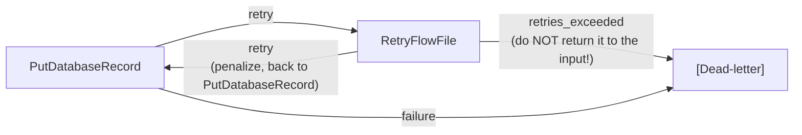
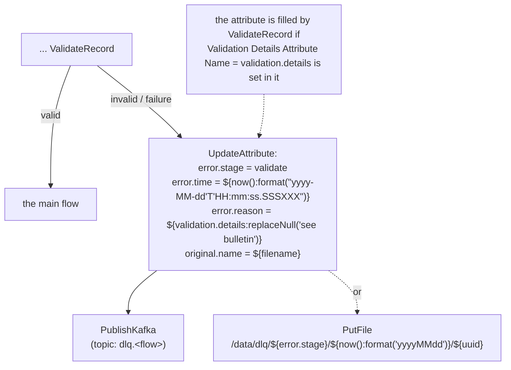
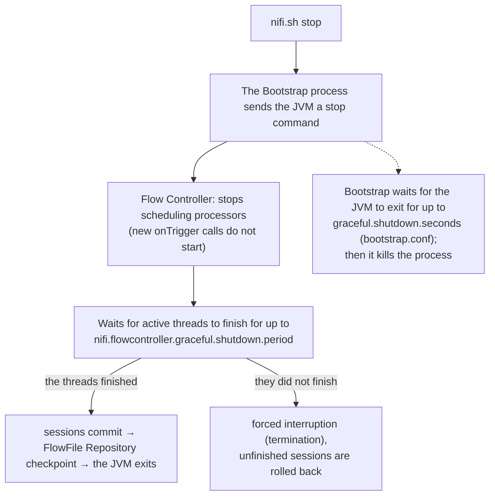
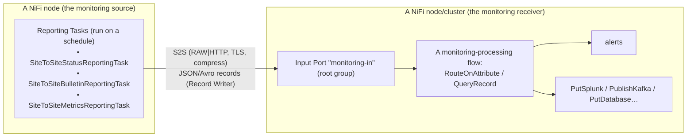
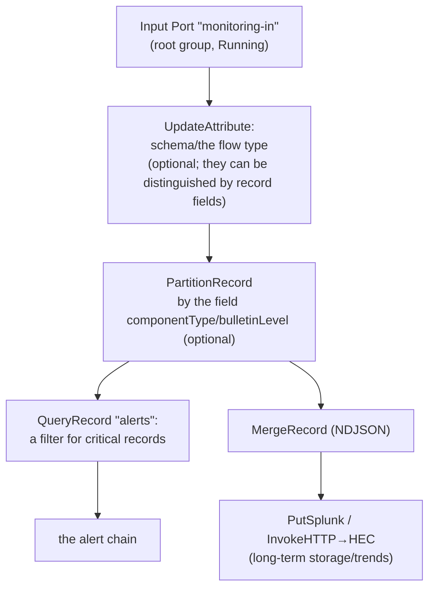

## Contents

- [Block 3.1: Fault tolerance and error handling](#block-31-fault-tolerance-and-error-handling)
- [Block 3.2: Monitoring, provenance and troubleshooting](#block-32-monitoring-provenance-and-troubleshooting)
- [Block 3.3: Security and governance](#block-33-security-and-governance)
- [Block 3.4: Performance tuning, hardware and storage](#block-34-performance-tuning-hardware-and-storage)
- [Block 3.5: Final hands-on lab: end-to-end pipeline](#block-35-final-hands-on-lab-end-to-end-pipeline)
- [Block 3.6: Course recap and next steps](#block-36-course-recap-and-next-steps)
- [Appendix A: The lab stand (Docker Compose)](Appendix-A.md)
- [Appendix B: List of sources and verification status](Appendix-B.md)

---

## Block 3.1: Fault tolerance and error handling

### 3.1.1 Designing resilient flows with minimal bottlenecks

**Principles.**

1. **Every relationship is handled.** For each processor, decide in advance: `success` — onward; `failure`/`invalid`/`retry` — to a separate path; auto-terminate only deliberately (for `LogAttribute.success`, etc.).
2. **Separate the types of errors.** Temporary ones (the network, an overloaded destination: *retry*) and permanent ones (the data is invalid: *dead-letter*). Retrying a permanent error is pointless and creates loops.
3. **Isolate points of failure.** One slow/unstable destination must not stop the other flows: separate destinations by Process Group and queues, and use independent queues and back pressure for each.
4. **Idempotency.** NiFi provides at-least-once internally and at the input/output; destinations must tolerate repeats (UPSERT, an event key, deduplication).
5. **Short transactions.** It is better to split large FlowFiles into reasonable batches (tens to hundreds of MB) so that a retry does not reprocess gigabytes.
6. **Observability on errors.** Add the cause of the error and context to the attributes (for example, `error.stage`, `error.message`, `retry.count`) so that DLQ analysis is possible without a rerun.

### 3.1.2 Failure and retry: relationships, framework-level retry, RetryFlowFile

**Framework-level retry (since 1.16.0).** Any relationship of a processor can be marked as *Retry*: the setting is in the processor dialog, on the *Relationships* tab. The parameters are the number of attempts (*Number of Retry Attempts*), the **Backoff Policy** (`Penalize` — a penalty on the FlowFile; `Yield` — a pause of the processor), and the **Maximum Backoff Period**. While attempts are not exhausted, the FlowFile is reprocessed by the same processor, and afterwards it goes along the relationship as usual. Advantage: no loops in the flow; disadvantage — it is a local solution on a single processor, without shared context.

**`RetryFlowFile`.** A processor for explicit control of retries in a flow ([a description of the `nifi-standard-nar` component in the Snowflake Openflow documentation mirror](https://docs.snowflake.com/en/user-guide/data-integration/openflow/processors/retryflowfile); the behavior of the counter and relationships is also confirmed by the implementation in [MiNiFi C++](https://apache.googlesource.com/nifi-minifi-cpp/+/656fca6f2331fe43915ebf4c83a56265fcb4790d/extensions/standard-processors/processors/RetryFlowFile.cpp); check separately against the component page on nifi.apache.org for your version). It checks the value of the **attempt counter** (stored in a FlowFile attribute — the *Retry Attribute*) against **Maximum Retries**: while the limit is not exceeded, it increments the counter and sends the FlowFile to `retry`; when it is exceeded — to `retries_exceeded`.



| Property | Purpose |
|---|---|
| **Retry Attribute** | The name of the counter attribute (`flowfile.retries` by default — **[verify]**). Updated with the current number of attempts |
| **Maximum Retries** | How many times a FlowFile can be retried before `retries_exceeded` (`3` by default — **[verify]**); the value may contain Expression Language |
| **Penalize Retries** | If `true`, the FlowFile is penalized before being sent to `retry` (does not apply to `retries_exceeded`) |
| **Fail on Non-numerical Overwrite** | If the *Retry Attribute* already contains something that is not a number: `false` — the value is reset to `1`; `true` — the FlowFile goes to `failure` |
| Dynamic properties | Any attributes that need to be **added to the FlowFile in `retries_exceeded`** (they support EL), for example `error.stage = retries_exceeded` |

**Relationships.**

| Relationship | Meaning | Where to connect |
|---|---|---|
| `retry` | The limit is not exhausted | **Back to the input** of the processor that failed: this creates a bounded loop |
| `retries_exceeded` | The limit is exhausted | **To the DLQ/error handling**; do not return it to the input, otherwise the loop becomes endless |
| `failure` | The counter is not numeric and *Fail on Non-numerical Overwrite* is on (or *Maximum Retries* does not evaluate to an integer) | To error handling |

**Additional attributes:** besides the counter, the processor writes `<Retry Attribute>.uuid` — the identifier of the processor that last retried the FlowFile.

**Pitfalls.**

1. **The counter does not reset by itself.** If a FlowFile successfully passed a retry and then landed in another `RetryFlowFile` with the same *Retry Attribute*, the old value will keep accumulating. Delete the attribute after success (`UpdateAttribute` → *Delete Attributes Expression*) or set different *Retry Attribute* names for different retry points.
2. **Penalty** (`30 sec` by default) protects the destination from a "storm" of retries: while a FlowFile is penalized, the processor does not take it. If **all** FlowFiles in the queue are penalized, the UI shows this, and the processor does not spin idly (an improvement in 1.16.0).
3. Do not use `RetryFlowFile` for **data errors** (`invalid`, `4xx`): a retry will change nothing.

**What to choose: framework retry or `RetryFlowFile`.**

| | Framework-level retry | `RetryFlowFile` |
|---|---|---|
| Where it is configured | In the processor dialog, on the *Relationships* tab | A separate processor in the flow |
| Extra components and loops | No | Yes (the `retry` loop) |
| Backoff | `Penalize`/`Yield`, **Maximum Backoff Period** (a growing pause) | The penalty is fixed (Penalty Duration) |
| Actions on exhaustion | The FlowFile goes along the relationship as usual | A separate `retries_exceeded` relationship with **additional attributes** (dynamic properties) |
| Context | Local, one processor | A single counter, visible in the attributes; it can be shared across several steps |

A practical rule: **framework retry by default**; `RetryFlowFile` — when you need a counter in the attributes, a shared limit for a chain of steps, or an explicit enrichment of the FlowFile when the attempts are exhausted.

**Exponential backoff.** For growing delays, use framework retry with a Backoff Policy and `Maximum Backoff Period`, or `RetryFlowFile` + `UpdateAttribute` computing the penalty.

**When not to use retry.** Data errors (a schema violation, `4xx` from an API, `invalid`) — straight to the DLQ. Authentication errors — after the attempts are exhausted, signal the operator (a bulletin/an alert).

### 3.1.3 Keeping the main flow running when failure queues fill up

**The problem.** As stated in [Block 1.2](day-1.md#block-12-building-data-flows), a processor stops being scheduled if **any** of its outgoing connections is filled to the back pressure threshold. Therefore the `failure` queue, which receives "garbage" (for example, due to a schema mismatch), will eventually fill up and **stop the entire main flow**, even though `success` is working.

**Solutions (combine them).**

| Technique | Essence | Risk/trade-off |
|---|---|---|
| **A high-capacity sink** | Connect `failure` to a processor that immediately pushes data out to disk/storage (`PutFile`, `PutS3Object`, `PublishKafka` to a DLQ topic) — the queue does not accumulate | Disk space/the DLQ needs to be monitored |
| **A dead-letter topic/store** | A centralized DLQ with error metadata; reprocessing on demand | Additional infrastructure |
| **Raised thresholds** on the failure connection | A higher back pressure threshold (for example, 100,000 / 10 GB) to buy time | This is a delay, not a solution |
| **FlowFile Expiration** on the failure connection | Automatic deletion after N hours | **Data loss**: acceptable only for non-critical/reproducible data |
| **Early separation** | `ValidateRecord`/`QueryRecord` separate the invalid records *before* the main chain; bad data does not interfere with good data | A more complex design, but the most resilient |
| **Alerts on the size of the failure queue** | Monitoring the queued count/size | Requires a configured monitoring system |
| **Different Process Groups for the branches** | The failure path is isolated and has its own resources | |

**The "Dead Letter" pattern (a typical implementation).**



DLQ best practices: keep the **original content unchanged** + the error attributes (in Kafka headers or in an accompanying JSON); limit the retention period; set up a *replay* procedure (a separate flow that reads the DLQ and feeds the data back after the cause is fixed); set up counters (`UpdateCounter`) and alerts on DLQ growth.

### 3.1.4 Restarting flows efficiently and minimizing manual intervention

**The goal of this subsection.** To learn (1) to stop and start NiFi and individual flows predictably and without data loss, (2) to reduce downtime on restart, (3) to automate the operator's typical actions, and (4) to build flows so that most failures disappear on their own, without calling a human.

Related blocks: back pressure and queues — [Block 1.2](day-1.md#block-12-building-data-flows); cluster roles and offload — [Block 1.4](day-1.md#block-14-installation-cluster-configuration-and-setup); backup/restore — 3.1.5; monitoring and alerts — Block 3.2; the sensitive key and security — Block 3.3.

#### What happens when NiFi stops and starts

**Stopping (`bin/nifi.sh stop`).**



Key parameters:

| Parameter | File | Default | What it controls |
|---|---|---|---|
| `nifi.flowcontroller.graceful.shutdown.period` | `nifi.properties` | `10 secs` | How long NiFi waits for components to finish on shutdown |
| `graceful.shutdown.seconds` | `bootstrap.conf` | `20` **[verify]** | How long Bootstrap waits for the JVM to exit before killing it |
| `nifi.flowcontroller.autoResumeState` | `nifi.properties` | `true` | Whether components return to their previous state after a restart |

**`nifi.flowcontroller.graceful.shutdown.period`**
- Source: [Administration Guide, the documentation source](https://github.com/apache/nifi/pull/11488/files).
- In the main branch (September 2026, NIFI-16290) the description was clarified: the same value also limits the wait for components to stop before a forced interruption during a **node offload** ([the commit](https://mail-archive.com/commits@nifi.apache.org/msg46395.html)). **[verify]** in which release this behavior is available to you.

**`graceful.shutdown.seconds`**
- `20` is the value from the NiFi Registry documentation; for NiFi, check your own `bootstrap.conf`.
- Changes take effect only after NiFi is stopped and started ([description](https://docs.cloudera.com/HDPDocuments/HDF3/HDF-3.0.1/bk_administration/content/bootstrap_properties.html)).

**`nifi.flowcontroller.autoResumeState`**
- Restores Running/Stopped for components and enabled/disabled for Controller Services ([Administration Guide](https://github.com/apache/nifi/pull/11488/files)).
- In a cluster the value must be the same on all nodes.

**What this means in practice.**

- 10 seconds is **little** for processors that perform long operations (a large `PutDatabaseRecord`, `MergeRecord`, a network write). If a thread did not finish during the wait, it is interrupted; the session is rolled back, the FlowFile returns to the queue, and the operation will be **repeated** after the start. For idempotent destinations this is safe; for non-idempotent ones it is a source of duplicates.
- Therefore, for a planned stop use a **"soft" sequence** (see [the order of stopping and starting](#the-order-of-stopping-and-starting-from-sources-to-sinks-and-back)): first stop the sources and let the pipeline drain, and only then stop the JVM.
- If `graceful.shutdown.seconds` in Bootstrap is smaller than the actual shutdown time (a large heap, a long checkpoint), Bootstrap will terminate the process by force. Increase the value and align it with the systemd/Kubernetes timeout (see [the process supervisor](#the-process-supervisor-systemd-and-kubernetes)).

**Starting.** The sequence: loading the NARs and extensions → reading `flow.json.gz` → restoring the **FlowFile Repository** (reading the WAL and snapshot, restoring the queues and swap files) → indexing/restoring the **Provenance Repository** → initializing the **Content Repository** (checking claims) → (in a cluster) connecting to ZooKeeper, flow election, joining the cluster → with `autoResumeState=true`, enabling Controller Services and starting processors.

#### Managing state after a restart: `autoResumeState`

`autoResumeState=true` (the default) is the ideal mode for **autonomous recovery**: after a crash or a planned restart the flow returns to a working state by itself, and no operator is needed. This property is what implements the "self-recovery" after a power failure, an OOM restart, or a container restart.

But there are situations in which auto-start is **harmful**:

| Situation | The risk with autoResume = true | What to do |
|---|---|---|
| Migration/upgrade ([Block 2.4](day-2.md#block-24-migration-from-nifi-1x-to-2x)) | Components that were not fully migrated start, and sources begin consuming before the flow has been checked | The first start after an upgrade — with `autoResumeState=false`; check the invalid/ghost components; then start manually/with a script |
| Restoring from a backup on a "foreign" environment | The processors start writing to **production** destinations | Start with `false`, replace the Parameter Context values, then start |
| Incident investigation | Uncontrolled repeated receipt of "poisonous" data | Start with `false`, examine the queues, then start group by group |
| A cluster: nodes with different values | Some nodes start, some do not → confusion | The same value on all nodes (manage it through IaC) |

The recommended scheme: **`true` in normal operation; `false` temporarily for the duration of work and recovery** through configuration (when configuration is managed through Ansible/Helm, the value is substituted by an environment parameter). After a restart with `false`, start the components **with a script** (see [automation via the REST API](#automation-the-rest-api-and-scripts-instead-of-manual-clicks)), in the right order.

#### The order of stopping and starting: from sources to sinks and back

The principle: **when stopping — sources first, then the rest in the direction of the data; when starting — sinks first, then sources.** Then there is no data in the system that has "nowhere to go", and there is no burst of retries.

**A planned pipeline stop (a runbook).**

1. Switch to maintenance mode: notify the consumers and, if necessary, freeze flow changes (organizationally).
2. **Stop the sources**: `ConsumeKafka`, `Listen*`, `List*`, `GenerateFlowFile`, `QueryDatabaseTable*`. For `ConsumeKafka` this results in committing the offsets of the processed data and in a rebalance of the group — plan for this in advance.
3. **Wait for the queues to drain** in the direction of the data: watch the queue counters and *Active Threads*; the criterion is that the queues are empty (or remain only in failure/DLQ — they survive a restart). Do not wait forever: set a time limit (for example, 5–15 minutes), after which a queue may be left on disk.
4. **Stop the processors** (group by group, in data order), then **disable the Controller Services** (Disable) — this releases the connections to the database and Kafka.
5. Stop NiFi (`bin/nifi.sh stop`) and wait for the process to finish; make sure from `nifi-bootstrap.log`/`nifi-app.log` that the shutdown was clean.
6. Perform the work.

**A planned start.**

1. Start NiFi; wait for the UI/API to become available and for the flow load to finish (with large repositories the start takes minutes).
2. Check: there are no invalid/ghost components, the Controller Services are enabled, and there are no bulletins (see the "Post-start checklist" section below).
3. Start the **sinks and the intermediate stages** (`Put*`, `InvokeHTTP`, `PublishKafka`), then the transformations, then the **sources**.
4. Watch the load for 10–15 minutes: the queues drain, there is no growth in back pressure, and no burst of errors.

**A special case — queues on disk.** Data in the queues survives a restart. After the sinks start, the accumulated backlog will begin to be processed at full speed; the destination must be ready for a "peak" load. For this use `ControlRate` or temporarily reduce `Concurrent Tasks` on the sinks.

#### Automation: the REST API and scripts instead of manual clicks

Every action in the UI is a call to the REST API (`/nifi-api`), so typical procedures can be automated. Below are illustrative examples; the paths `POST /access/token`, `PUT /flow/process-groups/{id}` (start and stop), `PUT /flow/process-groups/{id}/controller-services` (enabling and disabling services), and `GET /flow/process-groups/{id}/status` are confirmed by REST API descriptions and client libraries; check the request bodies and the structure of the responses against the REST API of your version, especially when using them in production. A secure environment needs authentication (a token, mTLS, or OIDC client credentials — see Block 3.3); **do not keep passwords in scripts**, use the secret store of the CI/orchestrator.

**Getting a token (Single User/LDAP) — an example for a lab.**

```bash
NIFI=https://nifi-1.example.com:8443/nifi-api
TOKEN=$(curl -s --cacert ca.pem -X POST "$NIFI/access/token" \
        -d "username=$NIFI_USER&password=$NIFI_PASS")
```

**Stopping/starting all components of a Process Group.**

```bash
PG_ID=<group id>
# STOP: send the STOPPED state to all scheduled components of the group
curl -s --cacert ca.pem -H "Authorization: Bearer $TOKEN" -H 'Content-Type: application/json' \
     -X PUT "$NIFI/flow/process-groups/$PG_ID" \
     -d "{\"id\":\"$PG_ID\",\"state\":\"STOPPED\"}"

# START
curl -s --cacert ca.pem -H "Authorization: Bearer $TOKEN" -H 'Content-Type: application/json' \
     -X PUT "$NIFI/flow/process-groups/$PG_ID" \
     -d "{\"id\":\"$PG_ID\",\"state\":\"RUNNING\"}"
```

**Enabling the group's Controller Services** — a similar `PUT` to the resource `/flow/process-groups/{id}/controller-services` with `"state":"ENABLED"` (the body is `{"id":"<group id>","state":"ENABLED"}`).

**Waiting for the stop (so as not to start the next step too early).**

```bash
# We wait until no active processor threads remain in the group
until [ "$(curl -s --cacert ca.pem -H "Authorization: Bearer $TOKEN" \
      "$NIFI/flow/process-groups/$PG_ID/status" \
      | jq '[.. | .activeThreadCount? // empty] | add')" = "0" ]; do
  sleep 5
done
```

(The structure of the status JSON depends on the version; the idea is to sum `activeThreadCount`.)

**The NiFi CLI (from the NiFi Toolkit).** It contains commands for managing Process Groups and flow versions (for example, starting/stopping a group, enabling services, changing a version, working with Flow Registry Clients; commands for managing Flow Registry Clients were added in 2.1.0 — [Release Notes 2.1.0](https://cwiki.apache.org/confluence/display/NIFI/Release+Notes)). For the list of commands, see the [Toolkit Guide](https://nifi.apache.org/docs/nifi-docs/html/toolkit-guide.html).

Automation brings three results: reproducibility (the same sequence every time), speed (minutes instead of hours of clicking), and the ability to run procedures on a schedule/from CI without a human.

#### The process supervisor: systemd and Kubernetes

In NiFi 1.x, Bootstrap could send notifications about the start, the stop, and an **unexpected crash** of NiFi through Notification Services. In 2.x **the Bootstrap Notification Services were removed** (2.0.0-M2, [Release Notes](https://cwiki.apache.org/confluence/display/NIFI/Release+Notes)), and Bootstrap was reworked (monitoring over HTTP, 2.0.0). Consequently, **crash notification and a guaranteed restart must be provided by an external supervisor and monitoring**.

**systemd (Linux, a single node/VM).**

```ini
# /etc/systemd/system/nifi.service  (an illustration; adapt it to your installation)
[Unit]
Description=Apache NiFi
After=network-online.target
Wants=network-online.target

[Service]
Type=forking
User=nifi
Group=nifi
Environment=JAVA_HOME=/usr/lib/jvm/java-21
ExecStart=/opt/nifi/bin/nifi.sh start
ExecStop=/opt/nifi/bin/nifi.sh stop
ExecReload=/opt/nifi/bin/nifi.sh restart
LimitNOFILE=50000
LimitNPROC=10000
Restart=on-failure
RestartSec=30
TimeoutStartSec=900
TimeoutStopSec=180

[Install]
WantedBy=multi-user.target
```

Notes: `TimeoutStopSec` must be **greater** than the time of a clean shutdown (the graceful period + `graceful.shutdown.seconds`); `TimeoutStartSec` — large enough for repository recovery; `LimitNOFILE` — a large number of file descriptors (many claim files and connections). Check the `forking`/`Restart` type on your distribution: `nifi.sh start` launches a daemon, and the behavior depends on the form of the launch (**[verify]**; the alternative is `nifi.sh run` with `Type=simple`).

**Kubernetes.**

- Use a **StatefulSet** with stable identities and persistent volumes for the repositories; `terminationGracePeriodSeconds` — longer than the time of a clean shutdown; `preStop` can run a "soft" stop script (stop the sources → wait).
- **Probes:** a `startupProbe` with a large `failureThreshold` (starting NiFi with large repositories takes minutes), otherwise the kubelet will kill a pod that is "still loading"; a `livenessProbe` that is not too aggressive (a GC pause must not lead to a restart); a `readinessProbe` — by API readiness (**[verify]** which endpoints are available without authentication in your configuration; a TCP port check is often used).
- A **PodDisruptionBudget** (no more than one node unavailable) and a **rolling update one node at a time** with a wait for readiness are recommended.
- In 2.x **Kubernetes-based leader election** is available without ZooKeeper ([Block 1.4](day-1.md#block-14-installation-cluster-configuration-and-setup)).

#### A cluster rolling restart without downtime

The goal is to update/restart the nodes one at a time so that the cluster keeps processing data the whole time.

1. **Preconditions:** the cluster is healthy (all nodes CONNECTED, ZooKeeper quorum), there are no invalid components; a decision has been made that sufficient capacity remains when one node is taken out.
2. **Node N → Disconnect** (UI: Cluster → Disconnect). The node stops receiving cluster requests but keeps running.
3. **Offload** (Cluster → Offload): the node stops accepting new data from the sources and **hands its FlowFiles** to the other nodes through load balancing. Wait for the OFFLOADED state. For a successful offload, balancing must be possible on the connections; FlowFiles on connections with balancing disabled may get "stuck" — check this before the offload. The offload is limited by the wait time for components to stop (see the graceful period above).
4. **Stop NiFi on the node** and perform the work (an update, an OS restart, a configuration change).
5. **Start it** and wait for the load; the node **joins (Reconnect)** and synchronizes the flow with the cluster (since 1.16.0 — even with a substantially different local flow, keeping a backup of its own). If the node was offloaded, perform *Connect*.
6. **A health check** before the next node: the node is CONNECTED; there are no invalid components; the queue is balanced; (for Kafka) there is no burst of rebalances and lag; the metrics are normal.
7. Repeat for the remaining nodes. The **Primary Node** and the **Cluster Coordinator** are re-elected on restart — the *Primary Node Only* processors (`List*`, `QueryDatabaseTable*`) will move to a new node, and the state is taken from the cluster state.

**What speeds up a simultaneous cluster restart.** When all nodes start at the same time, a **flow election** takes place: the nodes wait for up to `nifi.cluster.flow.election.max.wait.time` or until `nifi.cluster.flow.election.max.candidates` candidates are collected ([Migration Guidance 1.0→1.1](https://cwiki.apache.org/confluence/display/NIFI/Migration+Guidance)). If `max.candidates` equals the number of nodes, the election finishes immediately after all nodes have connected, rather than on a timeout.

**2.x restrictions for a TLS cluster.** Since 2.12.0, `nifi.cluster.node.address` and `nifi.cluster.load.balance.host` must be DNS names; after changing images/addresses, check this first ([Migration Guidance 2.12.0](https://cwiki.apache.org/confluence/display/NIFI/Migration+Guidance)).

#### What slows down a restart and how to reduce it

| Factor | Why it slows things down | Measure |
|---|---|---|
| Huge queues (millions of FlowFiles) | Reading the WAL/snapshot, restoring swap files | Keep queues small (back pressure, prompt draining); address the causes of accumulation |
| A large FlowFile Repository / infrequent checkpoints | A long journal replay | Tune `nifi.flowfile.repository.checkpoint.interval`; slow disks → fast ones (NVMe for the WAL) |
| A large Provenance Repository | Restoring the indexes | Reduce the retention period/size; an isolated fast volume (Block 3.4) |
| Many Controller Services and "external" checks | Enabling services waits for connections to the database/Kafka | Short connection timeouts; dependencies available before the start |
| Flow election by timeout | Waiting for `max.wait.time` | Set `max.candidates` = the number of nodes |
| A slow shutdown (GC pauses, a large heap) | Bootstrap kills the process → a long recovery after a "dirty" exit | Correct timeouts; a clean stop of the sources before the restart |
| A dirty exit (`kill -9`, a power loss) | Recovery after incomplete writes | Avoid it; use `nifi.sh stop` |

#### Self-recovery at the flow level: so that no human is needed

Restarting the process is a last resort. Most failures should be resolved **without a restart**, inside the flow:

| Failure | The automatic mechanism | Configuration |
|---|---|---|
| The destination is temporarily unavailable | Framework retry with backoff; `Yield Duration`; a queue + back pressure | Retry on relationships; adequate timeouts |
| A failure of individual data | Routing to the DLQ; the main flow is not blocked | Block 3.1.3 |
| A lost connection to the database/Kafka | The controller service/client reconnects; the processor repeats `onTrigger` | The Validation Query of DBCP, timeouts; Kafka client reconnect |
| A processor "hung" on an external call | Timeouts in the processor (Connection/Read Timeout) | Always set explicit timeouts |
| A controller service did not enable (a dependency was unavailable) | The framework periodically tries to enable the service again (the behavior depends on the version — **[verify]**); fixes are known for the "services do not start after a restart" scenarios ([Release Notes 1.28.0](https://cwiki.apache.org/confluence/display/NIFI/Release+Notes)) | Monitoring the state of the services + an alert |
| A JVM crash | A supervisor (systemd/Kubernetes) + `autoResumeState=true` + the WAL | [The process supervisor](#the-process-supervisor-systemd-and-kubernetes) |
| A node dropped out of the cluster | The node automatically returns and the flow synchronizes | Correct heartbeat/timeouts, a stable network |
| A source is idle (no data) | `MonitorActivity` → an alert | Block 3.2 |

**A watchdog flow (optional).** A simple "guard" inside NiFi or (preferably) in an external orchestrator: it periodically reads the status through REST/Site-to-Site Reporting Tasks (see the subsection "Site-to-Site Reporting Tasks" in Block 3.2), detects signs of a hang (*processor invalid*, a queue that does not shrink with an active destination, `activeThreadCount > 0` for too long) and calls the API (Stop → wait → Start) or raises an alert. Recommendations: (a) limit automatic actions by the **number of attempts** and a "cooldown" (otherwise there will be an endless loop of restarts); (b) make API calls from an external system with minimal permissions; (c) for critical actions, leave confirmation to a human.

**Flow design principles that reduce manual intervention:**

1. Environment parameters live in Parameter Contexts (changing a value does not require editing the flow).
2. No "loops without a counter" (a retry is always bounded).
3. Every failure branch has a sink and an alert.
4. All external calls have timeouts.
5. Destinations are idempotent → a restart and repeats are safe.
6. State is kept in state/in Kafka/in the destination, not "in the operator's head" (offsets, `List*` state).
7. All operations (stop/start/clear/replay) are described in a runbook and automated.

#### Checklists

**Before a planned restart:** the sources are stopped; the queues are emptied (or deliberately left); the Controller Services are disabled; a backup of `conf/`, `state/local`, and the keys has been made (3.1.5); there is a rollback plan; the window is agreed.

**After the start (validation, ≈10–15 minutes):**

- [ ] All nodes are CONNECTED, the Coordinator/Primary roles are elected.
- [ ] There are no invalid/ghost components (UI: Summary; search for `invalid`).
- [ ] All required Controller Services are *Enabled*.
- [ ] There are no ERROR bulletins (or they are explained).
- [ ] The queues are draining, there are no queues at back pressure.
- [ ] Kafka: the consumer group has stabilized, the lag is not growing.
- [ ] There is no unexpected growth of the DLQ.
- [ ] The heap/GC/disk metrics are normal.

#### Common problems after a restart

| Symptom | Probable cause | Solution |
|---|---|---|
| After the start all processors are stopped | `autoResumeState=false`, or the flow was loaded "without state" | Start them with a script/manually; return `true` after the work |
| A node does not join the cluster | Different `nifi.sensitive.props.key`; DNS/TLS (SAN, 2.12+); ZooKeeper is unavailable | Check the key, certificates, `nifi.cluster.*`; the `nifi-app.log` logs |
| A Controller Service does not enable | The database/Kafka is unavailable; wrong parameters | Check the dependency; Disable → Enable |
| A processor is `invalid` after a restart | An external check (for example, a Kafka topic) does not pass | Check availability and permissions; Verify in the UI |
| A slow start | Large queues/repositories | See [what slows down a restart](#what-slows-down-a-restart-and-how-to-reduce-it) |
| Duplicates at the destination after a restart | At-least-once: interrupted operations are repeated | Destination idempotency |
| Repeated listing of files/tables | The state was lost/cleared | Restore `state/local` or accept a reload |
| A burst of Kafka rebalances | A restart of the consumers | A staggered restart (one node at a time), the required version ≥ 2.8.0 |
| A 2.x node does not start after a rollback from 2.14 | The new local state format | Restore `state/local` from the backup ([Block 2.4](day-2.md#block-24-migration-from-nifi-1x-to-2x)) |

#### Mini-lab 3.1.4: a training restart under load

**Goal.** Make sure the pipeline survives a planned and an emergency restart without losses, and that repeats are acceptable.

**Steps.**

1. Run the pipeline from Lab 7 or Block 3.5 with load.
2. **A planned restart:** follow the runbook from [the order of stopping and starting](#the-order-of-stopping-and-starting-from-sources-to-sinks-and-back) (stop the sources → drain → stop → start → sinks → sources). Measure the stop/start time.
3. **An emergency restart:** send `kill -9` to the NiFi JVM process (**in a lab only**). Observe: the supervisor brings NiFi back up, and with `autoResumeState=true` the flow starts by itself.
4. Compare the number of records at the input and at the destination; count the duplicates (the event key).
5. Repeat with `autoResumeState=false` and start the flow with the script from [automation via the REST API](#automation-the-rest-api-and-scripts-instead-of-manual-clicks).
6. Formulate conclusions: how many duplicates are acceptable; how long the recovery took; what to automate.

**Verification.** There is no data loss; duplicates were detected and handled by the destination (UPSERT/a key); after the restart there are no invalid components; the recovery time is recorded.

### 3.1.5 Backup and restore: configuration, flow definitions, keys

| What | Where | Why | Frequency |
|---|---|---|---|
| `conf/flow.json.gz` | `NIFI_HOME/conf/` | The current flow | Regularly + before changes; NiFi keeps versions in `conf/archive/` |
| Flow versions in the Registry (Git) | A Git repository | The main mechanism for rolling back logic | Every change (a commit) |
| `nifi.properties`, `bootstrap.conf`, `logback.xml`, `state-management.xml` | `conf/` | The node configuration | On change (under CM/IaC control) |
| `authorizers.xml`, `users.xml`, `authorizations.xml`, `login-identity-providers.xml` | `conf/` | Users, groups, policies | Regularly |
| **`nifi.sensitive.props.key`** | `nifi.properties` / a secret store | Without it the sensitive values in the flow cannot be decrypted | Store it separately and reliably |
| Certificates and keys (keystore/truststore/PEM) | The file system/a secret store | TLS | Per the PKI procedure |
| `state/local` and the cluster state (ZooKeeper) | `state/`, ZooKeeper | The `List*` positions, incremental extractions | Before upgrades and regularly |
| Repositories (FlowFile/Content/Provenance) | Data volumes | Data "in flight"; provenance | Volume snapshots during planned work (a consistent hot backup is non-trivial) |
| `database_repository` | A directory | The flow change history | As needed |

**Note.** A "hot" backup of the repositories by file copying may be inconsistent; for a consistent snapshot, stop NiFi or use block-device-level snapshots that take the related repositories into account. In most scenarios, **data in flight is considered re-obtainable** (from Kafka, files), and the backup concentrates on the flow, the configuration, the keys, and the state.

**Restore (the sequence).** 1) Install the same (or a compatible) NiFi version; 2) restore `conf/` and the keys; 3) make sure `nifi.sensitive.props.key` matches; 4) restore the state (if necessary); 5) start; 6) check the validity of the components; 7) enable the sources.

In 2.12.0 a framework abstraction **PropertyEncryptionProvider** for encrypting properties was added ([Release Notes 2.12.0](https://cwiki.apache.org/confluence/display/NIFI/Release+Notes)); when it is used, the provider's keys also become part of the backup.

### Lab 7: a flow with retry and error handling

**Goal.** Build a flow that survives temporary failures of the destination and does not get blocked by "bad" data.

**Architecture.**

```text
GenerateRecord ► ValidateRecord ─ invalid ─► [DLQ group]
                     │ valid
                     ▼
              InvokeHTTP (an endpoint that simulates failures)
                 ├ Original (2xx) ► PutFile #{ok.dir}
                 ├ Response ► LogAttribute
                 ├ Retry ──► RetryFlowFile ─ retry ► (penalize) ► InvokeHTTP
                 │                 └ retries_exceeded ► [DLQ group]
                 ├ No Retry ───────────────────────────────► [DLQ group]
                 └ Failure ► RetryFlowFile (the same one)
[DLQ group]: UpdateAttribute (error.*) ► PutFile #{dlq.dir}/${error.stage} (with a high back pressure threshold)
```

`Original` is the source FlowFile of the request after a 2xx response (it is the one that makes sense to put into `ok`); `Response` is the response body (here `{}`).

The Parameter Context `lab7-params` (the stand): `flaky.url=http://flaky:9099/events`, `ok.dir=/opt/nifi/data/ok`, `dlq.dir=/opt/nifi/data/dlq` (on the host — `nifi/data/ok`, `nifi/data/dlq`).

**A data source with invalid records.** `GenerateRecord` produces records strictly according to its schema, so without preparation the `invalid` branch is empty. Declare the fields in the generator schema as `["null", …]` and set `Nullable Fields = true`, `Null Value Percentage = 5`, and in `ValidateRecord` (Schema Access Strategy `Use 'Schema Text' Property`) validate against a strict schema in which all fields are required: records with `null` will go to `invalid`.

**Simulating an unstable API.** On the stand the service is already running: the container `flaky` (`make lab-services`, the code is `lab-services/flaky.py`), the address from NiFi is `http://flaky:9099/events`. Without the stand:

```bash
python3 - <<'EOF'
import random
from http.server import BaseHTTPRequestHandler, HTTPServer
class H(BaseHTTPRequestHandler):
    def do_POST(self):
        self.rfile.read(int(self.headers.get('Content-Length', 0)))
        r = random.random()
        code = 200 if r < 0.6 else (503 if r < 0.9 else 400)   # 60% ok, 30% 503, 10% 400
        self.send_response(code); self.end_headers(); self.wfile.write(b'{}')
HTTPServer(('0.0.0.0', 9099), H).serve_forever()
EOF
```

**Configuration.**

| Component | Setting |
|---|---|
| `GenerateRecord` | Schema Text — a schema with `["null", …]` fields; Number of Records `5`; Nullable Fields `true`; Null Value Percentage `5`; Run Schedule `2 sec` |
| `ValidateRecord` | Schema Access Strategy `Use 'Schema Text' Property` — a strict schema (all fields required); Strict Type Checking `true`; Validation Details Attribute Name `validation.details` |
| `InvokeHTTP` | URL `#{flaky.url}`; POST; Connection/Read Timeout — `5 sec` each; Concurrent Tasks `2` |
| `RetryFlowFile` | Maximum Retries `3`; Penalize Retries `true`; Retry Attribute — the default; the dynamic property `error.stage` = `retries_exceeded`. The penalty value is *Penalty Duration* on the Settings tab (for example, `10 sec`) |
| The connection `...► DLQ` | Back Pressure Object Threshold `100000`, Size `10 GB` |
| `UpdateAttribute` (before the DLQ) | `error.stage` = `validation` / `http-${invokehttp.status.code}` / `retries-exceeded` (depending on the error path); `filename` = `${uuid}.json` |
| `PutFile` (DLQ) | Directory `#{dlq.dir}/${error.stage}`; Conflict Resolution `replace` (names by `${uuid}`) |

**Verification** (from the stand host):

- After a few minutes most FlowFiles are in `nifi/data/ok` (`ls nifi/data/ok | wc -l`); `400` responses — in `nifi/data/dlq/http-400`, invalid records — in `nifi/data/dlq/validation`; `503` responses pass through `RetryFlowFile` (FlowFiles with a penalty are visible in the `InvokeHTTP → RetryFlowFile` queue).
- `retries_exceeded` almost never occurs while `flaky` is running: four `503` responses in a row are needed (~1%). Stop the service — `docker stop flaky`: requests go to `Failure`, after 3 retries with a penalty `nifi/data/dlq/retries-exceeded` appears, the queue before `InvokeHTTP` grows, and then back pressure kicks in; after `docker start flaky` the queue drains *without intervention*.
- Check provenance: a FlowFile with several attempts has a chain of `ROUTE`/`SEND` events; the `flowfile.retries` attribute shows the number of attempts.

**Mistakes and diagnostics.** A loop without a counter (retry → the same processor, without `RetryFlowFile`) — endless retries; the `Failure` queue is not empty and blocks the source — it must be routed to a sink; the DLQ directory fills the disk — add monitoring (`MonitorDiskUsage`) and cleanup; the `invalid` branch is always empty — the generator produces only records that are valid according to its own schema (see "A data source with invalid records").

**Reference solution:** `nifi/flows/lab7-retry-errors.json`.

---

## Block 3.2: Monitoring, provenance and troubleshooting

### 3.2.1 The NiFi UI, metrics, Provenance, bulletins

**The UI.**

| Tool | What it shows |
|---|---|
| The canvas: counters on processors and connections | In/Out, Read/Write, Tasks/Time (CPU time), queue sizes, the back pressure indicator |
| **Status History** | Graphs of a component's metrics over time (including at the cluster level by node) |
| **Summary** (the global menu) | Summary tables by processors, connections, ports, Process Groups; sorting by Tasks/Time, etc. |
| **Bulletin Board** | All bulletins (with the level, source, node); in 2.7.0 a stack trace and clearing were added |
| **Counters** | User counters (`UpdateCounter`) |
| **System Diagnostics** | Heap, GC, threads, repository sizes, load |
| **Cluster** | Nodes, roles, heartbeat, load by node |
| **Flow Configuration History** | An audit of changes (Block 3.3) |
| **Data Provenance** | Search and visualization of events |

**The Provenance Visualizer (the Lineage graph).** For a selected FlowFile it shows a graph of events: `RECEIVE`/`CREATE` → `ROUTE`, `CONTENT_MODIFIED`, `CLONE`/`FORK`/`JOIN`, `SEND` → `DROP`. For each event the following are available: attributes before/after, the **content before/after** (if the retention period in the Content Repository/archive has not expired and you have permission for the data), and the ability to **Replay** (resending the FlowFile at the point of the event). In 2.8.0 the lineage UI shows the component type next to the node ([Release Notes 2.8.0](https://cwiki.apache.org/confluence/display/NIFI/Release+Notes)).

The main event types: `RECEIVE`, `FETCH`, `CREATE`, `SEND`, `ROUTE`, `CLONE`, `FORK`, `JOIN`, `CONTENT_MODIFIED`, `ATTRIBUTES_MODIFIED`, `DROP`, `EXPIRE`, `REPLAY`, `DOWNLOAD`.

**Metrics for external monitoring.**

- **Prometheus:** a REST metrics endpoint (since 1.12.0, [Release Notes 1.12.0](https://cwiki.apache.org/confluence/display/NIFI/Release+Notes); `/nifi-api/flow/metrics/prometheus`) and `PrometheusReportingTask`. In 2.13.0 the metrics `cluster_is_primary_node` and `cluster_is_cluster_coordinator` were added; in 2.12.0 the `connected_nodes` label was removed from `cluster_connected_node_count` ([Migration Guidance](https://cwiki.apache.org/confluence/display/NIFI/Migration+Guidance)).
- **Site-to-Site Reporting Tasks:** sending statuses, bulletins, and metrics to a receiving NiFi (`SiteToSiteStatusReportingTask`, `SiteToSiteBulletinReportingTask`, `SiteToSiteMetricsReportingTask`) — in detail in the subsection "Site-to-Site Reporting Tasks: in detail" below.
- **Key metrics for alerts:** the size/number of FlowFiles in queues and the back pressure indicator; the age of the oldest FlowFile in a queue; heap usage percentage and GC time; repository fill levels (`MonitorDiskUsage`); the number of active threads; the number of errors (ERROR bulletins); CONNECTED nodes; the Kafka consumer group lag (in an external system); the time since the last activity (`MonitorActivity`).

**Logs.**

| File | Contents |
|---|---|
| `nifi-app.log` | The main log of the application and the processors |
| `nifi-bootstrap.log` | JVM start/stop/restart |
| `nifi-user.log` | User actions, authorization requests |
| `nifi-request.log` | HTTP requests (since 1.16.0) |
| `nifi-deprecation.log` | Warnings about the use of deprecated components (since 1.18.0) |

#### Site-to-Site Reporting Tasks: in detail

This subsection expands on the item "sending statuses and bulletins to NiFi itself/to other systems" (`SiteToSiteStatusReportingTask`, `SiteToSiteBulletinReportingTask`, `SiteToSiteMetricsReportingTask`). All three tasks are part of the `nifi-site-to-site-reporting-nar` bundle and are present in the 2.x documentation (for example, 2.10.0 — [the reference](https://nifi.incubator.apache.org/components/org.apache.nifi.reporting.SiteToSiteMetricsReportingTask)). The description of the properties below is based on the component references (versions 1.27–1.28 and 2.0.0-M2/M3, [Status](https://nifi.apache.org/docs/nifi-docs/components/org.apache.nifi/nifi-site-to-site-reporting-nar/1.28.0/org.apache.nifi.reporting.SiteToSiteStatusReportingTask), [Metrics](https://nifi.apache.org/docs/nifi-docs/components/org.apache.nifi/nifi-site-to-site-reporting-nar/1.28.0/org.apache.nifi.reporting.SiteToSiteMetricsReportingTask)); check the exact names and default values in your version in the built-in documentation (**[verify]**).

##### Why this is needed

The NiFi UI shows the status "here and now" and a short history (Status History). This is not enough for operations: you need **long-term trends, alerts, and correlation with other systems**. There are two approaches:

| Approach | Essence | When to choose it |
|---|---|---|
| **Pull** (Prometheus, the REST API) | An external system polls NiFi itself | Prometheus/Grafana is already in place; node and JVM metrics are needed |
| **Push through Site-to-Site Reporting Tasks** | NiFi itself forms records about status/bulletins/metrics and sends them **to an Input Port of another (or the same) NiFi**, where they are processed by an ordinary flow | You need to process monitoring data with NiFi tools (filtering, enrichment, routing to Splunk, Kafka, a database, e-mail, chat); there is no way to install Prometheus; bulletin events are needed as a stream |

The strength of the push approach: monitoring data is ordinary **records**, which means that everything you already know from Day 1–2 applies to it: `QueryRecord`, `PartitionRecord`, `PutSplunk`, `PublishKafka`, the DLQ, back pressure.

##### What Site-to-Site (S2S) is

**Site-to-Site** is a built-in protocol for transferring FlowFiles between NiFi instances (and from MiNiFi/client libraries). The receiving side publishes a **Remote Input Port** (an Input Port of the root group); the sending side connects by the NiFi URL and writes into the port by name. Two transports (the *Transport Protocol* property): `RAW` (a socket; the default) and `HTTP` (convenient through proxies/load balancers). S2S supports compression, batches, and distribution across the nodes of the receiving cluster: **the address in the Destination URL is used only to establish the connection, while the data itself is balanced across all nodes of the target cluster** ([the Status reference](https://nifi.apache.org/docs/nifi-docs/components/org.apache.nifi/nifi-site-to-site-reporting-nar/2.0.0-M3/org.apache.nifi.reporting.SiteToSiteStatusReportingTask/index.html)).

##### Architecture



Options for placing the receiver:

1. **The same NiFi/cluster** (the Destination URL points to itself). Simple to set up, but **monitoring dies together with the system**: if NiFi is stopped, there will be no alert.
2. **A separate "monitoring" NiFi** (a small cluster/instance). The recommended option for production: failures of the main cluster do not interfere with alerts. The limitation is that one more instance has to be operated.
3. **Several receivers** — separate tasks for different recipients (for example, security and operations).

##### Properties common to all three tasks

| Property | Purpose | Default value / notes |
|---|---|---|
| **Destination URL** | The URL of the receiving NiFi (for a cluster — a comma-separated list of addresses, in the format `http(s)://host:port/nifi`) | Used only for the initial connection; the data is balanced across the receiver's nodes |
| **Input Port Name** | The name of the receiver's Input Port | Must match exactly |
| **SSL Context Service** | TLS settings for sending | If not set, the connection is **not secured**; always set it in production |
| **Instance URL** | The URL of this instance, placed in the Content URI of the event | By default `http://${hostname(true)}:8080/nifi` — **for an HTTPS deployment (port 8443) be sure to correct it** |
| **Compress Events** | Compression of the data during transfer | `true` |
| **Communications Timeout** | How long to wait for the receiver's response | `30 secs` |
| **Batch Size** | The maximum number of records in one batch (for Status/Bulletin) | `1000` |
| **Transport Protocol** | `RAW` or `HTTP` | `RAW` |
| HTTP Proxy hostname/port/username/password | A proxy for `HTTP` mode | The password is sensitive |
| **Record Writer** | A Controller Service for serializing records | For example, `JsonRecordSetWriter` (mandatory for Status/Bulletin; for Metrics — with the `Record Format`) |
| **Include Null Values** | Whether to output fields with the value `null` | `false` |
| **Platform** | The value of the `platform` field in the records | `nifi`; it is convenient to set an "environment/cluster" (`prod-eu`, `test`) to separate flows at the receiver |

Properties with Expression Language are evaluated against **environment variables/system properties** (the *Environment* scope; in 1.x — the Variable Registry, removed in 2.0). A separate note: reporting tasks are created at the controller level (Global menu → Controller Settings → Reporting Tasks), not inside a Process Group — **Parameter Contexts are not applicable to them** (**[verify]**), so substitute environment values through the task configuration or through EL/environment variables.

##### SiteToSiteStatusReportingTask

**What it sends:** periodic "snapshots" of the status of components: processors, Process Groups (including the root one), Remote Process Groups, connections, and input/output ports. Each record is one component at one moment in time.

**Filters (so as not to send the unnecessary):**

| Property | Default | Purpose |
|---|---|---|
| Component Type Filter Regex | `(Processor|ProcessGroup|RemoteProcessGroup|RootProcessGroup|Connection|InputPort|OutputPort)` | Which component types to send. For example, `(Processor|Connection)` — only processors and queues |
| Component Name Filter Regex | `.*` | A filter by component name |

Important: the filters form an intersection (a record must match both); at the same time, all Process Groups are traversed recursively regardless of whether the group itself matches the component filters ([the reference](https://nifi.apache.org/docs/nifi-docs/components/org.apache.nifi/nifi-site-to-site-reporting-nar/1.27.0/org.apache.nifi.reporting.SiteToSiteStatusReportingTask/index.html)).

**The record fields (an excerpt from the schema, [additionalDetails](https://nifi.apache.org/docs/nifi-docs/components/org.apache.nifi/nifi-site-to-site-reporting-nar/1.27.0/org.apache.nifi.reporting.SiteToSiteStatusReportingTask/additionalDetails.html)):**

| Group | Fields |
|---|---|
| Identification | `statusId`, `timestamp`, `timestampMillis`, `actorHostname`, `componentType`, `componentName`, `componentId`, `parentId`, `parentName`, `parentPath`, `platform`, `application` |
| Volumes | `bytesRead`, `bytesWritten`, `inputCount`, `inputBytes`, `outputCount`, `outputBytes`, `bytesTransferred`, `flowFilesTransferred` |
| Queues/back pressure | `queuedCount`, `queuedBytes`, `maxQueuedCount`, `maxQueuedBytes`, `backPressureObjectThreshold`, `backPressureBytesThreshold`, `backPressureDataSizeThreshold`, `isBackPressureEnabled` |
| Processors | `processorType`, `runStatus`, `averageLineageDurationMS`, `terminatedThreadCount`, `counters` (a map) |
| Remote Process Group | `activeRemotePortCount`, `inactiveRemotePortCount`, `transmissionStatus`, `targetURI` |

**Practical use:**

- *Long-term trends* of the throughput of each processor and of queue sizes (the UI keeps only a limited history).
- *Early detection of back pressure*: the condition `isBackPressureEnabled = 'true'` (in the schema the field is of a string type).
- *Detecting stopped/invalid components*: `runStatus` differs from the expected one (`Running`).
- *Load reports by Process Group/team*.

##### SiteToSiteBulletinReportingTask

**What it sends:** bulletins (ERROR/WARN/INFO) from all components — as an event stream. This gives what metrics do not: **the text of the cause of the error**.

The properties are the common ones (see the table above): Destination URL, Input Port Name, SSL Context Service, Instance URL, Compress Events, Communications Timeout, Batch Size, Transport Protocol, Record Writer, Include Null Values, Platform.

**The record fields** (the schema from the [task reference](https://nifi.apache.org/docs/nifi-docs/components/org.apache.nifi/nifi-site-to-site-reporting-nar/1.7.1/org.apache.nifi.reporting.SiteToSiteBulletinReportingTask/additionalDetails.html)): `objectId`, `platform`, `bulletinId`, `bulletinCategory`, `bulletinGroupId`, `bulletinGroupName`, `bulletinGroupPath`, `bulletinLevel`, `bulletinMessage`, `bulletinNodeAddress`, `bulletinNodeId`, `bulletinSourceId`, `bulletinSourceName`, `bulletinSourceType`, `bulletinTimestamp` (the format `yyyy-MM-dd'T'HH:mm:ss.SSS'Z'`), `bulletinFlowFileUuid`.

**Practical use:**

- Alerts on `ERROR` with the cause text and the component name.
- Correlating failures in time with incidents in external systems.
- Auditing the "noise": which components write errors most often.

**A peculiarity (confirmed by the task reference).** No more than **5 bulletins per component and 10 at the controller level are kept, for no longer than 5 minutes**; if the task is not run often enough, some bulletins will not be sent. Therefore **the run interval must be noticeably shorter than 5 minutes** (in the example below — 30 seconds), and when there are many errors on one component, some messages are lost in any case.

##### SiteToSiteMetricsReportingTask

**What it sends:** the metrics of the **NiFi node and the JVM** — the same ones the Ambari Reporting Task used to collect: CPU load/load average, the number of cores, the number of FlowFiles and bytes in queues, volumes over the last 5 minutes, the number of active threads, the total task time, JVM metrics (uptime, heap, GC, thread states, file descriptors, etc.).

Additional properties:

| Property | Default | Purpose |
|---|---|---|
| **Output Format** (`s2s-metrics-format`) | `Ambari Format` | `Ambari Format` — JSON in the Ambari Metrics API format with dynamic keys (a Jolt transformation is recommended for processing; there is an example in the documentation); `Record Format` — records through a Record Writer with a fixed schema |
| **Hostname** (`s2s-metrics-hostname`) | `${hostname(true)}` | The host name included in the metrics |
| **Application ID** (`s2s-metrics-application-id`) | `nifi` | The application identifier in the metrics |

In the `Record Format` the schema contains fields such as: `appid`, `instanceid`, `hostname`, `timestamp`, `loadAverage1min`, `availableCores`, `FlowFilesReceivedLast5Minutes`, `BytesReceivedLast5Minutes`, `FlowFilesSentLast5Minutes`, `BytesSentLast5Minutes`, `FlowFilesQueued`, `BytesQueued`, `BytesReadLast5Minutes`, `BytesWrittenLast5Minutes`, `ActiveThreads`, `TotalTaskDurationSeconds`, `jvmuptime`, `jvmheap_used`, `jvmheap_usage`, `jvmnon_heap_usage`, `jvmthread_states*`, and others ([additionalDetails](https://nifi.incubator.apache.org/docs/nifi-docs/components/org.apache.nifi/nifi-site-to-site-reporting-nar/1.28.0/org.apache.nifi.reporting.SiteToSiteMetricsReportingTask/additionalDetails.html)).

**Recommendation:** for new projects use the `Record Format` (it is easier to process with `QueryRecord` and to send to storage systems), and keep the `Ambari Format` only when compatibility is needed.

##### A comparison of the three tasks

| Aspect | Status | Bulletin | Metrics |
|---|---|---|---|
| The unit of a record | One component (a processor/queue/group/port) | One bulletin message | One set of node metrics |
| Level of detail | By flow components | By error events | By node and JVM |
| A typical question | Where is a queue growing? What is stopped? | What broke and why? | Is there enough heap/CPU? Is there a thread leak? |
| Data volume | Large (proportional to the number of components × the frequency) | Depends on the number of errors | Small |
| An alert case | Back pressure, invalid/stopped components | Growth of ERROR | Heap > a threshold, GC, threads |
| Additionally | Filters by type/name | — | The Ambari/Record format |

(The bundle also contains `SiteToSiteProvenanceReportingTask` — sending provenance events; it is not covered in the course agenda.)

##### Configuring the receiver

1. **An Input Port in the root Process Group** of the receiver (S2S accepts only ports of the root group): the name matches the *Input Port Name* in the task (for example, `monitoring-in`). The port must be **started**.
2. **The S2S configuration in the receiver's `nifi.properties`** (the names are confirmed by an example of a real 2.x configuration and the port documentation): `nifi.remote.input.host`, `nifi.remote.input.secure=true`, `nifi.remote.input.socket.port` (for RAW), `nifi.remote.input.http.enabled=true` (for HTTP). The RAW port must be reachable over the network.
3. **Access permissions (in secure mode):** the identities of the sending nodes (the certificate DNs) must have the global policy **retrieve site-to-site details** and the policy **receive data via site-to-site** on the Input Port. Without them the task will get an authorization denial (a bulletin on the task).
4. **TLS:** the sender uses an *SSL Context Service* with a certificate that the receiver trusts; the receiver — with a certificate that the sender trusts. For a receiving cluster, the node addresses must match the certificates' SANs ([Block 1.4](day-1.md#block-14-installation-cluster-configuration-and-setup)).
5. In 2.x: `StandardRestrictedSSLContextService` in such tasks sets protocol restrictions; a note — since 2.7.0 it is **[dep]** in favor of the base `SSLContextService` (see [Migration Guidance 2.7.0](https://cwiki.apache.org/confluence/display/NIFI/Migration+Guidance)); check which type the UI of your version offers.

##### Step-by-step configuration (using Status + Bulletin → Splunk as an example)

**1) The receiver (the monitoring NiFi).**



**2) The sender (the production NiFi): Global menu → Controller Settings → Reporting Tasks → "+".**

| Task | Key settings |
|---|---|
| `SiteToSiteStatusReportingTask` | Destination URL `https://monitor.example.com:8443/nifi`; Input Port Name `monitoring-in`; SSL Context Service — a service with a client certificate; Instance URL `https://${hostname(true)}:8443/nifi`; Record Writer `JsonRecordSetWriter` (NDJSON, without Pretty Print); Platform `prod-eu`; Component Type Filter Regex `(Processor|Connection)`; Run Schedule `1 min` |
| `SiteToSiteBulletinReportingTask` | The same Destination/Input Port/SSL; Record Writer `JsonRecordSetWriter`; Platform `prod-eu`; Run Schedule `30 sec` |
| `SiteToSiteMetricsReportingTask` | Output Format `Record Format`; Record Writer `JsonRecordSetWriter`; Hostname `${hostname(true)}`; Application ID `nifi-prod`; Run Schedule `1 min` |

Start the tasks (the *Start* button). For all three you can use one Input Port and distinguish the types by fields (`componentType` / `bulletinLevel` / `appid`). If there is one receiver but many flows, create **different ports** (`monitoring-status-in`, `monitoring-bulletin-in`, `monitoring-metrics-in`) — it is easier to configure the Readers and permissions.

**3) SQL examples for `QueryRecord` at the receiver.**

ERROR/WARN-level bulletins (the dynamic property `alerts`):

```sql
SELECT bulletinNodeAddress, bulletinGroupName, bulletinSourceName, bulletinLevel, bulletinMessage, bulletinTimestamp
FROM FLOWFILE
WHERE bulletinLevel IN ('ERROR', 'WARN')
```

Queues with back pressure on (from Status):

```sql
SELECT actorHostname, componentName, parentName, backPressureObjectThreshold, isBackPressureEnabled
FROM FLOWFILE
WHERE componentType = 'Connection' AND isBackPressureEnabled = 'true'
```

Stopped/invalid processors (check the `runStatus` values on your version):

```sql
SELECT actorHostname, componentName, parentName, runStatus
FROM FLOWFILE
WHERE componentType = 'Processor' AND runStatus <> 'Running'
```

Heap above a threshold (Metrics, Record Format):

```sql
SELECT hostname, timestamp, jvmheap_usage, FlowFilesQueued, ActiveThreads
FROM FLOWFILE
WHERE jvmheap_usage > 0.85
```

(SQL needs a Reader with a schema matching the input data. For S2S records, the simplest is to use `JsonTreeReader` with **Schema Access Strategy = Infer Schema** on the lab stand and an **explicit schema** in production — per [Block 1.3](day-1.md#block-13-record-based-processing).)

**4) Suppressing an "alert storm".** The same failure will arrive in every batch. Filter the repeats: `PartitionRecord` by a key (for example, `bulletinSourceId`) → `DetectDuplicate` (Cache Entry Identifier = `${bulletinSourceId}`; *Age Off Duration* `15 min`) → only `non-duplicate` leads to a notification. For a cluster receiver, use a distributed cache service (in 2.x the services are called `MapCacheServer`/`MapCacheClientService`, see [Block 2.4](day-2.md#block-24-migration-from-nifi-1x-to-2x)).

**5) Delivering alerts.** `PutEmail`, `InvokeHTTP` to Slack/Teams/PagerDuty/Opsgenie, `PublishKafka` to an `alerts` topic, `PutSplunk`/HEC. Always add context: `platform`, `actorHostname`/`bulletinNodeAddress`, the group name, a link to the component (`Instance URL` + `?processGroupId=...&componentIds=...`).

##### Performance and capacity

- **Frequency.** Status — once every 1–5 minutes (not seconds); Bulletin — 15–60 seconds; Metrics — 1 minute. The more often, the greater the load on the sender, the network, and the receiver.
- **The Status volume** is proportional to the number of components: 1,000 components × 1 time/min × 1 KB ≈ 1 MB/min per node — for a cluster, multiply by the number of nodes. Limit `Component Type Filter Regex` and `Component Name Filter Regex`.
- **Compression** (`Compress Events=true`) reduces network traffic but adds CPU.
- **Batch Size** affects the size of batches and the number of calls.
- **The receiver** must cope with peaks (after a connection outage the sender may send what has accumulated).

##### Reliability and pitfalls

| Problem | Cause | Solution |
|---|---|---|
| Monitoring data does not arrive | The port is not started/the name does not match; no policies; network/TLS | Check the Input Port, the policies *retrieve site-to-site details* / *receive data via site-to-site*, the bulletins on the Reporting Task itself |
| A TLS/handshake error | An untrusted certificate; the SAN does not match the host | The truststore/SAN; for a receiving cluster — DNS names (since 2.12.0) |
| Links in events lead to `:8080` | *Instance URL* was not changed | Specify the actual HTTPS URL |
| Gaps in the data | There is no queue on the reporting task side: if the receiver is unavailable, the data for the period may be lost (**[verify]** the behavior of your version) | Do not use S2S monitoring as the sole source of an alert; duplicate critical alerts through Prometheus/an external health check |
| **A feedback loop** | The monitoring flow itself lands in Status (it generates records about its own components) on the same NiFi | A separate monitoring NiFi; or exclude the group with a name filter |
| A burst of volume | Running too often/too many components | The schedule, filters |
| Duplicates from several nodes | Reporting Tasks run on every node, each sends its own status | Distinguish by `actorHostname`/`bulletinNodeAddress`; for tasks that need one report per cluster, check whether execution can be restricted to the Primary Node (**[verify]**) |
| An alert storm | Repeating bulletins | Deduplication (item 4) |
| Leakage of secrets in messages | A bulletin message may contain fragments of data/URLs with tokens | Masking (`UpdateRecord`/`ReplaceText`) before sending to external systems |

##### Alternatives and combinations

| Tool | When it is better |
|---|---|
| The Prometheus REST endpoint / `PrometheusReportingTask` | The standard metrics stack (Prometheus + Grafana + Alertmanager); minimal load; node/cluster/JVM/processor metrics |
| Site-to-Site Reporting Tasks | You need to process monitoring data **inside NiFi**, deliver to Splunk/Kafka/a database, bulletins with the text of the causes |
| The REST API (`/nifi-api/flow/...`) | One-off checks, orchestration scripts |
| Logs (`nifi-app.log`) in a SIEM | Exception details, forensics |

A practical tip: **combine them** — Prometheus for metrics and resource alerts, Site-to-Site Bulletin Reporting for error texts and notification routing, Status — for long-term statistics by component.

##### Mini-lab: monitoring NiFi with NiFi

**Goal.** Send status and bulletins to an Input Port, build two alerts, and save the records to a file/the Splunk emulator.

**Steps.**

1. On the same NiFi, create an Input Port `monitoring-in` (the root group) and a flow: `monitoring-in ► QueryRecord (alerts) ► LogAttribute`, and in parallel `monitoring-in ► MergeRecord (NDJSON) ► PutFile /opt/nifi/data/monitoring` (on the stand host — `nifi/data/monitoring`).
2. Create a `JsonTreeReader` (Infer Schema — for the lab only) and a `JsonRecordSetWriter` (One Line Per Object).
3. Create a `SiteToSiteBulletinReportingTask` and a `SiteToSiteStatusReportingTask` with the Destination URL pointing to this same instance; grant the policies (*retrieve site-to-site details*, *receive data via site-to-site*) to the NiFi identity.
4. Deliberately cause an error: put a wrong URL into `InvokeHTTP` — an ERROR bulletin will appear; create a queue overflow — back pressure.
5. Check: `QueryRecord` passes the ERROR bulletin and the records with `isBackPressureEnabled = 'true'`; NDJSON accumulates in `nifi/data/monitoring`.

> On the stand (Appendix A) the Destination URL is `https://nifi:8443/nifi` (single) or `https://nifi1:8443/nifi` (cluster); the nodes work over TLS with a common CA (`nifi/certs`). The node identity for the S2S policies is the certificate DN (`CN=nifi, OU=NIFI` / `CN=nifiN, OU=NIFI`). The mini-lab was not tested on the stand (**[verify]**).
6. Exclude the loop: restrict the Status filters so that the `monitoring` flow does not appear in the reports (by name), and compare the volume before/after.

**Verification.** Alerts are formed within 1–2 run intervals; there is no growth of the queue on `monitoring-in`; when the receiver is stopped, the sender logs an error (a bulletin on the task), and after it resumes the flows recover.

**Common mistakes.** The Input Port was not started; the policies were not granted; the `Instance URL` was left at its default; the Reader does not match the schema of the Status/Bulletin records (an empty `QueryRecord` result).


### 3.2.2 Monitoring and autonomous recovery: reducing manual supervision

1. **Alerting instead of watching the canvas.** Prometheus/Alertmanager (or an equivalent) on the metrics above; `MonitorActivity` (an alert about a source's "silence"); bulletins → Site-to-Site → a separate flow that sends out notifications (`PutEmail`, `InvokeHTTP` to chat/PagerDuty).
2. **Self-recovery:** retry at the framework level/`RetryFlowFile`; an automatic JVM restart; DLQ+replay; Kubernetes liveness/readiness.
3. **Limiting damage:** back pressure on all connections; disk space limits (the Content Repository archive is limited by age and usage percentage); `FlowFile Expiration` where loss is acceptable.
4. **Runbooks.** For typical signals — formalized actions (what to look at, which decisions to make).
5. **Flow Analysis Rules** (the API was introduced in 2.0): prevent bad practices at the design stage (for example, a ban on auto-terminating `failure`), reducing the number of operational incidents (the set of built-in rules is in section 3.2.6).

### 3.2.3 Common problems and root cause investigation

#### Memory

| Symptom | Probable causes | Diagnostics | Actions |
|---|---|---|---|
| `OutOfMemoryError: Java heap space` | Millions of small FlowFiles (metadata in the heap); large attributes (content in attributes); `MergeContent`/`MergeRecord` with huge bins; a Reader/Writer that accumulates data; `EvaluateJsonPath`/`ReplaceText` on an entire huge FlowFile; leaks in custom components | System Diagnostics; `bin/nifi.sh dump`/`diagnostics`; a heap dump (`-XX:+HeapDumpOnOutOfMemoryError`); Summary by the number of FlowFiles | The Record approach; smaller bins/batches; increase the heap while checking GC; limit the size of attributes; swap/queue thresholds |
| Long GC pauses | A heap that is too large/too small, G1 with large live sets | GC logs; GC graphs in Status History | Tune the sizes; reduce the number of FlowFiles; experiment with G1 parameters |
| `unable to create native thread` | Too many threads/OS limits | `ulimit -u`, the number of threads | Reduce concurrent tasks; increase the limits |

#### Queues

| Symptom | Cause | Solution |
|---|---|---|
| A queue grows before a processor | Not enough concurrent tasks/resources; a slow destination | Scale (threads, nodes); look for the bottleneck by Tasks/Time; limit the source |
| A processor "does not start" with free threads | One of the outgoing connections is full; a Primary Node Only processor on an inactive node; resources; invalid | Check the connections (the red indicator), validation errors |
| All FlowFiles are "stuck" | They are penalized | Check the penalized indicator; wait/fix the cause |
| Growth of swap files | Queues > `nifi.queue.swap.threshold` | Strengthen the destination/aggregation |
| Data has "disappeared" | `FlowFile Expiration`; auto-terminate; `DROP` in provenance | Provenance by `uuid` |

#### Processor errors

1. Open the bulletin (the icon on the processor); look at the stack trace (available in the UI since 2.7.0).
2. Find it in `nifi-app.log` by time/`uuid`/processor name; pay attention to `Caused by`.
3. Check the provenance of the FlowFile on which the error occurred: which attributes/content were at the input.
4. Reproduce on a copy: save the problematic FlowFile (through provenance → Download), run it through a test chain (or use `Run Once`).
5. Classify: data / configuration / an external system / NiFi resources.

**The investigation flow (RCA).**

```text
Symptom (an alert) → Where? (Summary: which processor/queue) → What? (the bulletin, the log) →
Why? (provenance + attributes, resource metrics, the external system) → The fix →
Prevention (an alert, an analysis rule, a test, a runbook)
```

### 3.2.4 Recovery strategies: restart and failover

- **Restarting a processor/group:** Stop → check that there are no active threads → Start; for a Controller Service — Disable → Enable.
- **Restarting a node:** a clean stop; after the start, check validity and the queues. The data in the repositories will be restored from the WAL.
- **Failover.** The cluster keeps working when a node fails (while the ZooKeeper quorum is preserved). The Coordinator and the Primary Node are re-elected; the *Primary Node Only* processors start on the new primary (the state is in the cluster state). The data that was on the failed node waits for its return; for a fast failover "with the data" — storage that can be attached to another node (a network disk/a PV in Kubernetes) and **the node identity**, or a reload from the sources is acceptable (the Kafka offset did not move because the commit happened after processing).
- **A disconnected node.** Since 1.16.0 a node can return to the cluster, synchronizing the flow (with a backup of its own); the cluster permits flow changes while nodes are disconnected.
- **Restoring from a backup** — Block 3.1.5.

### 3.2.5 Flow rollback: returning a flow to a previous version

1. **Through the Registry (Git).** Process Group → **Version → Change version** → choose the previous one; NiFi will stop the affected components and apply it. To verify — **Show local changes** before/after.
2. **Rolling back local edits** — **Revert local changes**.
3. **The configuration archive.** `conf/archive/flow.json.gz.<timestamp>` — restoring the whole flow on a node/the cluster while NiFi is stopped (take the parameters/the sensitive key into account).
4. **What a rollback will not return:** the data in the queues (it will remain and will be processed by the already rolled-back flow), the state of components (if the state schema has changed), external side effects.
5. **A safety rule:** before a rollback, stop the sources and let the queues empty if the new and the old versions process "intermediate" FlowFiles differently.

### 3.2.6 NiFi Settings: the purpose of the General, Management Controller Services, Reporting Tasks, Flow Analysis Rules, Registry Clients, and Parameter Providers tabs

The **NiFi Settings** section (in 1.x — *Controller Settings*; the menu in the upper right corner → *Settings*) contains settings **at the level of the whole instance/cluster**, not of a specific Process Group. This is where the components live that do not belong to any one flow but serve the whole NiFi: monitoring, design quality control, versioning, and parameter sources. Changes are replicated to all cluster nodes, and the components themselves are saved in the flow configuration (**[verify]** for your version). Access requires global permissions (the *access the controller* policy; Block 3.3).

```text
NiFi Settings
├── General                          ← global operating parameters (thread pools, etc.)
├── Management Controller Services   ← shared services for the components of this section
├── Reporting Tasks                  ← periodic tasks: metrics, monitoring, sending statuses
├── Flow Analysis Rules              ← rules for checking the quality of flow design
├── Registry Clients                 ← connections to flow version stores (Git, NiFi Registry)
└── Parameter Providers              ← loading parameters from external sources (secrets, configuration)
```

#### General

**Purpose.** Global settings of the node's behavior.

| Parameter | Meaning |
|---|---|
| **Maximum Timer Driven Thread Count** | The size of the shared thread pool from which all of the node's processors and services run (Block 3.4). This is the most important parameter of the section: a value that is too small — idle cores and growing queues; too large — competition for CPU and disk |
| Maximum Event Driven Thread Count | In 1.x only; in 2.x event-driven scheduling and this pool were removed |

**What is not here.** The default values for new connections (back pressure: 10,000 FlowFiles and 1 GB) are set **not on this tab**: globally — by the properties `nifi.queue.backpressure.count` and `nifi.queue.backpressure.size` in `nifi.properties` ([Administration Guide, Core Properties](https://docs.cloudera.com/cfm/2.1.2/nifi-admin-guide/topics/nifi-core-properties-br.html) — a mirror of the Apache documentation), and at the group level — in the Process Group settings (*Default FlowFile Expiration*, *Default Back Pressure Object/Data Size Threshold*). The sources do not confirm any other mandatory fields apart from the thread pool; if your UI shows additional fields, rely on the help in the interface itself.

**Specifics.** The parameter applies **on each node** of the cluster separately (the total number of threads in the cluster = the value × the number of nodes). The event-driven pool was removed in 2.x, so a single pool remains. A change takes effect immediately, without a restart.

#### Management Controller Services

**Purpose.** **Controller-level** Controller Services: shared services used by the components of this same section (Reporting Tasks, Flow Analysis Rules, Registry Clients, Parameter Providers). This distinguishes them from services created in a Process Group: **processors in a flow do not see these services**, and Process Group services are not available to reporting tasks.

**Examples.**

| Service | What it is for here |
|---|---|
| `StandardSSLContextService` (or the PEM variant) | TLS for `SiteToSite*ReportingTask`, registry clients, and parameter providers |
| `JsonRecordSetWriter` / another Record Writer | The format of the records that the Site-to-Site reporting tasks send (Block 3.2.1) |
| `StandardProxyConfigurationService` | Access to external services through a proxy |
| Credential services (AWS Credentials, GCP Credentials, Kerberos) | Authentication of parameter providers and reporting tasks in external systems |

**The columns of the table in the screenshot:** *Name* (the name), *Type* (the service class), *Bundle* (the NAR it was loaded from), *State* (Enabled/Disabled/Invalid, etc.), *Scope* (the scope of action). The **"+"** button creates a service. The workflow is the same as in a Process Group: create → configure → **Enable**. An empty table means that no management services have been created yet.

**Recommendations.** Create separate services for monitoring (do not reuse the data flow services); give them clear names; make sure the service is enabled before the dependent task starts.

#### Reporting Tasks

**Purpose.** Tasks that NiFi runs **periodically at the controller level**, outside the data flow: collecting and exporting metrics, checking resources, sending statuses and bulletins. The Site-to-Site tasks are covered in detail in the subsection "Site-to-Site Reporting Tasks: in detail" above.

| Task | What it does |
|---|---|
| `PrometheusReportingTask` | Publishes metrics in the Prometheus format (an alternative to the REST metrics endpoint, Block 3.2.1) |
| `SiteToSiteStatusReportingTask`, `SiteToSiteBulletinReportingTask`, `SiteToSiteMetricsReportingTask` | Send the statuses of components, bulletins, and metrics to an Input Port of another (or the same) NiFi |
| `MonitorDiskUsage` | Monitors how full the directories (repositories) are and writes warnings when a threshold is exceeded |
| `MonitorMemory` | Watches the use of the JVM memory pools and signals when a threshold is exceeded |
| `ControllerStatusReportingTask` | Periodically writes a summary of the status of the controller and components to the log |

**Configuration.** Each task has a *Scheduling Strategy* (Timer driven or CRON), a *Run Schedule* (the frequency), a state (Running/Stopped), and properties; the default frequency for reporting tasks is on the order of 5 minutes (as stated in [NIFI-3878](https://issues.apache.org/jira/browse/NIFI-3878), where it was changed to 1 minute for one specific task); processors have an *Execution* setting (*All Nodes* / *Primary Node*, [NIFI-401](https://www.mail-archive.com/commits@nifi.apache.org/msg19852.html)), but we could not confirm that reporting tasks have such a switch in your version — by default, assume that the task runs **on every node** (the records show which node they came from) (**[verify]** the possibility of running only on the Primary Node). The result is reported through the bulletins of the task itself, so look at them when there are problems.

**Practice.** The minimum set for production: `MonitorDiskUsage` for the repository volumes, `MonitorMemory`, a metrics export (Prometheus or S2S), sending bulletins; choose the thresholds and the schedule so as not to create noise.

#### Flow Analysis Rules

**Purpose.** **Rules for the automatic checking of flow design** (governance): they analyze the configuration of components and Process Groups and find violations of standards (for example, prohibited processor types or unsafe settings). The API was introduced in 2.0.0-M1 ([Release Notes](https://cwiki.apache.org/confluence/display/NIFI/Release+Notes)).

**How they work.**

1. An administrator creates a rule on the *Flow Analysis Rules* tab, configures its properties, and **enables** it.
2. When a flow changes, NiFi analyzes the affected components and groups; the **violations** found are shown in the UI on the corresponding components.
3. A rule has an **enforcement policy** (*Enforcement Policy*): *Warn* — a component with a violation **can be started**, the violation only goes into the violations report (the Rules Violations report, available from the canvas); *Enforce* — a component with a violation is marked **Invalid** and **cannot be started**, even if it is configured correctly; the violation is also visible in the report ([a post about Flow Analysis Rules](https://community.cloudera.com/t5/Developer-Blogs/Flow-Analysis-Rules-enforcing-Best-Practices-in-Flow-Design/m-p/413017) by a NiFi developer).

**Built-in rules.** Apache NiFi 2.6.0 provides four ([source](https://community.cloudera.com:443/users/641/mburgess.html)):

| Rule | What it checks |
|---|---|
| `DisallowComponentType` | Prohibits the use of a specified component type (for example, `ExecuteScript`, if scripts are prohibited by policy) |
| `RestrictBackpressureSettings` | Restricts the back pressure values on connections |
| `RequireServerSSLContextService` | Requires an SSL Context Service on server components |
| `RestrictFlowFileExpiration` | Restricts the FlowFile Expiration values |

In newer builds (according to Cloudera, based on Apache NiFi 2.x) the set is wider, for example `DisallowDeadEnd`, `RecommendRecordProcessor`, `RestrictComponentNaming`, `RestrictProcessorConcurrency`, `RestrictThreadPoolSize`, `RequireHandleHttpResponseAfterHandleHttpRequest` ([the list](https://docs.cloudera.com/cfm/latest/release-notes/topics/cfm-supported-nifi-flow-analysis-rules.html)); which of them are part of Apache NiFi itself in your version, see in the list when creating a rule (**[verify]**). A rule is created and configured from the NiFi menu (the Settings section) on the *Flow Analysis Rules* tab.

**Why this matters in operations.** The rules move the requirements for "how to design a flow" from a document into an automatic check: fewer errors in production (for example, auto-terminating `failure`, unsafe settings) and uniform standards across teams. You can write your own rules as extensions.

#### Registry Clients

**Purpose.** NiFi's connections to **flow version stores** — the basis of Process Group versioning ([Block 1.4.6](day-1.md#146-flow-versioning-and-change-management)). Through a client you perform *Version → Start version control / Commit / Change version*.

| Client | Store | Status |
|---|---|---|
| NiFi Registry | A separate NiFi Registry service | **[dep]** since 2.8.0 |
| GitHub | A GitHub repository (branches and subdirectories) | 2.x |
| GitLab | A GitLab repository | 2.x |
| Bitbucket | A Bitbucket repository | 2.x |
| Azure DevOps | An Azure DevOps Git repository | 2.x |

**Configuring the GitHub client** (from the implementation source code, [PR #8765](https://www.mail-archive.com/issues@nifi.apache.org/msg173690.html); the set may be wider in later versions):

| Property | Meaning |
|---|---|
| GitHub API URL | The API address (`https://api.github.com/` by default; for GitHub Enterprise — your own) |
| Repository Owner / Repository Name | The owner and the name of the repository |
| Default Branch | The default branch (`main`) |
| Repository Path | A subdirectory for storing flows; an empty value is the repository root; **without a `/` at the start and at the end** (otherwise a validation error) |
| Authentication Type | `NONE` (the default), `PERSONAL_ACCESS_TOKEN`, or `APP_INSTALLATION_TOKEN` |
| Personal Access Token / App Installation Token | A secret (sensitive); the field depends on the chosen authentication type |

For GitLab, Bitbucket, and Azure DevOps the property names are different (**[verify]** in the client documentation). If the client needs TLS or a proxy, use the services from *Management Controller Services*.

**Practice.** A separate repository/branch per environment, or a single repository with promotion between branches; a token with minimal permissions; do not commit secrets (sensitive parameters must not end up in Git); check that users have permissions to create and commit versions.

#### Parameter Providers

**Purpose.** Loading values for **Parameter Contexts from external sources** (secret stores, files, environment variables, databases). Introduced in 1.18.0. They let you avoid storing passwords and tokens in a flow.

**How it works.**

1. Create a provider on the *Parameter Providers* tab and configure the source (the store address, authentication — often through a service from *Management Controller Services*).
2. **Fetch Parameters**: NiFi requests the parameters from the source. They are grouped into **Parameter Groups**; for each group you need to specify which parameters are **sensitive**.
3. **Apply**: the group turns into a Parameter Context (or updates an existing one) marked as "managed by a provider". The values of such parameters are edited only at the source.
4. After that, the parameters are used as usual: `#{db.password}` in the properties of processors and services.

**Available providers** (according to the lists of providers shipped as part of Apache NiFi from the [Cloudera documentation](https://docs.cloudera.com/cfm/latest/release-notes/topics/cfm-supported-parameter-providers.html)):

| Provider | Source |
|---|---|
| `EnvironmentVariableParameterProvider` | Environment variables |
| `FileParameterProvider`, `PropertiesFileParameterProvider` | Files (each file is a parameter) and `.properties` files |
| `DatabaseParameterProvider` | A database table through JDBC |
| `HashiCorpVaultParameterProvider` | HashiCorp Vault |
| `AwsSecretsManagerParameterProvider` | AWS Secrets Manager |
| `GcpSecretManagerParameterProvider` | GCP Secret Manager |
| `AzureKeyVaultSecretsParameterProvider` | Azure Key Vault |
| `CyberArkConjurParameterProvider`, `OnePasswordParameterProvider` | CyberArk Conjur, 1Password |
| `KubernetesSecretParameterProvider` | Kubernetes Secrets (in newer 2.x builds) |

The set depends on the version (in 1.18 there were six of them, in newer 2.x — more); see the final list in the provider creation dialog. Providers are created from the NiFi menu in the Settings section, like the other global components ([description](https://community.cloudera.com:443/users/641/mburgess.html)).

**Important nuances.** Loading is performed **on request** (Fetch/Apply), not continuously: after a secret is rotated, the context has to be updated (manually or by automating it through the REST API). Values from external sources must not end up in Git when versioning a flow. Permissions on Parameter Providers belong to administrators only.

#### How the components work together (scenarios)

| Scenario | Which tabs are involved |
|---|---|
| **Monitoring into Splunk** | *Management Controller Services* (SSL Context + a Record Writer) → *Reporting Tasks* (`SiteToSite*`) → the receiving flow delivers to Splunk |
| **Safe secrets** | *Management Controller Services* (cloud credentials) → *Parameter Providers* (Vault/Secrets Manager) → a Parameter Context in the flow |
| **Quality control and releases** | *Flow Analysis Rules* check the design → *Registry Clients* commit the version to Git → promotion across environments |
| **Performance tuning** | *General* (the Timer Driven Thread Count) + metrics from *Reporting Tasks* to verify the effect |

#### Backup and audit

The contents of this section are part of the NiFi configuration: they are included in `flow.json.gz` and in the backup (Block 3.1.5); changes are recorded in the *Flow Configuration History* (Block 3.3.3). When restoring from a backup in a different environment, check the registry tokens, the addresses of the reporting task receivers, and the parameter provider sources: they are often environment-specific.

---

## Block 3.3: Security and governance

### 3.3.1 TLS and authentication

**TLS by default.** Since 1.14.0, NiFi starts in a secure mode: HTTPS (port 8443), an automatically generated self-signed certificate, and random Single User credentials printed to the log ([Release Notes 1.14.0](https://cwiki.apache.org/confluence/display/NIFI/Release+Notes), [Migration Guidance](https://cwiki.apache.org/confluence/display/NIFI/Migration+Guidance)). For production, replace it with a certificate from the corporate PKI.

**The TLS configuration (`nifi.properties`).**

```properties
nifi.web.https.host=nifi-1.example.com
nifi.web.https.port=8443
nifi.security.keystore=./conf/keystore.p12
nifi.security.keystoreType=PKCS12
nifi.security.keystorePasswd=<secret>
nifi.security.keyPasswd=<secret>
nifi.security.truststore=./conf/truststore.p12
nifi.security.truststoreType=PKCS12
nifi.security.truststorePasswd=<secret>
```

2.x specifics:

- Configuration with **PEM-encoded** keys and certificates is supported for the framework (since 2.1.0) and for extensions (`PEMEncodedSSLContextProvider`) ([Release Notes 2.1.0](https://cwiki.apache.org/confluence/display/NIFI/Release+Notes)).
- The Jetty keystore/truststore can be **reloaded automatically** when files change (since 1.14.0; in 2.0.0-M4 dynamic reloading was improved for cluster communication).
- **PKCS8** is mandatory for the PEM keys of `StandardPrivateKeyService` (2.13.0).
- Node certificates must contain a SAN matching the host name; wildcard certificates are officially not supported (from the history of 1.7.x); since 2.12.0 a TLS cluster needs DNS names in the cluster properties.
- Removed: OCSP validation of client certificates (2.7.0).

**User authentication methods.**

| Method | Notes |
|---|---|
| **Client certificate (mTLS)** | The identity from the certificate DN; convenient for service clients; mandatory between cluster nodes |
| **Single User** (`SingleUserLoginIdentityProvider`) | For development/the lab only |
| **LDAP / Active Directory** | `LdapProvider` in `login-identity-providers.xml`; in 2.x group providers are also available (including Azure AD, since 1.14.0) |
| **OpenID Connect (OIDC)** | SSO; supports Authorization Code (with PKCE, 2.0.0-M3) and Client Credentials (for programmatic access) |
| **SAML** | SSO |
| **Kerberos Login Identity Provider** | **[dep]** marked for removal starting with 2.7.0 |
| ~~Knox SSO~~ / ~~Kerberos SPNEGO (REST)~~ | **[rem 2.0.0-M4]** |

(Source: [Release Notes](https://cwiki.apache.org/confluence/display/NIFI/Release+Notes).)

**Single User in Docker/the lab:** `bin/nifi.sh set-single-user-credentials <user> <password>`.

### 3.3.2 Access control: users, groups, policies, the role model

**The authorization model (multi-tenant authorization).** Permissions are set by **policies (Access Policies)** — a pair *(a resource, an action)* and a list of users/groups. There are no roles as such: a "role" is implemented by a **group** (for example, `nifi-operators`, `nifi-developers`) with a set of policies. Since 1.0.0 it has replaced the earlier role-oriented model ([Migration Guidance 0.x→1.0.0](https://cwiki.apache.org/confluence/display/NIFI/Migration+Guidance)).

The configuration is `authorizers.xml`, consisting of three levels:

1. A **User Group Provider** — where users/groups come from (`FileUserGroupProvider`, `LdapUserGroupProvider`, Azure, Composite…).
2. An **Access Policy Provider** — where policies are stored (`FileAccessPolicyProvider`) and who the initial administrator is (*Initial Admin Identity*).
3. An **Authorizer** — `StandardManagedAuthorizer`, which uses the providers above.

In 2.x, the previously supported external mechanisms were removed: the **Apache Ranger plugin was removed** (2.0.0-M3) and the **Shell User Group Provider was removed** (2.0.0).

**Policy types.**

| Level | Examples | Actions |
|---|---|---|
| Global (controller) | access the controller, access parameter contexts, query provenance, access all policies, access system diagnostics, proxy user requests, retrieve site-to-site details, view counters | View/Modify |
| Component | view/modify the component; **view/modify the data** (access to a FlowFile's attributes and content through a queue/Provenance); **view provenance** (since 1.7.0 — a separate policy for viewing events without access to the content); operate the component (start/stop); view/modify the policies | Applied to a Process Group and inherited by nested components |

**Principles of access design.**

1. **Least privilege.** Operators — *operate* + *view*; developers — *modify* in their own Process Groups; administrators — policy management.
2. **Separating data from metadata.** *view provenance* without *view the data* lets you understand a flow without access to its contents (important for PII).
3. **Groups instead of individual users;** a policy at the Process Group level (inheritance) instead of policies on each component.
4. **Parameter Contexts:** separate permissions for *access parameter contexts*; sensitive parameters are not displayed.
5. **Proxy users:** with a reverse proxy/load balancer — the `proxy user requests` policy for the proxy's identity, correct passing of `X-ProxiedEntitiesChain` (the format with enclosing `<>`, [Migration Guidance 1.13](https://cwiki.apache.org/confluence/display/NIFI/Migration+Guidance)).

**Changes in 2.x regarding authorization (important for long-term design).**

- **2.10.0 [rem]:** the framework authorization "restricted components / required permissions" (NIFI-24) and the Restricted annotations on components were removed; restrictions are now implemented by other means (Process Group policies, process constraints) ([Migration Guidance 2.10.0](https://cwiki.apache.org/confluence/display/NIFI/Migration+Guidance)).
- **2.12.0 [dep]:** **fine-grained authorization at the Process Group and component level was declared deprecated for removal** (NIP-39), as was `AbstractPolicyBasedAuthorizer` ([Release Notes 2.12.0](https://cwiki.apache.org/confluence/display/NIFI/Release+Notes), [Migration Guidance](https://cwiki.apache.org/confluence/display/NIFI/Migration+Guidance)). This means that when designing a new access model you should not build a complex hierarchy of policies at the level of individual components; **follow NIP-39** and plan a coarser model (at the level of environments/flows) and isolation through separate instances/clusters/namespaces.
- **Check the specifics** (the removal dates, what exactly remains) in NIP-39 before making architectural decisions.

### 3.3.3 Audit trails: tracking changes to configuration and access

| Mechanism | What it records | Where |
|---|---|---|
| **Flow Configuration History** | Who, when, and what was changed (adding/removing/configuring components, starting/stopping) | UI: Global menu → *Flow Configuration History*; stored in `database_repository` (JetBrains Xodus since 1.24.0; H2 before) |
| `nifi-user.log` | Authentication, user requests, authorization denials | `logs/` |
| `nifi-request.log` | HTTP requests (since 1.16.0) | `logs/` |
| **Data Provenance** | The origin of data (which components processed a FlowFile) | The UI and the API |
| Git history (the Registry) | Flow versions and the authors of commits | Git |
| **Flow Action Reporter** | An extensible integration for sending flow change actions to external systems (added in 2.4.0) | [Release Notes 2.4.0](https://cwiki.apache.org/confluence/display/NIFI/Release+Notes) |

Recommendations: centralize the logs (a SIEM); set the retention period of the change history in accordance with the audit policy; map identities from mTLS/OIDC to human-readable names; audit administrative operations (policy changes) separately.

### 3.3.4 Encryption: sensitive properties and data at rest

**Sensitive properties.** The values of properties marked as *sensitive* (passwords, tokens) are encrypted in `flow.json.gz` with a key derived from `nifi.sensitive.props.key`. The settings: `nifi.sensitive.props.key`, `nifi.sensitive.props.algorithm` (by default in the shipped 2.x configuration — `NIFI_PBKDF2_AES_GCM_256`). The rules:

- The key is **mandatory** and must be **the same on all nodes of the cluster**; changing it is done through `bin/nifi.sh set-sensitive-properties-key <new key>` (which re-encrypts the configuration) ([Migration Guidance 1.13→1.14](https://cwiki.apache.org/confluence/display/NIFI/Migration+Guidance)).
- Losing the key = being unable to decrypt the sensitive values; they will have to be entered again.
- It is preferable **not to store secrets in the flow at all:** **Parameter Providers** (HashiCorp Vault, AWS/GCP Secrets Manager, Kubernetes Secrets — since 1.18.0/2.0) load parameters at run time. In 2.12.0 an extensible property encryption abstraction (**PropertyEncryptionProvider**) was added.
- In 2.x the following were removed: "application property protection" and `encrypt-config` (2.0.0-M4) — that is, encrypting values in `nifi.properties` with `encrypt-config` is unavailable; use external secret stores/environment variables and file system permissions ([Release Notes 2.0.0-M4](https://cwiki.apache.org/confluence/display/NIFI/Release+Notes)). **[verify]** the current standard alternatives for protecting `nifi.properties` in your version.
- Dynamic properties can be marked as sensitive by the user (since 1.17.0).

**Data at rest.**

- **[rem 2.0.0]** The built-in repository encryption (FlowFile/Content/Provenance) was **removed**. Consequently, protection of data "on disk" in 2.x is provided at the infrastructure level: **file system/volume encryption** (LUKS/dm-crypt, cloud disk encryption, KMS), access control to the OS and the backups.
- Encrypting individual data inside a flow: the processors `EncryptContentAge`/`DecryptContentAge` (age), `EncryptContentPGP`/`DecryptContentPGP`; note: `DecryptContent` and `DecryptContentCompatibility` were removed in 2.0.0.
- **Data in motion:** TLS at all boundaries (UI/API, the cluster, Site-to-Site, Kafka, JDBC, HTTP).
- **PII:** masking/removal before logging; restricting the *view the data* permission; caution with `LogAttribute`/`LogMessage`.

### Governance: a practical checklist

1. TLS everywhere; no Single User in production.
2. Groups and policies are documented; access is reviewed regularly.
3. Secrets are in Parameter Providers/Vault; `sensitive.props.key` is protected and backed up separately.
4. Disk encryption at the OS level; closed repository directories.
5. Audit: the change history + logs + Git; export to a SIEM.
6. The change process: PRs/review in Git, a test environment, a ban on direct edits on prod.
7. The update policy: follow the [Security Advisories](https://nifi.apache.org/security.html) and the Release Notes.

---

## Block 3.4: Performance tuning, hardware and storage

### 3.4.1 JVM, heap, thread pools, concurrent tasks, cluster parameters

**The JVM (`conf/bootstrap.conf`).**

```text
java.arg.2=-Xms8g
java.arg.3=-Xmx8g
# The default collector is G1; change parameters only based on an analysis of GC logs
java.arg.XX...=-XX:+HeapDumpOnOutOfMemoryError
```

- The default heap in the distribution is small (on the order of 512 MB) and is intended for getting acquainted. For production, start with ~4–16 GB and adjust based on GC and the volume of FlowFile metadata. Set `Xms = Xmx` (no dynamic resizing).
- The main consumer of the heap is **FlowFile metadata (attributes)** and the entries in queues, not the content (which is on disk). So the heap grows with the **number** of FlowFiles, not with the volume of data.
- Do not allocate all RAM to the heap: the Content Repository and Provenance actively use the **OS page cache**; leave RAM for the cache.
- Enable GC logging and analyze the pauses; increasing the heap "for the sake of the pause" often masks the problem of too many FlowFiles.

**Thread pools.**

- **Maximum Timer Driven Thread Count** (Global menu → *Controller Settings*): the shared pool for all of a node's components (`10` per node by default; for a cluster of three nodes this is 30 threads in total). The general recommendation of the NiFi developers is to start with **2–4 threads per core** and adjust based on CPU load: if the load average approaches or exceeds the number of cores, the pool should be reduced ([an explanation on community.cloudera.com](https://community.cloudera.com/t5/Community-Articles/Understanding-NiFi-max-thread-pools-and-processor-concurrent/m-p/248920)); this is a commonly accepted community guideline, not a normative value from the Administration Guide. A value that is too small — idle cores and queues; too large — context switching and competition for the disk.
- The *event-driven* pool was removed in 2.0 — only the Timer-driven one is configured.
- In a cluster the setting applies **to each node**.

**Concurrent Tasks (on a processor).**

- Determines how many threads can simultaneously execute *one* processor (1 by default). Increase it for processors that are limited by I/O waits or by CPU, when there are several FlowFiles in the queue.
- The total load is limited by the pool: the sum of active tasks ≤ Maximum Timer Driven Thread Count.
- For sources (`ConsumeKafka`, `ListenX`) — the number of tasks ≈ the number of partitions/channels.
- Do not increase it for processors that depend on ordering/a single resource.

**Run Duration.** The parameter (0 ms … 2 s) lets a processor handle several FlowFiles in one session within a single "run" → less overhead for commits to the repository; higher throughput, but higher latency and more data "in flight" on a failure. Suitable for processors marked as supporting batching (the *Run Duration* slider in the UI).

**Scheduling.** *Run Schedule* (`0 sec` — as often as possible; for sources set a reasonable interval so as not to pound external systems), *Penalty Duration* (`30 sec` by default), *Yield Duration* (`1 sec` by default).

**Cluster parameters.**

- `nifi.cluster.node.protocol.threads` (the initial size) and `nifi.cluster.node.protocol.max.threads` (the maximum size of the request replication pool, 50 by default) — for clusters with a large number of nodes/components ([Migration Guidance 1.3.0](https://cwiki.apache.org/confluence/display/NIFI/Migration+Guidance)).
- Balancing between nodes ([Cluster Node Properties](https://docs.cloudera.com/cfm/2.1.2/nifi-admin-guide/topics/nifi-cluster_node_properties.html)): `nifi.cluster.load.balance.connections.per.node` (`4` according to the documentation; how many sockets to open to each node) and `nifi.cluster.load.balance.max.thread.count` (`8` according to the documentation; how many threads transfer data to the other nodes). Increasing it has an effect until the value exceeds the number of nodes × the number of connections per node; additional threads load the writes to the Content and FlowFile Repositories. The exchange timeout is `nifi.cluster.load.balance.comms.timeout` (`30 sec`).
- The size of the ZooKeeper ensemble (3/5), latency to ZK; frequent state changes load ZK.
- Heartbeat time/timeouts: values that are too aggressive lead to false disconnects during GC pauses.

**Repositories.**

- `nifi.content.claim.max.appendable.size` — the size of a claim to which small FlowFiles are appended (fewer files in the file system, better for small data).
- `nifi.flowfile.repository.checkpoint.interval` — less frequent checkpoints = less load, longer recovery time.
- `always.sync=true` — more reliable but substantially slower.
- `nifi.queue.swap.threshold` — the swap threshold.
- Provenance: `nifi.provenance.repository.max.storage.time/size`, `index.threads`, `rollover.time/size`, the list of `indexed.fields`/`indexed.attributes` — **index the minimum**; the more indexed fields, the higher the load (CPU and I/O).
- In 2.10.0, partial defragmentation of the Content Repository (truncation of the tail claim) was added — it reduces disk consumption with long-lived claims ([Release Notes 2.10.0](https://cwiki.apache.org/confluence/display/NIFI/Release+Notes)).

### 3.4.2 Scaling and hardware selection

**More cores vs fewer but faster.**

| Load | Preference | Rationale |
|---|---|---|
| Many independent threads/FlowFiles, high parallelism (Kafka with many partitions, batch processing) | **More cores** | Throughput scales with the number of simultaneous tasks (the Timer-driven pool) |
| A narrow sequential link (a single order/a single connection, `Concurrent Tasks=1`, complex parsing of one huge FlowFile, TLS encryption of a single stream) | **Faster cores** | The speed of a single thread is limited by the clock frequency/IPC |
| Provenance indexing, compression, encryption, JSON parsing | A larger number of cores **plus** sufficient frequency | These are CPU-bound operations, but they parallelize |
| Mixed | Balance: 16–32 physical cores per node is a typical starting point, then **scale horizontally** | A node with an excessive number of cores hits the disk/GC/heap before all the cores are used |

Recommendations: horizontal scaling (more nodes) is more reliable than one "huge" machine (GC pauses, disks, a single point of failure). But remember the price: balancing between nodes = network + a write to the receiving node's repository.

**RAM.** The heap (see above) + the page cache; intensive Provenance needs an OS cache for the Lucene indexes.

**Network.** 10 GbE for a cluster with intensive load balancing; check the MTU, the absence of NAT recalculation; TLS overhead.

### 3.4.3 The storage layout and the I/O load of the Provenance Repository

**Load patterns.**

| Repository | I/O profile |
|---|---|
| FlowFile Repository | Small synchronous WAL writes (latency-sensitive); with `always.sync=true` — an fsync on every commit |
| Content Repository | Sequential writes/reads of large volumes (throughput-sensitive); a large number of claim files |
| Provenance Repository | Journal writes + **indexing (Lucene)**: many small random operations, segment merges, search reads on UI queries |
| `database_repository` | Little |

**Option A: separate arrays/disks.**

```text
Disk/RAID1-10 №1: FlowFile Repository (low latency, reliability)
Disks №2..N     : Content Repository (several `contentX` directories on different devices)
Disk №M         : Provenance Repository (isolates indexing and search from the main flow)
OS/logs         : separately
```

Pros: I/O isolation (the provenance load does not affect the WAL/content), predictability, the ability to choose the device type for the profile. Cons: more complex, more devices, uneven utilization.

**Option B: a single NVMe array.**

Pros: very high IOPS/throughput of the shared pool, simplicity, fast Lucene merges. Cons: **noisy neighbors** — a burst of Provenance indexing/merging competes with the WAL fsync and the content writes; when a volume is filled by one repository, everyone suffers; it is harder to observe the cause of degradation.

**How to choose.**

1. If possible — a **separate volume for Provenance**, even with NVMe (logical separation, `quota`, separate metrics).
2. If the NVMe array has a large IOPS reserve and you measure the absence of WAL latency degradation — a single array is acceptable.
3. Reduce the Provenance load: a shorter retention period/size, fewer indexed fields, tune `rollover`, exclude large/useless attributes from indexing; **do not disable provenance entirely** without understanding the consequences (loss of audit and debugging) — as a last resort use the `VolatileProvenanceRepository` (in memory; events are lost on restart).
4. **Measure** (`iostat -x`, `await`, `%util`, `fio`; the repository metrics in System Diagnostics) before and after.
5. Distribute the **Content Repository** across several directories/devices; watch the `archive` (`max.retention.period`, `max.usage.percentage`): the archive keeps deleted content for viewing/Replay but takes up space.

**The file system/OS:** ext4/xfs; disable `atime` (`noatime`); raise the limits on file descriptors (`ulimit -n`) and processes; plan in advance for a sufficient number of inodes (many small claims).

### 3.4.4 Reducing bottlenecks in flow design, prioritization, throughput control

**Design.**

1. **The Record approach** instead of Split ([Block 1.3](day-1.md#block-13-record-based-processing)) — the biggest improvement for CPU/heap/repositories.
2. **Fewer steps that rewrite content:** combine transformations (one `QueryRecord`/`JoltTransformRecord` instead of a chain `ReplaceText`→`ReplaceText`).
3. **Avoid content in attributes** (`EvaluateJsonPath` of large objects, `ExtractText` of large values).
4. **Large batches on output** (MergeRecord) for destinations that pay for each connection/request (databases, Splunk, HTTP).
5. **Parallelism where it is narrow:** Concurrent Tasks/load balancing at the slow link, not everywhere.
6. **Do not use `Connection Per FlowFile`, `Wait/Notify`, and the like on "hot" paths without need.**
7. **A minimum of complex regular expressions** on the hot path; prefer strict parsers.
8. **Move "cold" paths** (DLQ, audit) into separate groups.

**Prioritization and throughput control.**

- **Prioritizers** on queues ([Block 1.2](day-1.md#block-12-building-data-flows)): `NewestFlowFileFirst` to prioritize fresh data; `PriorityAttributePrioritizer` for traffic classes.
- **ControlRate:** limiting the rate by the number of FlowFiles/size/an attribute value — protecting destinations.
- **Back pressure** as the main regulator; plan the thresholds by capacity: a threshold by FlowFiles protects the heap, by size — the disk.
- **Load balancing** is an equalizer, not a cure for all ills.
- **Run Duration / Run Schedule** — a balance of latency and throughput.
- **Priorities between flows:** NiFi has no hard QoS between Process Groups in a single thread pool; for guarantees, allocate a separate cluster/instance or limit the concurrent tasks of less critical flows.

**Common performance mistakes.**

| Mistake | Consequence |
|---|---|
| The default heap | Frequent GC/OOM |
| Millions of small FlowFiles | Load on the heap/WAL/provenance |
| Provenance and Content on one slow disk | Low throughput |
| Too many Concurrent Tasks | Contention, GC, a slower overall result |
| `Infer Schema` on large FlowFiles | Extra passes and instability |
| One huge FlowFile | No parallelism, a hard retry |

### Lab 8: a performance test and pipeline tuning

**Goal.** Measure the throughput of the pipeline from [Lab 5](day-2.md#lab-5-an-ndjson-transformation-pipeline), find the bottleneck, and improve the indicators.

**Method (step by step).**

1. **The baseline.** Record the version, the configuration (heap, thread pool, concurrent tasks), the hardware. Prepare a load generator (`GenerateRecord`, a Kafka producer perf-test).
2. **Metrics.** Events/s at the output; Tasks/Time per processor; queues (where they grow); heap/GC; CPU; `iostat`; the size/time of provenance events.
3. **Scenarios.**
   - A: the baseline configuration.
   - B: explicit schemas (remove Infer).
   - C: increase `Concurrent Tasks` of the bottleneck.
   - D: increase the batch size (`MergeRecord`).
   - E: move Provenance to a separate volume/reduce indexing.
   - F: increase the heap and thread pool (in line with the growing number of cores).
4. **One parameter at a time;** 3 runs each; the median.
5. **The report:** a "change → effect → conclusion" table, the updated settings, recommendations.

**On the stand (Appendix A).**

- **The generator:** `GenerateRecord` (a log event schema with `user.pwd`, Number of Records `10000`, Run Schedule `1 sec`) before the [Lab 5](day-2.md#lab-5-an-ndjson-transformation-pipeline) pipeline — about 10,000 events/s; the load is increased through *Number of Records* and *Run Schedule*. While the generator remains the bottleneck, that is the baseline.
- **The output counter:** `UpdateCounter` after `MergeRecord` with Delta `${record.count}` — events/s = the growth of the counter (☰ → Counters) over an interval.
- **Scenario A** — a Reader with `Infer Schema`; **B** — switch the Record Reader of `ValidateRecord` to a `JsonTreeReader` with an explicit schema.
- **Scenario D** — *Minimum/Maximum Number of Records* of `MergeRecord`.
- **Scenario E** — on Docker Desktop all volumes sit on one virtual disk, so the effect of a separate volume cannot be reproduced; reduce the provenance indexing in `conf/nifi.properties` (the volume `nifi_conf`): `nifi.provenance.repository.indexed.fields`, `nifi.provenance.repository.indexed.attributes`, `nifi.provenance.repository.max.storage.time`, then restart with `make nifi` (**[verify]** the effect on your version).
- **Scenario F** — heap: `NIFI_JVM_HEAP_INIT` / `NIFI_JVM_HEAP_MAX` in `nifi/single/docker-compose-nifi-single.yml` and `make nifi` (mind the Docker Desktop memory limit); thread pool: ☰ → Controller Settings → *Maximum Timer Driven Thread Count*.
- **Metrics:** Prometheus already collects NiFi metrics (`http://localhost:9090`, job `nifi`), and the graphs are in Grafana at `http://localhost:3000`.
- **The output** is written to `nifi/data/lab8-out` with names by seconds (`lab8-${now():format('ss')}.ndjson`, Conflict Resolution `replace`) — no more than 60 files are on disk at any load.

**A results table template.**

| Scenario | Change | events/s | CPU % | GC pause (p95) | I/O await (ms) | Conclusion |
|---|---|---|---|---|---|---|
| A | baseline | | | | | |
| B | explicit schemas | | | | | |
| C | more Concurrent Tasks on the bottleneck | | | | | |
| D | larger `MergeRecord` batches | | | | | |
| E | Provenance on a separate volume / less indexing | | | | | |
| F | larger heap and thread pool | | | | | |

**Useful commands.**

```bash
bin/nifi.sh dump /tmp/nifi-dump.txt           # thread dump
bin/nifi.sh diagnostics /tmp/diag.txt         # diagnostics
iostat -x 5                                   # disk load
jstat -gcutil <pid> 5000                      # GC
```

On the stand the same commands are run inside the container, and the load is visible through `docker stats`:

```bash
docker exec nifi /opt/nifi/nifi-current/bin/nifi.sh dump /tmp/nifi-dump.txt
docker exec nifi /opt/nifi/nifi-current/bin/nifi.sh diagnostics /tmp/diag.txt
docker exec nifi sh -c 'jstat -gcutil $(pgrep -f org.apache.nifi.NiFi | head -1) 5000'   # [verify]
docker stats nifi                                                                     # the container's CPU / memory
```

**Common mistakes.** Measuring without a stable input; changing several parameters at once; ignoring JVM warm-up (the first minutes are not representative); comparing without identical data; output to disk without a volume limit (it fills the disk within minutes).

**Reference solution:** `nifi/flows/lab8-performance.json`.

---

## Block 3.5: Final hands-on lab: end-to-end pipeline

### Goal and result

Build a production-oriented pipeline: **Kafka → validation and transformation of JSON/NDJSON (Record) → delivery (Splunk or a file) → error handling → a performance check and tuning**.

### Architecture

```text
                         ┌───────────────────────── PG: ingest ─────────────────────────┐
 Kafka topic logs.raw ──►│ ConsumeKafka (Processing=RECORD, Group=nifi-logs, Output=Value)│
                         │   └ parse failure ───────────────────────────► PG: errors     │
                         └───────────────┬───────────────────────────────────────────────┘
                                         ▼
                         ┌───────────────── PG: validate-transform ───────────────────┐
                         │ ValidateRecord (schema LogEvent.in)                         │
                         │   ├ invalid ─────────────────────────────► PG: errors        │
                         │ UpdateRecord (ingest_ts; a writer schema without secrets,    │
                         │               field order: ingest_ts first)                  │
                         │ QueryRecord (WHERE level <> 'DEBUG')                         │
                         │ MergeRecord (NDJSON, up to 10,000 records, Max Bin Age 30 sec)│
                         └───────────────┬───────────────────────────────────────────────┘
                                         ▼
                         ┌───────────────────── PG: deliver ─────────────────────────┐
                         │ PutSplunk (TCP)  or  InvokeHTTP→HEC  or PutFile              │
                         │   ├ failure/retry ► RetryFlowFile ► (exhausted) ► PG: errors │
                         └───────────────┬───────────────────────────────────────────────┘
                                         ▼
                         ┌───────────────────── PG: errors ───────────────────────────┐
                         │ UpdateAttribute(error.*) ► PublishKafka (logs.dlq) / PutFile │
                         └───────────────────────────────────────────────────────────────┘
```

### Controller Services and parameters

| Service/parameter | Value |
|---|---|
| `Kafka3ConnectionService` | `#{kafka.bootstrap}` |
| `AvroSchemaRegistry` | `LogEvent.in`, `LogEvent.out` |
| `JsonTreeReader` | Schema Name Property, the registry; without Infer |
| `JsonRecordSetWriter` | `LogEvent.out`, `One Line Per Object`, without Pretty Print |
| Parameter Context `logs-prod` | `kafka.bootstrap`, `splunk.host`, `splunk.port`, `dlq.topic`, `out.dir` |

Values for the stand (Appendix A.5): `kafka.bootstrap=kafka1:19092`, `splunk.host=splunk-sim`, `splunk.port=5514`, `dlq.topic=logs.dlq`, `out.dir=/opt/nifi/data/final` (a fallback sink for the DLQ; on the host — `nifi/data/final`).

In `RECORD` mode `ConsumeKafka` has a relationship **`parse failure`** (messages that the Reader could not parse) — route it to `errors`, otherwise the processor is invalid. For reconciliation it is convenient to put an `UpdateCounter` with Delta `${record.count}` at the points "accepted" (after `ConsumeKafka`), "delivered" (before `PutSplunk`), "filtered" (the `debug` output of the second `QueryRecord`: `SELECT * FROM FLOWFILE WHERE level = 'DEBUG'`), and "to the DLQ" (in the `errors` group).

### Sequence

1. Prepare the stand (Appendix A); create the topics `logs.raw` (for example, 6 partitions) and `logs.dlq` — on the stand `make lab-setup` does this.
2. Create the Parameter Context and the Controller Services (the schemas!).
3. Build the groups in the order: ingest → validate-transform → deliver → errors; connect the ports.
4. Configure back pressure on the inter-group connections; on the connections into `errors` — high thresholds.
5. Enable framework retry on `PutSplunk`/`InvokeHTTP`; `RetryFlowFile` for those that exhausted their attempts.
6. Start the load generator: a mix of valid and invalid events (5–10% invalid), DEBUG events, events with a secret. On the stand: `make lab-final-load n=100000` (the code is `lab-services/produce_logs.py`). Manually:

```bash
python3 - <<'EOF' | docker exec -i kafka1 kafka-console-producer --bootstrap-server kafka1:19092 --topic logs.raw
import json, random, time
for i in range(100000):
    r = random.random()
    if r < 0.05:
        print('{"ts":"bad"}')                     # an invalid record
    else:
        print(json.dumps({"ts": time.strftime("%Y-%m-%dT%H:%M:%SZ"), "level": random.choice(["INFO","ERROR","DEBUG"]),
                          "svc": "api", "msg": "event %d" % i, "user": {"id": i % 100, "pwd": "s3cret"}}))
EOF
```

### Correctness check

- At the destination: events **without** `pwd`, without `DEBUG`, with `ingest_ts` as the first field.
- In `logs.dlq` — invalid records (about 5%) with error attributes/headers.
- The sum: `accepted = delivered + filtered (DEBUG) + to the DLQ` (reconciled through `record.count`/the `UpdateCounter` counters).
- There is no growth of the queues in `errors` above the thresholds; the main queue is not blocked when the DLQ grows.
- Provenance: for a random event the path Kafka → … → SEND is visible.

On the stand:

```bash
make lab-splunk-count                                    # lines in the emulator = final.delivered
docker exec splunk-sim sh -c 'grep -c pwd /data/splunk_in.log; grep -c DEBUG /data/splunk_in.log'   # we expect 0 and 0
docker exec kafka1 kafka-console-consumer --bootstrap-server kafka1:19092 --topic logs.dlq \
   --from-beginning --timeout-ms 10000 --property print.headers=true | head
```

An example of reconciliation on 2,000 events: `final.accepted` 2000 = `final.delivered` 1256 + `final.filtered.debug` 636 + `final.dlq` 108 (☰ → Counters).

**Re-running.** The consumer group `nifi-logs` stores the offsets; before a new run from the start of the topic, stop `ConsumeKafka` and run `docker exec kafka1 kafka-consumer-groups --bootstrap-server kafka1:19092 --delete --group nifi-logs`; zero the emulator: `docker exec splunk-sim sh -c ': > /data/splunk_in.log'`.

### Failure testing

1. Stop the destination (the Splunk emulator; on the stand `docker stop splunk-sim`, then `docker start splunk-sim`): the queue grows, back pressure stops the ingest; the Kafka lag grows (there is no loss; `docker exec kafka1 kafka-consumer-groups --bootstrap-server kafka1:19092 --describe --group nifi-logs`); after it returns — the backlog drains.
2. Restart NiFi during the load (on the stand `docker restart nifi`): the queues are restored, the consumer continues from the committed offsets; repeats are possible (at-least-once) — check idempotency/acceptability.
3. Submit a "batch of garbage" (100% invalid): the main flow does not stop; the DLQ accepts it.

### Performance check and tuning

Perform Lab 8 on this pipeline: the goal is stable throughput without growth of the lag, GC pauses within the SLO; record the final settings (heap, thread pool, concurrent tasks, batch sizes, repositories).

### Common mistakes and diagnostics

| Symptom | Diagnostics |
|---|---|
| Data does not appear | The status of `ConsumeKafka` (Group/Offset Reset), bulletins; `kafka-consumer-groups.sh --describe` (on the stand `docker exec kafka1 kafka-consumer-groups --bootstrap-server kafka1:19092 --describe --group nifi-logs`); the group has already read the topic — see "Re-running" |
| `ConsumeKafka` is invalid | The `parse failure` relationship is not connected |
| Everything goes to the DLQ | The `LogEvent.in` schema does not match the data (types/nested structures) — look at the error attributes |
| Low throughput | Tasks/Time, queues; not enough partitions; small FlowFiles; a single thread on `PutSplunk` |
| Duplicates at the destination | Restarts/rebalances; idempotency is needed |

**Reference solution:** `nifi/flows/lab9-final-pipeline.json`. The failure tests (stopping the destination, restarting NiFi under load) were not run on the reference solution.

---

## Block 3.6: Course recap and next steps

### Key takeaways from the three days

1. **The foundation:** the NiFi architecture (the Flow Controller, three repositories, immutable content), the FlowFile (attributes + content), back pressure, prioritization, modular design (Process Group + Parameter Context + Flow Registry).
2. **The Record approach** is the main way to process efficiently: Reader/Writer/Schema, explicit schemas, NDJSON, `QueryRecord`/`UpdateRecord`/`JoltTransformRecord`/`MergeRecord`.
3. **Integrations:** JDBC (`ExecuteSQLRecord`, `QueryDatabaseTableRecord`, `PutDatabaseRecord`), REST (`InvokeHTTP`), Kafka 2.x (`ConsumeKafka`/`PublishKafka` + `Kafka3ConnectionService`), Splunk (`PutSplunk`/HEC).
4. **Migration 1.x → 2.x:** Java 21; 1.27.0 beforehand; removed components (including Kafka 2.6, Variables, Templates, Event-driven); blue/green and a backup of `state/local`; testing and a rollback plan.
5. **Reliability:** retry (framework-level and `RetryFlowFile`), the DLQ, separation of error paths, protecting the main flow from failure queues filling up, a backup of `conf/` + the sensitive key.
6. **Operations:** monitoring (the UI, Prometheus, bulletins, provenance), RCA, rollback, recovery.
7. **Security:** TLS/mTLS, OIDC/LDAP, policies (taking into account the deprecated fine-grained authorization since 2.12), audit, secrets and encryption (repo encryption was removed in 2.0).
8. **Performance:** heap/GC, thread pool, concurrent tasks, the storage layout (isolating Provenance), flow design without bottlenecks, measurements.

### Recommended next steps for the team

| Area | Actions |
|---|---|
| **Migration** | An inventory of components; an upgrade to the latest 1.x ≥ 1.27.0; a deprecation audit; staging 2.x (Java 21); a Kafka switchover plan through the Group ID; blue/green; a backup of `conf/`, the keys, and `state/local` |
| **Flow tuning** | Replacing Split with Record; explicit schemas; reviewing concurrent tasks/heap/thread pool; isolating Provenance; metrics and a baseline |
| **Error handling** | A standard DLQ+replay template; framework retry on network processors; alerts on the size of failure queues; idempotent destinations |
| **Security** | mTLS/OIDC; a group model; a plan for moving away from fine-grained policies (NIP-39); Parameter Providers; disk encryption |
| **Process** | A Git-based Registry; review and promotion dev→test→prod; Flow Analysis Rules; runbooks |

### Final Q&A and feedback

A discussion of open questions; collecting feedback on the course; a 30/60/90-day implementation plan.
